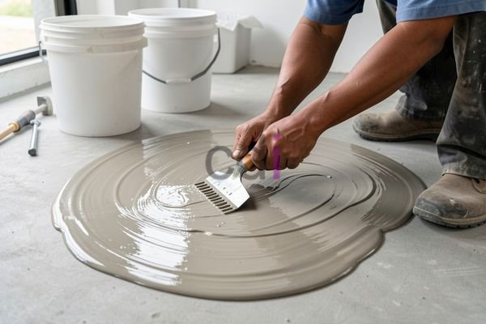

**Campuran Epoxy Nippe 2000: Sebelum Memesan, Pastikan Ini!** - Hai Mitra CDI! Mencari solusi lantai tahan banting atau perekat super kuat? Campuran epoxy Nippe 2000 bisa jadi jawabannya. Tapi tunggu dulu! Pemilihan dan aplikasi yang tepat itu kunci keberhasilannya. Artikel ini akan membahas tuntas semua yang perlu Anda ketahui sebelum memutuskan untuk menggunakan epoxy Nippe 2000. Yuk, simak bersama!

## Mengupas Tuntas Komponen dan Perbandingan Takaran Epoxy Nippe 2000

Epoxy Nippe 2000 itu sebenarnya gabungan dua bagian penting: resin dan hardener. Resin ini bertugas sebagai perekat utama, sementara hardener-lah yang memicu proses pengerasan. Nah, takaran yang pas antara keduanya itu krusial banget, lho! Secara umum, produsen merekomendasikan rasio 2:1 (dua bagian resin, satu bagian hardener) berdasarkan berat. Tapi ingat, rasio ini bisa sedikit beda tergantung jenis produk dan tujuan penggunaannya.

Jadi, selalu cek dulu *technical data sheet* (TDS) produk Nippe 2000 yang Anda pakai. Di sana ada info lengkap soal rasio ideal, waktu pengeringan, bahkan suhu terbaik untuk aplikasi. Kalau takarannya salah, bisa bikin epoxy gagal mengeras, jadi lembek, atau daya rekatnya kurang maksimal. Sebagai mitra terpercaya, Creative Design Interior memastikan setiap produk yang Kami gunakan sudah melewati uji kualitas ketat dan memenuhi standar SNI.

## Intip Kelebihan dan Kekurangan Epoxy Nippe 2000 – Mana yang Paling Cocok untuk Anda?

Mitra, sama seperti material lain, epoxy Nippe 2000 punya sisi baik dan kurangnya. Salah satu keunggulannya yang paling menonjol adalah daya rekatnya yang luar biasa, bisa menempel kuat di berbagai permukaan seperti beton, logam, kayu, bahkan plastik. Selain itu, epoxy ini juga tahan terhadap bahan kimia, gesekan, dan kelembapan, jadi pas banget buat area industri atau yang sering kena air. Kuat tariknya juga tinggi, menjadikannya pilihan tepat untuk aplikasi yang butuh kekuatan struktural.

Tapi, ada juga beberapa hal yang perlu diperhatikan. Epoxy butuh waktu untuk benar-benar kering, bisa beberapa jam sampai beberapa hari, tergantung suhu dan kelembapan. Lalu, epoxy juga agak sensitif terhadap perubahan suhu ekstrem dan paparan sinar UV jangka panjang. Kalau dibiarkan begitu saja, warnanya bisa memudar atau kualitasnya menurun. Kami di Creative Design Interior biasa merekomendasikan penggunaan *top coat* atau lapisan pelindung UV untuk mencegah hal ini.

## Dari Lantai Gudang Sampai Perbaikan Beton: Segudang Aplikasi Epoxy Nippe 2000 & Solusi CDI

Epoxy Nippe 2000 itu serbaguna banget, bisa dipakai untuk banyak hal. Contohnya, buat pelapis lantai gudang, parkiran, pabrik, pelapis tangki, perekat material, atau bahkan memperbaiki retakan pada beton. Untuk lantai, epoxy akan menciptakan permukaan yang rata, bersih, dan awet. Kalau sebagai perekat, epoxy bisa menyatukan berbagai material dengan kekuatan yang super. Estimasi biaya aplikasi epoxy, termasuk material dan tenaga kerja, berkisar antara Rp 300.000 hingga Rp 700.000 per meter persegi, tergantung kompleksitas proyek dan kondisi permukaan. Untuk informasi harga yang lebih detail dan sesuai dengan kebutuhan proyek Anda, hubungi Kami sekarang juga!

Creative Design Interior siap membantu Anda mewujudkan lantai atau aplikasi epoxy impian. Tim Kami punya pengalaman lebih dari 10 tahun dalam berbagai proyek epoxy, dari yang kecil sampai yang besar. Kami menawarkan layanan lengkap, mulai dari persiapan permukaan, pencampuran epoxy, aplikasi, hingga finishing. Pilihan warna dan desain epoxy juga banyak, jadi bisa disesuaikan dengan selera Anda. Kami jamin pengerjaan yang tepat waktu dan hasil yang memuaskan.

## Butuh Jasa Pengecoran atau Material? CDI Solusinya!

Selain layanan aplikasi, Kami juga menyediakan jasa pengecoran dan menyediakan material epoxy Nippe 2000. Jaringan supplier Kami luas, jadi Kami bisa menawarkan harga yang bersaing dengan kualitas yang terjamin. Kami juga punya stok lengkap berbagai material bangunan lainnya seperti pasir, split, batu belah, bata merah, batako, hebel, sirtu, dan masih banyak lagi. Yuk, penuhi semua kebutuhan konstruksi Anda bersama Kami. Jangan ragu untuk menggunakan tombol **Telepon** atau **WhatsApp** di bawah ya untuk konsultasi dan penawaran terbaik! Di (not detected), Kami siap melayani Anda dengan sepenuh hati. Jangan lupa, Kami juga melayani di wilayah (not detected) dan sekitarnya.