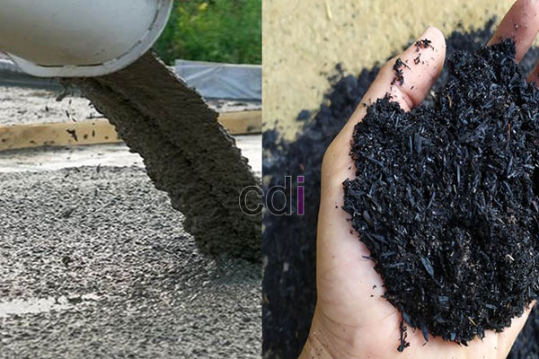

**Campuran Molen Beton Ideal: Rasio, Aplikasi, dan Biaya di Jabodetabek** - Hai Mitra CDI! Apakah Anda sedang merencanakan proyek konstruksi dan ingin memastikan campuran molen beton yang digunakan benar-benar optimal? Kami seringkali menemukan bahwa kesalahan dalam menentukan proporsi campuran dapat berdampak signifikan pada kekuatan dan efisiensi biaya proyek Anda. Yuk, kita bahas lebih detail!

### Memahami Dasar-Dasar Campuran Molen Beton

Mendapatkan campuran molen beton yang efektif itu gampang-gampang susah. Keberhasilan campuran beton sangat dipengaruhi oleh jenis pekerjaan yang akan dikerjakan, tingkat kekuatan yang diharapkan, dan kualitas material yang dipakai. Komponen utama dalam campuran beton adalah semen, pasir, kerikil, dan air. Rasio standar yang sering digunakan adalah 1:2:3. Namun, perlu diingat, rasio ini bisa disesuaikan berdasarkan kebutuhan spesifik proyek Anda. Sebagai contoh, untuk fondasi yang memerlukan kekuatan ekstra, rasio 1:2:3 mungkin perlu ditingkatkan menjadi 1:1.5:3 atau bahkan 1:1:2.

Kualitas air juga jangan dilupakan, lho! Kami sangat merekomendasikan penggunaan air bersih yang bebas dari kontaminasi minyak, garam, atau senyawa organik lainnya. Air yang tercemar dapat menurunkan kekuatan akhir beton. Selain itu, pemilihan jenis semen yang tepat juga sangat penting. Semen Portland (PC) adalah pilihan paling umum, namun ada beragam jenis PC dengan karakteristik yang berbeda-beda, jadi pilih yang sesuai dengan kebutuhan proyek Anda.

### Aplikasi Campuran Molen Beton: Sesuaikan dengan Kebutuhan Proyek!

Mitra CDI, memahami aplikasi spesifik beton akan membantu Anda menentukan campuran yang paling tepat. Untuk fondasi rumah tinggal pada umumnya, campuran dengan mutu K-250 hingga K-300 sudah cukup memadai. Tetapi, bila Anda membangun gedung komersial atau struktur yang harus menahan beban berat, mutu K-350 atau lebih tinggi mungkin jadi pilihan yang lebih bijak. 

Untuk area seperti lantai carport atau tempat parkir, campuran K-225 biasanya sudah memenuhi syarat. Sementara untuk kolom dan balok, disarankan menggunakan campuran K-300 atau K-350 untuk menjamin kekuatan yang optimal. Perlu diingat, pemilihan mutu beton harus selalu didasarkan pada perhitungan struktural yang akurat dari tenaga ahli. [Analisa Campuran Beton 1 3 5: Panduan Lengkap untuk Fondasi Kuat](/blog/analisa-campuran-beton-1-3-5/) bisa jadi sumber referensi awal untuk memahami lebih dalam tentang proporsi campuran yang tepat.

### Estimasi Biaya Campuran Molen Beton di Area Jabodetabek

Harga campuran molen beton di wilayah Jabodetabek dipengaruhi oleh berbagai faktor, seperti mutu beton yang dibutuhkan, volume pemesanan, dan lokasi proyek Anda. Sebagai gambaran, harga per meter kubik campuran beton K-250 biasanya berkisar antara Rp 700.000 hingga Rp 850.000. Untuk campuran K-300, harga bisa mencapai Rp 800.000 hingga Rp 950.000 per meter kubik. Perlu diingat bahwa harga ini hanyalah estimasi dan dapat berubah sewaktu-waktu. Untuk mendapatkan penawaran harga terbaru dan paling sesuai dengan kebutuhan proyek Anda, jangan ragu untuk menghubungi Kami.

Selain harga beton per meter kubik, Anda juga perlu memperhitungkan biaya operasional molen, termasuk biaya sewa molen (jika Anda tidak memiliki sendiri), biaya tenaga kerja, dan tentu saja biaya bahan bakar. Biaya sewa molen bervariasi tergantung ukuran dan jenis molen, tetapi umumnya berkisar antara Rp 300.000 hingga Rp 500.000 per hari. Agar lebih hemat, kami sarankan untuk menghitung volume beton yang dibutuhkan secara tepat dan memesan dalam jumlah yang sesuai.

### Maksimalkan Hasil dengan Jasa Pengecoran Profesional

Bagi Mitra CDI yang sedang mengerjakan proyek kompleks atau membutuhkan mutu beton yang tinggi, Kami merekomendasikan untuk mempertimbangkan penggunaan jasa pengecoran profesional. Tenaga ahli pengecoran memiliki pengalaman dan peralatan yang memadai untuk memastikan kualitas beton sesuai dengan standar yang diharapkan. Selain itu, mereka juga dapat membantu menghitung kebutuhan material dan mengawasi seluruh proses pengecoran. [Memahami Arti Molen: Fungsi, Jenis, dan Perawatan untuk Hasil Beton Berkualitas](/blog/arti-molen/) akan memberikan wawasan tambahan mengenai perawatan molen yang baik untuk menghasilkan campuran beton berkualitas tinggi.

Jangan ragu untuk menghubungi Tim Kami jika Anda membutuhkan bantuan! Kami siap mendukung proyek Anda – klik tombol **Telepon** atau **WhatsApp** di bawah untuk konsultasi lebih lanjut.