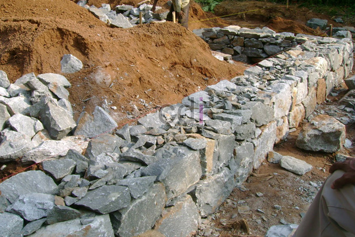

**Campuran Pondasi Rumah** - Hai Mitra CDI! Pernahkah Anda membayangkan betapa krusialnya pondasi untuk sebuah rumah? Ibarat akar pohon yang kokoh, pondasi adalah penopang utama bangunan. Pondasi yang kuat menjamin rumah mampu bertahan menghadapi berbagai kondisi, mulai dari cuaca ekstrem hingga guncangan waktu. 

Di artikel ini, Kami akan mengupas tuntas cara membuat campuran pondasi rumah yang tepat sesuai standar. Mari kita telusuri bersama langkah-langkahnya!

Seringkali, kesalahan yang Kami temui di lapangan bukan terletak pada perbandingan material, melainkan pada urutan dan teknik pencampuran. Bahan berkualitas pun akan sia-sia jika prosesnya keliru. Artikel ini akan memandu Anda membuat **Campuran Pondasi Rumah** secara komprehensif — mulai dari persiapan bahan hingga langkah kerja yang benar.

Banyak pemilik rumah yang terpaku mencari “resep ajaib” di internet, padahal kekuatan pondasi sebagian besar ditentukan oleh disiplin mengikuti proses yang tepat, bukan sekadar angka.

## Mengapa Campuran Pondasi Rumah Begitu Penting?

Pondasi berperan krusial dalam menopang seluruh beban bangunan di atasnya. Ini mencakup beban mati (dinding, atap) dan beban hidup (penghuni, perabotan). Campuran yang tidak ideal membahayakan integritas struktural, meskipun secara visual bangunan tampak baik-baik saja untuk sementara.

## Persiapan Bahan – Pondasi Kuat Dimulai Dari Sini

Sebelum mulai mencampur, pastikan ketersediaan dan kualitas bahan-bahan berikut:

1. **Semen** — Pastikan masih dalam masa kadaluarsa dan bebas dari penggumpalan akibat kelembapan.
2. **Pasir beton** — Pilih yang bersih dari lumpur dan kotoran lainnya. Uji genggam sederhana bisa membantu memastikannya.
3. **Kerikil atau split** — Gunakan ukuran yang seragam untuk menjamin distribusi kekuatan yang merata.
4. **Air bersih** — Hindari air yang terkontaminasi minyak atau bahan kimia yang dapat mengganggu proses pengikatan.

### Rasio Ideal: Panduan Awal yang Berguna

Sebagai titik awal, rasio 1 bagian semen : 2 bagian pasir : 3 bagian kerikil, dengan penambahan air secukupnya (sekitar 0,4-0,6 dari total berat campuran) cocok untuk pondasi rumah tinggal satu lantai. Namun, rasio ini dapat disesuaikan dengan jenis pondasi, seperti yang akan Kami bahas nanti.

## Proses Pencampuran: Langkah Demi Langkah

### Langkah 1: Aduk Bahan Kering Terlebih Dahulu

Campurkan semen, pasir, dan kerikil dalam keadaan kering sampai warna dan teksturnya homogen. Hal ini mencegah penggumpalan semen, yang dapat mengakibatkan bagian pondasi menjadi lebih lemah.

### Langkah 2: Tambahkan Air Secara Bertahap

Hindari menuangkan air sekaligus. Tambahkan sedikit demi sedikit sambil terus diaduk hingga konsistensi yang diinginkan tercapai. Campuran yang terlalu encer sulit dikoreksi, sementara yang terlalu kental sulit dikerjakan.

### Langkah 3: Pilih Alat yang Sesuai dengan Skala Proyek

Untuk volume kecil, sekop dan ember manual sudah memadai. Namun, untuk pondasi rumah dengan skala lebih besar, penggunaan molen atau *concrete mixer* akan menghasilkan campuran yang lebih merata dan menghemat tenaga.

### Langkah 4: Manfaatkan Campuran Segera Setelah Jadi

Campuran yang sudah jadi sebaiknya digunakan dalam waktu maksimal 2 jam. Setelah itu, semen mulai mengeras dan kualitas ikatannya berkurang, meskipun secara visual masih tampak dapat digunakan.

## Hindari Kesalahan Umum Ini!

Kesalahan yang sering terjadi antara lain penggunaan material berkualitas rendah demi penghematan biaya, takaran yang hanya diperkirakan tanpa alat ukur yang akurat, serta pencampuran dalam volume besar sekaligus sehingga sebagian mengeras sebelum digunakan. Pertimbangkan juga cuaca; pencampuran dalam jumlah besar saat cuaca panas dapat mempercepat pengerasan.

## Kapan Waktunya Menyerahkan pada Ahlinya?

Untuk pondasi rumah bertingkat atau lahan dengan kondisi tanah yang kurang stabil, mencampur sendiri berisiko menyebabkan kesalahan signifikan. Dalam kasus seperti ini, melibatkan tenaga profesional mungkin lebih hemat dalam jangka panjang, daripada harus memperbaiki kerusakan di kemudian hari.

## Sesuaikan Campuran dengan Jenis Pondasi yang Digunakan

Berbagai jenis pondasi, seperti pondasi batu kali, pondasi cakar ayam, dan pondasi tapak, membutuhkan komposisi campuran yang sedikit berbeda. Pondasi batu kali umumnya menggunakan rasio spesi 1:4 hingga 1:5 sebagai perekat antar batu. Sementara itu, pondasi cakar ayam atau tapak yang berbasis beton bertulang membutuhkan rasio yang lebih padat (1:2:3) karena fungsi menahan beban struktural secara langsung.

## Ciri-Ciri Campuran yang Siap Digunakan

Sebelum digunakan, pastikan campuran tidak terlalu encer (mengalir dengan sendirinya) atau terlalu kental (sulit diratakan). Konsistensi ideal memungkinkan campuran untuk berdiri sendiri ketika ditumpuk, namun tetap mudah diratakan dengan tekanan ringan.

## Penutup

Campuran pondasi rumah yang prima membutuhkan perpaduan antara bahan berkualitas dan proses pencampuran yang tepat – keduanya sama pentingnya.

Jika Mitra CDI membutuhkan bantuan untuk menyiapkan pondasi rumah yang kokoh di wilayah (not detected), tim Kami siap melayani. Jangan ragu untuk menghubungi Kami melalui tombol **Telepon** atau **WhatsApp** yang tersedia di bawah halaman ini. [Batu Cor Pondasi: Pilihan Terbaik untuk Konstruksi Rumah Kokoh](/blog/batu-cor-pondasi/) akan semakin membantu Anda memahami kebutuhan fondasi. Kami siap membantu mewujudkan impian rumah kokoh yang tahan lama!