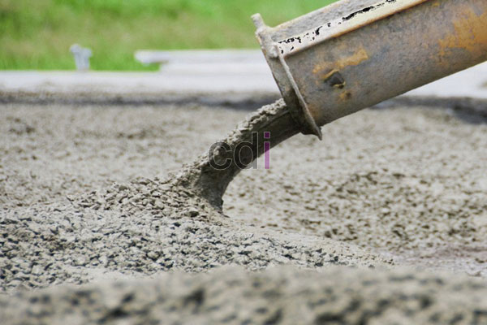

**Campuran Semen Beton: Panduan Lengkap untuk Kekuatan dan Daya Tahan Optimal** - Hai Mitra CDI! Pernahkah Anda membayangkan fondasi bangunan yang kokoh, awet, dan tahan terhadap segala kondisi? Kualitas beton itu kunci! Nah, di artikel ini, kami akan membahas tuntas bagaimana memilih dan meracik campuran semen beton yang tepat untuk memastikan bangunan Anda berdiri kokoh selama bertahun-tahun. Yuk, simak selengkapnya!

### Memahami Dasar-Dasar Campuran Semen Beton

Membuat beton berkualitas bukan sekadar mencampur semen dan air. Ada beberapa komponen penting yang saling bekerja sama menentukan kekuatan dan ketahanannya. Campuran beton umumnya terdiri dari semen, agregat halus (pasir), agregat kasar (kerikil), air, dan terkadang bahan tambahan (*admixture*) untuk meningkatkan kinerja beton. Proporsi standar yang banyak dipakai adalah 1:2:3 (semen:pasir:kerikil) untuk struktur bangunan. Akan tetapi, rasio ini bisa disesuaikan sesuai kebutuhan kekuatan beton dan jenis proyek. Misalnya, untuk membangun fondasi rumah di (not detected), beton K125 mungkin sudah cukup. Namun, konstruksi vital seperti jembatan tentu membutuhkan campuran dengan mutu lebih tinggi.

Kualitas masing-masing bahan sangat krusial. Pastikan semen yang dipilih bersertifikasi SNI, pasir bersih dari lumpur dan sampah organik, serta kerikil seragam ukurannya. Jangan lupakan kualitas air! Air yang terkontaminasi zat kimia bisa mengganggu proses pengerasan semen dan melemahkan struktur beton.

### Mengenal Jenis-Jenis Semen untuk Campuran Beton

Memilih jenis semen yang tepat akan memengaruhi karakteristik akhir beton Anda. Berikut beberapa jenis yang umum digunakan:

*   **Semen Portland (OPC):** Pilihan paling populer untuk konstruksi umum. Kuat dan harganya terjangkau.
*   **Semen Portland Komposit (PCC):** Kombinasi semen Portland dengan *pozzolan* atau *slag*. Hasilnya? Beton lebih awet saat terpapar sulfat dan lebih mudah dikerjakan.
*   **Semen Portland Putih (WPC):** Cocok untuk aplikasi dekoratif karena warnanya yang cerah.
*   **Semen Portland Pozzolan (PPC):** Mengandung material pozzolan alami atau buatan, menghasilkan beton yang lebih ramah lingkungan dan tahan terhadap air laut.

Proyek di lingkungan yang ekstrem, seperti area dengan kadar klorida tinggi di dekat pantai (not detected), sebaiknya menggunakan PCC atau PPC. Walaupun harganya sedikit lebih mahal dibanding OPC, investasi ini akan memberikan perlindungan jangka panjang bagi bangunan Anda.

### Tips Praktis Mencampur Semen Beton: Manual vs. Mesin

Campuran beton bisa dilakukan manual atau menggunakan mesin *concrete mixer*. Mencampur manual cocok untuk proyek kecil, meski membutuhkan tenaga dan waktu lebih banyak. Kalau menggunakan mesin, pastikan kondisinya prima dan ikuti petunjuk penggunaan yang disediakan.

Berikut beberapa tips yang bisa Anda terapkan:

1.  **Urutan Bahan:** Mulai dengan memasukkan agregat kasar, lalu agregat halus, semen, dan terkahir air.
2.  **Takaran Air:** Tambahkan air sedikit demi sedikit sampai konsistensi yang diinginkan tercapai. Kelebihan air akan menurunkan kekuatan beton, sedangkan kekurangan air akan membuat campuran sulit dikerjakan.
3.  **Lama Pencampuran:** Lakukan pencampuran sampai semua bahan tercampur rata dan warnanya homogen. Untuk mesin, idealnya sekitar 3-5 menit, sedangkan manual membutuhkan 10-15 menit.
4.  **Uji Konsistensi:** Gunakan *slump test* untuk menguji konsistensi campuran. Alat ini membantu mengukur seberapa mudah campuran mengalir dan apakah takaran air sudah tepat.

### Perkiraan Biaya dan Faktor Penentu Harga Campuran Semen Beton

Harga campuran semen beton bervariasi tergantung lokasi, jenis semen, dan jumlah pesanan. Untuk gambaran, harga per zak semen (50 kg) saat ini berkisar antara Rp 50.000 hingga Rp 70.000. Harga pasir dan kerikil juga fluktuatif, umumnya antara Rp 150.000 hingga Rp 300.000 per meter kubik.

Informasi harga di atas bersifat estimasi dan bisa berubah sewaktu-waktu. Untuk mendapatkan penawaran terbaru dan paling akurat yang sesuai dengan proyek Anda di (not detected), silakan hubungi Kami.

Selain harga material, biaya transportasi dan tenaga kerja juga perlu diperhitungkan. Jika Anda memilih jasa pengecoran, biaya tersebut juga perlu dimasukkan dalam anggaran. Memilih penyedia material dan jasa yang terpercaya akan menjamin kualitas beton dan menghindari masalah di kemudian hari.

Butuh bantuan lebih lanjut? Jangan sungkan untuk menghubungi Kami melalui tombol **WhatsApp** atau **Telepon** di halaman ini. Tim Kami siap membantu mewujudkan proyek impian Anda! Kami siap membantu Anda menghitung kebutuhan material dan biaya proyek di (not detected). Mari mulai membangun masa depan yang kokoh! [Campuran Beton K150: Panduan Lengkap Kekuatan, Penggunaan, dan Biaya](/blog/campuran-beton-k150/) juga bisa jadi referensi tambahan untuk proyek Anda.