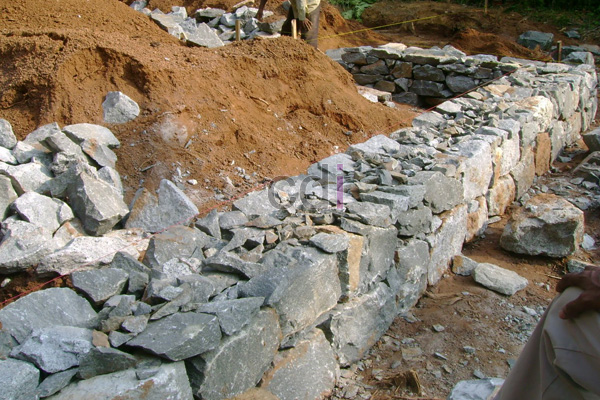

**Campuran Semen Untuk Pondasi** – Hai Mitra CDI! Pondasi itu ibarat jantungnya bangunan. Kuat jantungnya, sehat pula seluruh tubuh. Begitu juga pondasi, kokoh pondasinya, aman dan nyaman pula hunian Anda. Tapi, pondasi yang "jantungnya lemah" bisa berakibat fatal.

Lantas, bagaimana memastikan pondasi kita punya "jantung" yang kuat? Salah satu kuncinya ada di campuran semen yang tepat. Di artikel ini, kami akan bedah tuntas tips dan trik campuran semen pondasi yang handal, tahan lama, dan sesuai dengan kebutuhan Anda. Simak yuk!

Lama kelamaan, rasio 1:2:3 memang jadi patokan utama. Tapi, sadar atau tidak, tiap lokasi punya tantangannya sendiri. Kondisi tanah di (not detected) misalnya, bisa beda jauh dengan di kota lain. Beban bangunan juga berbeda-beda. Artinya, rasio yang "sakral" itu perlu disesuaikan!

## Mengapa Campuran Semen yang Tepat Itu Krusial?

Simple saja, Mitra. Campuran semen yang pas memastikan pondasi punya kekuatan maksimal, tahan terhadap cuaca ekstrem, dan mampu menanggung beban bangunan tanpa masalah. 

Bayangkan kalau campurannya terlalu encer? Pondasi jadi keropos dan gampang retak. Kalau terlalu kering? Rapuh dan mudah pecah. Jadi, bisa dibayangkan kan, betapa pentingnya menemukan "titik keseimbangan" yang tepat? 

Selain itu, kesalahan di sini bisa bikin Anda keluar biaya lebih besar untuk perbaikan di kemudian hari. Mending preventif dari awal, bukan?

## Rasio Dasar: Kapan dan Bagaimana Menggunakannya?

Untuk rumah tinggal 1 lantai di (not detected), rasio **1 semen : 2 pasir : 3 kerikil** biasanya sudah memadai. Tambahkan air secukupnya—sekitar 0,5 bagian dari berat semen—hingga teksturnya pas: tidak terlalu cair, tidak juga terlalu padat.

Nah, kalau bangunannya lebih dari 1 lantai, atau area (not detected) memiliki kondisi tanah yang kurang stabil, rasio yang lebih padat seperti **1:1,5:2,5** lebih disarankan. Rasio ini memberikan kekuatan tekan yang lebih tinggi, tapi ingat, kebutuhan semennya juga akan bertambah. Jadi, hitung matang-matang ya!

## Mengapa "Ngecek" Rasio Itu Penting?

Jangan pernah main tebak-tebakan, Mitra! Kekurangan semen bikin pondasi gampang retak. Kelebihan semen malah bisa menyebabkan penyusutan, yang juga berujung pada retakan. Banyak yang salah paham, mengira makin banyak semen, makin kuat pondasinya. Padahal, kelebihan semen justru sama berbahayanya.

## Jenis Semen: Pilihan yang Tepat untuk Pondasi Anda

Pemilihan semen juga berpengaruh besar:

- **Semen Portland** — standar emas untuk kekuatan dan daya rekat. Cocok untuk hampir semua jenis pondasi.
- **Semen Pozzolan** — juara ketahanan terhadap serangan sulfat. Ideal untuk area di (not detected) yang dekat sungai atau rawan kelembapan.
- **Semen Campuran (PCC)** — lebih ramah lingkungan dan ekonomis. Cocok untuk proyek yang memprioritaskan keberlanjutan.

Oh ya, untuk daerah yang sering tergenang banjir di (not detected), semen pozzolan bisa jadi pilihan tepat karena lebih tahan terhadap air.

## Tes Sederhana: Apakah Campuran Sudah Ideal?

Setelah mengaduk, ambil sedikit campuran dan kepal di tangan. Kalau campuran bisa membentuk gumpalan yang tidak mudah pecah dan tidak mengeluarkan air berlebih, berarti konsistensinya sudah pas. Kalau gumpalan hancur saat ditekan lembut, tambahkan sedikit air.

## Dampak Kondisi Tanah Terhadap Campuran Semen

Mitra, rasio campuran terbaik pun bisa jadi sia-sia kalau kondisi tanah di (not detected) bermasalah. Tanah lembek atau berpotensi ambles memerlukan perhatian ekstra. Konsultasikan dengan ahli teknik sebelum menentukan rasio final. Jangan ragu untuk mempertimbangkan pondasi cakar ayam atau tiang pancang jika diperlukan.

## Perkiraan Kebutuhan Semen untuk Pondasi Rumah Biasa

Sebagai gambaran, pondasi batu kali dengan dimensi 30 meter (panjang), 60 cm (lebar), dan 80 cm (kedalaman) kira-kira membutuhkan 1,4 m³ campuran beton per meter panjangnya. Ini setara dengan sekitar 6-8 sak semen, tergantung rasio yang digunakan. Angka ini hanyalah estimasi, ya. Tetap konsultasikan dengan tim teknis untuk perhitungan yang lebih akurat.

## Hindari Kesalahan Umum di Lapangan

Ada beberapa kesalahan yang sering Kami temui: memakai rasio yang sama untuk semua jenis pondasi, mengabaikan kualitas air, dan tidak melakukan uji coba sebelum mencampur skala besar. Hal-hal sepele ini bisa berdampak besar pada kekuatan pondasi Anda.

## Kesimpulan: Investasi di Awal, Tenang di Kemudian Hari

Memilih campuran semen untuk pondasi bukanlah sekadar ikut-ikutan atau mengandalkan rumus baku. Penting untuk memahami kebutuhan spesifik bangunan Anda, kondisi tanah di (not detected), dan menyesuaikan rasio campuran sesuai kebutuhan. Ingat, investasi di awal akan menyelamatkan Anda dari masalah yang lebih besar di masa depan.

Butuh bantuan? Yuk, konsultasikan proyek Anda dengan tim ahli Kami! Hubungi melalui tombol **Telepon** atau **WhatsApp** yang tersedia di bawah ini untuk mendapatkan solusi terbaik. Jangan ragu, Kami siap membantu! [Jual Material Batu Pondasi di Ancol Jakarta Gratis Ongkir](/batu/jual-material-batu-pondasi-di-ancol-jakarta-gratis-ongkir/) — untuk opsi fondasi berkualitas di sekitar (not detected).