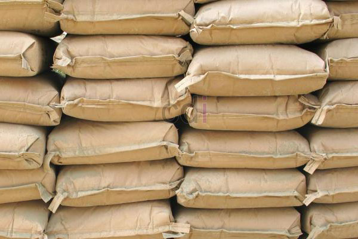

**Cara Tepat Menghitung Kebutuhan Semen** - Hai Mitra CDI! Apakah Anda sedang merencanakan proyek pembangunan di (not detected)? Semen adalah material krusial yang tak boleh terlewat. Kami memahami betul pentingnya perhitungan yang tepat agar proyek berjalan efisien dan hemat biaya. Karena itu, yuk simak panduan lengkap dari kami tentang cara menghitung kebutuhan semen yang akurat. Artikel ini kami susun sebagai wujud komitmen untuk memberikan solusi terbaik bagi kebutuhan konstruksi Anda. Semoga membantu memperlancar perencanaan RAB bangunan Anda, ya!

*Menghitung Kebutuhan Semen: Panduan Praktis dari CDI*

Banyak panduan serupa yang beredar, namun kami ingin menyajikan cara menghitung kebutuhan semen versi CDI yang mudah dipahami dan diterapkan. Kenapa? Karena kami ingin Anda tidak perlu repot mencari-cari informasi di berbagai sumber. Semua yang Anda butuhkan tentang dunia konstruksi, ada di sini!

## Mengenal Kualitas dan Jenis Semen

Sebelum masuk ke perhitungan, penting untuk memahami berbagai jenis semen, merk, dan ukurannya. Pengetahuan ini akan membantu memastikan perhitungan Anda lebih akurat dan terhindar dari kesalahan. Yuk, kita bahas satu per satu:

- **1. Merk Semen.** Meskipun bahan dasar pembuatan semen sama (pasir besi), merk memegang peran penting dalam menentukan kualitas dan reputasi produk. Tips dari kami: pilih merk yang sudah dikenal luas dan terpercaya, minimal 5 tahun digunakan masyarakat. Atau, coba pertimbangkan semen impor yang sedang menjajaki pasar Indonesia – biasanya menawarkan kualitas bagus dengan harga kompetitif.
- **2. Jenis Semen.** Mengenal jenis semen juga penting untuk perhitungan yang presisi. Beberapa jenis semen yang umum digunakan antara lain: Semen Portland Tipe 1 s/d 7, Super Masonry Cement, Oil Well Cement, Portland Composite Cement (PCC), dan Portland Pozzolan Cement (PPC). Untuk bangunan rumah atau ruko, Semen Portland Tipe 1 umumnya sudah cukup memadai.
- **3. Ukuran per Sak.** Jangan lupa perhatikan ukuran sak semen! Apakah 40kg atau 50kg? Perbedaan ukuran ini akan memengaruhi total kebutuhan semen Anda. Pastikan Anda mencatat ukuran yang digunakan agar perhitungan tidak meleset.

## Rumus Menghitung Kebutuhan Semen

Setelah Anda memahami spesifikasi semen, saatnya menghitung kebutuhan semen sesuai dengan jenis bangunan yang Anda inginkan. Kami merekomendasikan untuk menghitung berdasarkan pengukuran detail setiap bagian yang akan menggunakan semen (dinding, lantai, dll.), bukan hanya mengandalkan luas bangunan secara umum. Mengapa? Karena semen sebagian besar digunakan sebagai campuran dengan pasir, jadi kita perlu tahu dulu berapa kebutuhan pasirnya. Anda bisa merujuk ke artikel kami sebelumnya tentang [**CARA MENGHITUNG KEBUTUHAN PASIR**](/blog/cara-hitung-kebutuhan-pasir) untuk informasi lebih lanjut. Kemudian, gunakan rumus berikut:

> - **Kebutuhan Semen untuk Cor.**

> _Rumus_: **Luas (dinding /lantai) yang akan di cor** X **11,5 kg**

> - **Kebutuhan Semen untuk Pasang Bata /Plester.**

> _Rumus_: **Total Kebutuhan Pasir (untuk pasang bata /batu /plester)** X **8,32 kg**

Itulah tips akurat dari kami tentang cara menghitung kebutuhan semen untuk proyek Anda di (not detected). Jika Anda memiliki pertanyaan lebih lanjut atau membutuhkan bantuan, jangan ragu untuk menghubungi tim kami melalui jalur yang tertera di website ini. Kami selalu siap berdiskusi dan memberikan solusi terbaik untuk proyek konstruksi Anda. Kami juga sangat menghargai kritik dan saran dari Anda, Mitra CDI! Jangan sungkan untuk berbagi pengalaman Anda dengan kami.