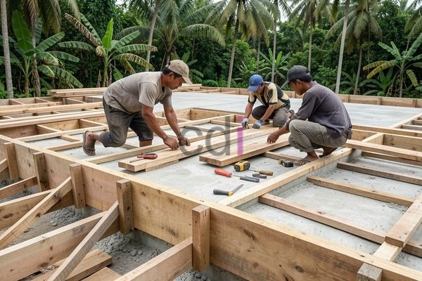

**Cara Bikin Bekisting Dak: Panduan Lengkap untuk Hasil Kuat dan Presisi** - Hai Mitra CDI! Pernahkah Anda menjumpai dak beton yang tampak kurang sempurna, misalnya ada bagian yang melengkung atau bahkan retak setelah pengecoran? Nah, seringkali akar masalahnya terletak pada kualitas bekisting yang digunakan. Bekisting ini berperan krusial sebagai cetakan sementara yang membentuk dak beton sesuai rancangan. Untuk itu, memahami betul cara bikin bekisting dak yang tepat sangat penting agar hasil pengecoran Mitra kuat, akurat, dan awet digunakan.

## Memilih Material Bekisting yang Tepat

Pilihan material bekisting akan sangat memengaruhi hasil akhir, kemudahan pengerjaan, serta anggaran proyek Mitra. Ada beberapa opsi yang umum digunakan, di antaranya kayu, baja, dan aluminium. Kayu bisa jadi pilihan ekonomis, tapi perlu penanganan khusus agar tidak mudah melengkung atau lapuk. Baja menawarkan kekuatan dan presisi tinggi, akan tetapi modal yang dibutuhkan lebih besar. Sementara aluminium dikenal ringan dan tahan karat, ideal untuk proyek dengan bentuk dak yang kompleks. 

Untuk pembuatan bekisting dak yang sederhana, kayu kelas II atau III dengan ketebalan minimal 2 cm umumnya sudah mencukupi. Pastikan kayu yang dipilih benar-benar kering dan bebas dari cacat seperti retakan atau mata kayu yang terlalu besar. Selain kayu, Mitra juga memerlukan paku, baut, skrup, dan penyangga (shoring) untuk memperkuat struktur bekisting. Penggunaan multipleks tebal (minimal 9mm) sebagai lapisan permukaan bekisting akan memberikan hasil beton yang lebih halus dan rapi, lho.

## Panduan Langkah Demi Langkah Membuat Bekisting Dak yang Presisi

Proses cara bikin bekisting dak ini memerlukan beberapa tahapan yang cukup krusial. Pertama, lakukan pengukuran dan pemotongan material sesuai dengan gambar desain dak. Pastikan dimensi bekisting sesuai dengan ukuran yang direncanakan, termasuk ketebalan dak dan posisi tulangan. Setelah itu, rangkai rangka bekisting dengan menyambungkan elemen kayu atau baja menggunakan paku, baut, atau pengelasan. 

Kemudian, pasang penyangga (shoring) secara berkala di bawah bekisting guna menopang beban beton saat pengecoran. Jarak antar penyangga perlu disesuaikan dengan ketebalan dak dan beban yang akan ditanggung. Idealnya, jarak antar penyangga berkisar antara 30-50 cm. Pastikan struktur bekisting terpasang dengan kokoh dan stabil sebelum pengecoran dimulai. Untuk mencegah beton meresap ke dalam kayu, lapisi bagian dalam bekisting dengan plastik atau minyak khusus bekisting.

## Perkiraan Biaya dan Hal-hal yang Perlu Diperhatikan

Estimasi biaya pembuatan bekisting dak sangat bervariasi, tergantung pada material yang dipilih, kerumitan desain, serta luas area dak. Secara umum, biaya bekisting kayu berkisar antara Rp 80.000 - Rp 150.000 per meter persegi. Sedangkan untuk bekisting baja, biaya yang dibutuhkan bisa mencapai Rp 150.000 - Rp 300.000 per meter persegi. Perlu diingat bahwa informasi harga ini bersifat estimasi dan bisa berubah sewaktu-waktu. Untuk mendapatkan penawaran harga yang lebih akurat sesuai dengan kebutuhan proyek Mitra CDI, silakan hubungi Kami.

Penting diingat, bekisting harus dirancang dan dipasang dengan memperhitungkan beban beton yang akan ditanggung. Mutu beton yang umum digunakan untuk dak adalah K-250 atau K-300. Selalu perhatikan pula standar SNI yang berlaku bagi bekisting beton, seperti SNI 03-6989-2008 yang mengatur Spesifikasi Beton Struktural untuk Bangunan Gedung. Kami sangat menyarankan untuk melibatkan tenaga ahli konstruksi dalam proses perencanaan dan pemasangan bekisting, terutama untuk proyek dengan desain yang rumit. [Apa Itu Bekisting Beton? Panduan Lengkap untuk Fondasi Kokoh](/blog/apa-itu-bekisting-beton/) — dengan memahami dasar-dasar bekisting, Mitra bisa lebih optimal dalam perencanaan. 

## Merawat Bekisting Setelah Pengecoran Selesai

Setelah pengecoran beton rampung, bekisting belum bisa langsung dibongkar begitu saja. Mitra perlu memberikan waktu yang cukup agar beton mengeras dan mencapai kekuatan optimalnya. Waktu pelepasan bekisting bervariasi, tergantung pada jenis semen yang digunakan dan kondisi cuaca. Umumnya, bekisting dapat dilepas setelah 7-14 hari pasca pengecoran. Pastikan beton sudah benar-benar kuat sebelum membongkar bekisting, agar tidak terjadi kerusakan pada struktur dak. Setelah dibongkar, bekisting kayu masih bisa dibersihkan dan digunakan kembali untuk proyek lain. Sedangkan bekisting baja atau aluminium biasanya disewakan atau dijual kembali.

Ada pertanyaan lanjutan seputar bekisting dak? Jangan ragu! Tombol **Telepon** dan **WhatsApp** di bawah halaman ini siap membantu Mitra CDI.