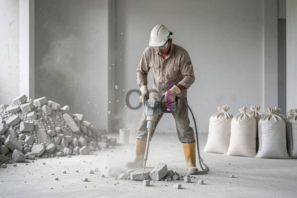

**Cara Bobok Beton: Panduan Lengkap, Peralatan, Biaya, dan Tips Profesional** - Hai Mitra CDI! Apakah proyek konstruksi Anda di (not detected) memerlukan perubahan atau pembongkaran sebagian struktur beton? Proses yang sering disebut “bobok beton” ini memang membutuhkan perencanaan cermat supaya berjalan lancar dan aman. Artikel ini akan membongkar tuntas seluk-beluk bobok beton: mulai dari persiapan awal, peralatan yang dibutuhkan, perkiraan biaya di Jabodetabek, sampai tips profesional dari Kami. Yuk, simak panduan lengkapnya!

## Mempersiapkan Diri: Memahami Proses Bobok Beton dan Pertimbangan Awal

Bobok beton bukan sekadar menghancurkan. Ini adalah proses pembongkaran terkontrol yang memerlukan pemahaman mendalam tentang struktur bangunan. Langkah pertama, identifikasi jenis beton yang akan Anda tangani. Apakah itu beton bertulang yang kuat, beton ringan yang lebih mudah dipecah, atau beton biasa? Nah, jenis ini akan memengaruhi pilihan alat dan teknik yang tepat.

Selanjutnya, perhatikan lokasi bobok beton. Apakah berada di dalam ruangan atau di area terbuka? Bagaimana aksesibilitasnya? Pertimbangkan juga potensi adanya instalasi tersembunyi seperti pipa, kabel listrik, atau saluran pendingin. Matikan sumber listrik atau air jika perlu, dan berhati-hati saat bekerja. Konsultasi dengan ahli struktur bangunan sangat Kami rekomendasikan, terutama jika bobok beton menyangkut elemen struktural penting.

## Peralatan Penting untuk Pekerjaan Bobok Beton

Memilih peralatan yang tepat adalah kunci efisiensi dan keselamatan. Berikut adalah daftar beberapa alat utama yang biasa digunakan dalam proses bobok beton:

*   **Mesin Jackhammer (Jack Pneumatic):** Pilihan utama untuk membobok beton dengan daya besar. Tersedia beragam ukuran dan tipe, disesuaikan dengan kebutuhan proyek Anda.
*   **Concrete Saw (Mesin Potong Beton):** Alat ini ideal untuk membuat potongan presisi, misalnya saat membuat bukaan untuk pintu atau jendela.
*   **Breaker Beton (Concrete Breaker):** Mengandalkan tenaga hidrolik untuk memecah beton. Keunggulannya? Lebih senyap dibandingkan jackhammer, meski sedikit lebih rendah daya pecahnya.
*   **Gerinda Tangan (Angle Grinder):** Berguna untuk detail finishing: menghaluskan permukaan beton atau memotong besi tulangan.
*   **Peralatan Keselamatan:** Jangan lupakan helm, kacamata pelindung, masker debu, sarung tangan, sepatu safety, dan pelindung telinga. Keselamatan Anda adalah prioritas utama Kami!

## Biaya Bobok Beton: Perkiraan di Wilayah Jabodetabek

Biaya bobok beton itu dinamis, lho. Banyak faktor yang memengaruhi, misalnya:

*   **Kekuatan dan Ketebalan Beton:** Beton yang lebih kuat dan tebal tentu membutuhkan waktu lebih lama untuk dibobok dan menyebabkan biaya lebih tinggi.
*   **Luas Area yang Dibobok:** Semakin besar area yang dikerjakan, semakin besar pula biayanya.
*   **Jenis Pekerjaan:** Apakah cukup pembobokan saja, atau ada tambahan pembersihan puing dan pembuangan material?
*   **Akses Lokasi:** Lokasi yang sulit dijangkau bisa meningkatkan biaya transportasi dan tenaga kerja.

Berikut estimasi biaya bobok beton di area Jabodetabek (pembaruan data tahun 2026):

<table class="table">
  <caption>Estimasi Biaya Bobok Beton Jabodetabek (2026)</caption>
  <thead>
    <tr><th>Jenis Pekerjaan</th><th>Satuan</th><th>Estimasi Biaya (Rp)</th></tr>
  </thead>
  <tbody>
    <tr><td>Bobok Beton Biasa</td><td>m²</td><td>150.000 - 350.000</td></tr>
    <tr><td>Bobok Beton Bertulang</td><td>m²</td><td>300.000 - 600.000</td></tr>
    <tr><td>Sewa Jackhammer</td><td>hari</td><td>500.000 - 1.500.000</td></tr>
    <tr><td>Jasa Angkut Puing</td><td>rit</td><td>300.000 - 700.000</td></tr>
  </tbody>
</table>

Perlu diingat, angka di atas hanyalah perkiraan. Untuk mendapatkan penawaran harga yang paling akurat dan sesuai dengan kebutuhan proyek Anda di (not detected), segera hubungi Kami. Jangan ragu untuk meminta penawaran dari beberapa penyedia jasa jika Anda berencana melakukan pembobokan beton dalam skala besar.

## Tips Profesional: Bobok Beton yang Aman dan Efisien

Berikut beberapa tips dari Kami agar proses bobok beton Anda berjalan lancar:

*   **Pilih Peralatan yang Sesuai:** Pastikan alat yang Anda gunakan cocok dengan jenis beton dan pekerjaan yang akan dikerjakan.
*   **Utamakan Keselamatan:** Selalu gunakan APD lengkap dan pastikan area kerja steril dari orang yang tidak berkepentingan.
*   **Bekerja Bertahap:** Hindari terburu-buru. Bekerjalah perlahan dan hati-hati untuk mencegah kerusakan yang tidak perlu.
*   **Kontrol Debu:** Basahi beton dengan air sebelum dibobok untuk meminimalkan debu dan menjaga kualitas udara.
*   **Buang Puing dengan Benar:** Buang puing beton pada tempatnya dan ikuti peraturan setempat.
*   **Serahkan pada Ahlinya:** Untuk proyek kompleks atau berbahaya, lebih baik percayakan pada tenaga profesional yang berpengalaman.

Ada pertanyaan atau butuh bantuan? Jangan sungkan untuk menghubungi Kami! Klik tombol **WhatsApp** atau **Telepon** di bawah ini untuk berkonsultasi dengan tim profesional Kami. Kami siap membantu Anda mencapai hasil terbaik.  