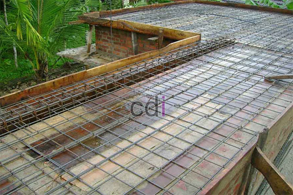

**Cara Buat Dak Teras Tanpa Tiang: Solusi Ringan & Kuat untuk Bangunan Anda** - Hai Mitra CDI! Sedang memikirkan bagaimana menciptakan teras yang luas dan nyaman tanpa terhalang tiang? Atau mungkin sedang merenovasi teras dan ingin tampilan yang lebih modern? Kami punya solusinya! Artikel ini akan membahas tuntas cara membuat dak teras tanpa tiang, mulai dari pilihan material, perkiraan biaya, hingga tips pemasangan yang perlu diperhatikan. Yuk, simak selengkapnya!

## Mengapa Dak Teras Tanpa Tiang? Keunggulan yang Perlu Anda Tahu

Memilih dak teras tanpa tiang berarti memilih kesan lapang dan fleksibel. Bayangkan, Anda bisa menata ruang teras sesuai keinginan tanpa terganggu oleh tiang penyangga. Selain itu, desain ini akan memberikan sentuhan modern pada bangunan Anda di (not detected).  Ini bukan hanya soal estetika, lho.

Namun, perlu diingat, membangun dak tanpa tiang membutuhkan perhitungan yang cermat. Kekuatan struktur adalah kunci utama. Anda harus memastikan bahwa dak mampu menahan beban, baik itu beban tetap maupun beban bergerak. Pemilihan material yang tepat sangatlah penting untuk menjamin keamanan dan ketahanan jangka panjang.

## Pilihan Material untuk Dak Teras Tanpa Tiang: Mana yang Terbaik?

Ada beberapa opsi material yang bisa Anda pertimbangkan untuk dak teras tanpa tiang. Masing-masing punya kelebihan dan kekurangannya sendiri, serta harga yang bervariasi. Kami akan membahas beberapa material yang paling umum digunakan:

*   **Beton Ringan (CLC/Foam Concrete):** Pilihan tepat jika Anda mencari material yang ringan dan mudah diaplikasikan. Beton ringan mengurangi beban pada struktur bangunan dan juga memiliki kemampuan isolasi termal dan akustik yang baik.
*   **Baja Ringan:** Kuat, ringan, dan tahan korosi – itulah keunggulan baja ringan. Biasanya dipadukan dengan penutup dak seperti genteng atau spandek untuk memberikan perlindungan tambahan.
*   **Plat Beton Pracetak:** Solusi praktis dan cepat! Plat beton pracetak sudah diproduksi di pabrik dengan standar kualitas yang terjamin. Pemasangannya pun relatif mudah.
*   **Kayu Komposit:** Meskipun tidak sepopuler material lain, kayu komposit bisa menjadi pilihan menarik jika Anda menginginkan tampilan yang unik dan tahan lama. Material ini juga tidak memerlukan perawatan yang rumit.

## Estimasi Biaya: Berapa Dana yang Perlu Anda Siapkan?

Tentu saja, biaya pembuatan dak teras tanpa tiang akan bervariasi tergantung pada beberapa faktor, seperti luas teras, material yang dipilih, dan tingkat kesulitan desain. Berikut adalah perkiraan biaya per meter persegi (harga ini bisa berubah sewaktu-waktu, ya — untuk penawaran akurat sesuai proyek Anda di (not detected), silakan hubungi Kami!):

| Material             | Estimasi Biaya per m² |
| -------------------- | --------------------- |
| Beton Ringan         | Rp 350.000 - Rp 500.000 |
| Baja Ringan          | Rp 400.000 - Rp 600.000 |
| Plat Beton Pracetak | Rp 500.000 - Rp 700.000 |
| Kayu Komposit        | Rp 600.000 - Rp 800.000 |

Ingat, angka di atas belum termasuk biaya desain, perizinan, dan jasa pemasangan. Untuk mendapatkan gambaran biaya yang lebih detail dan sesuai dengan kebutuhan proyek Anda, jangan ragu untuk berkonsultasi dengan tim ahli Kami.

## Tips Sukses Membangun Dak Teras Tanpa Tiang di (not detected)

Pemasangan dak teras tanpa tiang memerlukan perencanaan yang matang dan eksekusi yang tepat. Berikut adalah beberapa tips yang bisa Anda terapkan untuk memastikan hasil yang optimal:

*   **Desain Struktural yang Tepat:** Serahkan desain struktur dak kepada ahli sipil atau insinyur struktur. Keamanan dan kekuatan dak adalah prioritas utama.
*   **Pilih Material Berkualitas:** Pastikan material yang Anda gunakan sudah memenuhi standar SNI dan memiliki kualitas yang terjamin.
*   **Tenaga Kerja Berpengalaman:** Gunakan jasa tenaga kerja yang sudah ahli dan berpengalaman dalam pemasangan dak teras tanpa tiang.
*   **Sistem Drainase yang Baik:** Pastikan sistem drainase dak teras berfungsi dengan baik untuk mencegah genangan air dan kerusakan struktur.
*   **Perawatan Berkala:** Lakukan perawatan rutin pada dak teras untuk menjaga kondisinya tetap prima.

Dengan mengikuti tips ini, Anda bisa mendapatkan dak teras tanpa tiang yang kuat, awet, dan aman untuk digunakan di (not detected). Kami dari CDI siap menjadi mitra terpercaya Anda dalam mewujudkan teras impian!

Butuh bantuan lebih lanjut? Jangan sungkan untuk menghubungi Kami melalui tombol **Telepon** atau **WhatsApp** di bawah ini. Kami akan dengan senang hati membantu Anda. [Buat Lemari Gantung Dapur: Solusi Ruang Rapi & Estetis](/blog/buat-lemari-gantung-dapur/) bisa jadi inspirasi untuk desain teras Anda juga, lho!