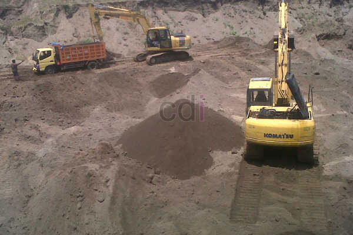

**Cara Hitung Kebutuhan Pasir Untuk Bangun Rumah** - Hai Mitra CDI! Punya rencana membangun rumah atau ruko di (not detected)? Nah, artikel ini pas banget buat Anda! Kami akan membahas tuntas cara menghitung kebutuhan pasir untuk berbagai keperluan konstruksi. Dengan memahami perhitungan ini, Anda bisa lebih akurat dalam menyusun anggaran biaya pembangunan, sekaligus menghemat pengeluaran. Yuk, simak panduannya!

*Kebutuhan Pasir Untuk Bangun Rumah*

## Memilih Jenis Pasir yang Tepat untuk Proyek Anda

Sebelum kita melangkah lebih jauh menghitung kebutuhan, penting untuk mengetahui cara memilih pasir yang sesuai dengan kebutuhan bangunan Anda di (not detected). Memilih jenis yang tepat akan mempengaruhi kualitas hasil akhir dan efisiensi biaya. Berikut panduannya:

- 1. **Tentukan Jenis Pasir:** Ada beberapa jenis pasir yang umum digunakan dalam konstruksi, masing-masing punya keunggulan dan harga berbeda. Beberapa jenis yang perlu Anda kenali adalah: [Pasir Pasang](/product/pasir-pasang-cilegon), [Pasir Cor](/product/pasir-cor-hitam), dan [Pasir Plester](/product/pasir-putih-lampung). Anda juga bisa mengkombinasikan pasir pasang dan pasir cor untuk pekerjaan plester dengan cara mengayak pasir pasangnya.
- 2. **Pilih Pasir yang Hemat Semen:** Ini adalah kunci untuk mengontrol anggaran! Caranya, untuk pengecoran, pastikan pasirnya adalah pasir sungai atau pasir galian yang sudah dicuci bersih. Untuk pasang bata atau pondasi, pilih pasir ayak hitam. Sedangkan untuk plester, gunakan pasir halus bebas bebatuan (bisa pasir laut atau pasir pantai). Semakin berat timbangan pasirnya, umumnya semakin baik kualitasnya.
- 3. **Ukurlah di Tempat:** Meskipun tidak semua penjual bersedia, idealnya Anda membeli pasir dengan sistem ukur ulang di lokasi. Ini memastikan Anda mendapatkan jumlah yang sesuai kebutuhan dan mencegah kerugian akibat kekurangan material. Percuma sudah menghitung RAB kalau taksirannya meleset, kan?

## Menghitung Kebutuhan Pasir untuk Berbagai Pekerjaan Konstruksi

Setelah Anda memahami cara memilih pasir yang tepat, mari kita hitung kebutuhan pasir untuk masing-masing pekerjaan di proyek bangunan Anda di (not detected). Berikut adalah rumus dan contohnya:

**1. Menghitung Kebutuhan Pasir Pasang:** Pasir pasang digunakan untuk memasang bata, batu pondasi, dan sebagai lapisan dasar sebelum pemasangan keramik. 

Rumus: **Total panjang dinding atau lantai** X **Lebar** X **Tinggi /Tebal = Hasil m³ — 60%**

Contoh: Hitung kebutuhan pasir untuk memasang bata: **100 m** X **0,08 m** X **4 m** = **32 m³** — **60%** = **12,8 m³**

_Jadi, kebutuhan pasir untuk memasang bata pada dinding tersebut adalah **12,8 m³**_

**2. Menghitung Kebutuhan Pasir Cor:** Pasir cor digunakan khusus untuk pekerjaan pengecoran seperti tiang, dak, selup, dan balok.

Rumus: **Panjang balok /tiang /selup** X **Lebar** X **Tinggi** = **Hasil m³** — **50%**

Contoh: Hitung kebutuhan pasir cor untuk satu tiang: **0,30 m** X **0,30 m** X **4 m** = **0,36 m³**

_Jadi, kebutuhan pasir cor untuk satu tiang adalah **0,36 m³**_

**3. Menghitung Kebutuhan Pasir Plester:** Pasir plester digunakan untuk melapisi dinding bagian dalam dan luar setelah pemasangan bata merah atau hebel. Ketebalan plesteran bisa bervariasi, umumnya antara 1,5 cm hingga 3 cm.

Rumus: **Panjang total dinding** X **Tinggi** X **Tebal** = **Hasil m³** X **2**

Contoh: **100 m** X **4 m** X **0,03 m** = **12 m³** X **2** = **24 m³**

_Jadi, kebutuhan pasir plester untuk luar dan dalam adalah **24 m³**_

Itulah dia panduan lengkap Cara Hitung Kebutuhan Pasir Untuk Bangun Rumah dari kami. Semoga artikel ini bermanfaat bagi Anda yang berencana membangun di (not detected)! Jika ada pertanyaan lebih lanjut, jangan ragu untuk menghubungi kami. Dapatkan penawaran harga terbaik dan layanan pengiriman terpercaya hanya di CDI!  Klik tombol Telepon/WhatsApp di halaman ini untuk konsultasi gratis. Jangan lupa cek juga [Jual Pasir Bangka di Babakan Pasar Bogor Gratis Ongkir](/pasir/jual-pasir-bangka-di-babakan-pasar-bogor-gratis-ongkir/) untuk pilihan pasir berkualitas.