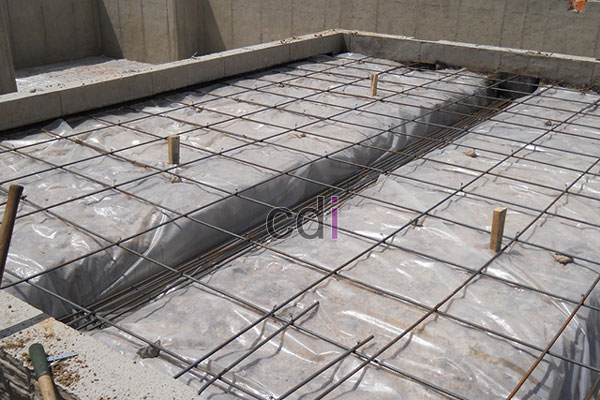

**Cara Hitung Kebutuhan Scaffolding** - Hai Mitra CDI! Punya proyek konstruksi di (not detected) dan lagi pusing mikirin berapa scaffolding yang dibutuhkan? Tenang, Anda gak sendirian! Banyak yang bingung soal ini. Di artikel ini, kami akan kupas tuntas cara menghitung kebutuhan scaffolding dengan simpel dan akurat. Yuk, langsung kita bahas!

Seringkali, kemacetan proyek bukan soal kurangnya pekerja, tapi justru karena perhitungan scaffolding yang kurang tepat di awal. Akibatnya, pekerjaan terhenti menunggu unit scaffolding tambahan datang. Sayang banget, kan?

## Mengapa Scaffolding Penting dalam Proyek Anda?

Sebelum kita membahas cara menghitung kebutuhan, ada baiknya kita pahami dulu apa itu scaffolding dan kenapa alat ini sangat penting. Scaffolding, atau perancah, adalah struktur sementara yang dirancang untuk menopang pekerja, material, dan peralatan selama proses konstruksi, renovasi, atau pengecatan.

Fungsi scaffolding bukan hanya sekadar menopang, tapi juga memastikan keselamatan pekerja dan mempercepat penyelesaian proyek. Dengan scaffolding yang tepat, pekerjaan di ketinggian bisa dilakukan dengan lebih efisien dan aman. Nah, karena itu, perhitungan yang akurat adalah kunci utama!

## Langkah-Langkah Menghitung Kebutuhan Scaffolding

Jadi, bagaimana cara menghitung kebutuhan scaffolding? Jangan khawatir, ini lebih mudah dari yang Anda bayangkan. Ikuti langkah-langkah berikut:

### Langkah 1: Pengukuran Area yang Akurat

Langkah pertama adalah mengukur area kerja secara detail. Ukur panjang, lebar, dan tinggi area yang akan dipasang scaffolding. Misalnya, untuk dinding dengan panjang 12 meter dan tinggi 6 meter, luas area yang perlu ditopang adalah **72 meter persegi**.  Pastikan pengukuran Anda teliti, ya. Kesalahan di tahap ini bisa merusak seluruh perhitungan. Jika area kerja bentuknya tidak reguler, pecah menjadi beberapa bagian persegi atau persegi panjang, lalu jumlahkan luasnya.

### Langkah 2: Pemilihan Jenis Scaffolding yang Tepat

Ada berbagai jenis scaffolding, masing-masing punya keunggulan dan kegunaannya sendiri. Berikut beberapa jenis yang umum digunakan:

- **Scaffolding Frame** — Pilihan paling populer dan mudah ditemukan, cocok untuk bangunan dengan struktur standar.
- **Scaffolding Ring Lock** — Ideal untuk desain kompleks yang membutuhkan fleksibilitas tinggi dalam penyesuaian ketinggian.
- **Scaffolding Tube and Coupler** — Pilihan tepat jika Anda butuh penyesuaian bentuk yang sangat fleksibel, terutama untuk struktur yang tidak beraturan.

### Langkah 3: Menerapkan Rumus untuk Hasil Optimal

Rumus dasar untuk menghitung kebutuhan scaffolding adalah:

**Jumlah Scaffolding = (Luas Area ÷ Luas Satu Set Scaffolding) x Faktor Keamanan**

Faktor keamanan biasanya berkisar antara 1,2 hingga 1,5, tergantung kondisi lapangan dan tingkat risiko proyek.

### Contoh Perhitungan: Penerapan Rumus Secara Nyata

Misalkan Anda memiliki area seluas 72 m², satu set scaffolding memiliki luas 20 m², dan faktor keamanan yang digunakan adalah 1,3. Maka perhitungannya adalah:

(72 ÷ 20) x 1,3 = **4,68**, yang kemudian dibulatkan menjadi **5 set scaffolding**.

## Pentingnya Faktor Keamanan: Mengapa Tidak Boleh Diabaikan?

Jangan anggap remeh faktor keamanan! Angka hasil pembagian luas sering kali belum memperhitungkan tumpang tindih antar-unit scaffolding atau kondisi permukaan yang tidak rata. Faktor keamanan berfungsi sebagai pengaman supaya Anda tidak kekurangan scaffolding di lapangan, terutama untuk proyek di area yang sulit seperti lahan miring atau area dengan banyak sudut.

## Strategi Menghemat Biaya Scaffolding: Sewa atau Beli?

Untuk proyek kecil atau sementara, menyewa scaffolding biasanya lebih hemat daripada membeli. Sebaliknya, untuk proyek jangka panjang yang membutuhkan scaffolding secara berulang, membeli mungkin lebih efisien. Tapi ingat, jangan sampai menghemat dengan memilih material scaffolding berkualitas rendah. Keselamatan kerja jauh lebih mahal daripada selisih harga.

## Menghitung Kebutuhan Scaffolding untuk Bangunan Bertingkat

Kalau proyek Anda berupa bangunan dengan dua lantai atau lebih, perhitungan dasar tadi perlu dikalikan dengan jumlah tingkat yang akan dijangkau. Contohnya, jika tinggi bangunan setara dengan dua kali tinggi standar satu susun scaffolding, Anda perlu menghitung kebutuhan total berdasarkan jumlah susunan vertikal yang dibutuhkan untuk mencapai ketinggian tersebut dengan aman.

## Manfaat Teknologi: Kalkulator Online untuk Mempercepat Perhitungan

Saat ini, banyak supplier scaffolding besar menyediakan kalkulator online yang bisa membantu Anda memperkirakan kebutuhan scaffolding dengan cepat. Input luas area dan jenis scaffolding, dan kalkulator akan memberikan estimasi. Namun, jangan sepenuhnya bergantung pada hasil kalkulator. Cek ulang hasilnya dengan kondisi riil di lapangan, seperti kontur tanah atau halangan struktural.

## Hindari Kesalahan Umum: Periksa Kembali Perhitungan Anda!

Beberapa kesalahan umum yang sering terjadi saat menghitung kebutuhan scaffolding antara lain: melupakan area yang bertumpang tindih antar sisi bangunan, hanya mengukur secara kasuar tanpa alat ukur yang akurat, dan mengabaikan kebutuhan tambahan untuk akses tangga atau jalur evakuasi pekerja.

## Rangkap Kesimpulan: Pastikan Proyek Anda Berjalan Lancar

Menghitung kebutuhan scaffolding dengan akurat itu sederhana: ukur luas area, pilih jenis scaffolding yang sesuai, lalu terapkan rumus pembagian dengan faktor keamanan. Perhitungan yang tepat akan membantu proyek Anda berjalan lebih efisien, hemat biaya, dan yang terpenting, aman.

Butuh bantuan untuk pengadaan atau pemasangan scaffolding di (not detected)? Jangan sungkan untuk menghubungi kami melalui tombol **Telepon** atau **WhatsApp** yang tersedia di halaman ini. Tim kami siap membantu!  Kami juga menyediakan berbagai material bangunan lainnya lho! [Cek juga artikel kami tentang cara menghitung kebutuhan pasir](/blog/cara-hitung-kebutuhan-pasir/) untuk proyek Anda.