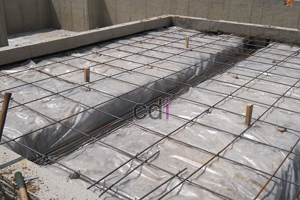

**Cara Hitung Material Cor Dak: Panduan Lengkap & Estimasi Biaya 2026** - Hai Mitra CDI! Punya rencana membangun atau merenovasi di (not detected)? Pasti ada pertanyaan tentang bagaimana menghitung material cor dak dengan tepat, kan? Pengukuran yang akurat penting banget supaya anggaran proyek tetap terkendali dan kualitas bangunan terjamin. Yuk, kita bahas tuntas!

### Menentukan Volume Cor Dak yang Tepat

Hal pertama yang perlu dilakukan adalah menghitung volume beton yang dibutuhkan. Caranya sederhana: kalikan luas area dak dengan ketebalan dak yang sudah direncanakan. Ketebalan dak biasanya antara 10 hingga 15 cm, disesuaikan dengan beban yang akan ditanggung dan desain arsitektur. Misalnya, kalau luas dak Anda 50 meter persegi dan rencana ketebalannya 12 cm (atau 0,12 meter), perhitungannya begini:

50 m² x 0,12 m = 6 m³

Ingat, volume ini adalah volume beton bersih. Untuk mengantisipasi kemungkinan kehilangan material selama proses pengerjaan, sebaiknya tambahkan toleransi sekitar 5-10%. Jadi, total beton yang perlu dipesan adalah:

6 m³ + (6 m³ x 5%) = 6,3 m³ (dengan toleransi 5%)

Untuk hasil yang lebih presisi, Kami sarankan menggunakan jasa profesional. Jangan lupa, pertimbangkan juga Biaya Cor Dak Lantai Beton per m2 saat menyusun anggaran proyek di (not detected).

### Menghitung Kebutuhan Material Utama: Semen, Pasir, dan Kerikil

Setelah volume beton diketahui, saatnya menghitung kebutuhan material utamanya: semen, pasir, dan kerikil. Rasio campuran yang umum digunakan adalah 1:2:3 (semen:pasir:kerikil) atau 1:2:4, bergantung pada mutu beton yang diinginkan. Mutu beton biasanya dilambangkan dengan K-xxx, di mana 'xxx' menunjukkan kekuatan tekan beton dalam MegaPascal (MPa). Untuk rumah tinggal, mutu K-250 hingga K-300 biasanya sudah cukup ideal.

Sebagai contoh, mari kita gunakan rasio 1:2:3 dan mutu beton K-250. Berikut perkiraan kebutuhan material per meter kubik beton:

*   **Semen:** 350 kg
*   **Pasir:** 700 kg
*   **Kerikil:** 1050 kg

Dengan volume beton 6,3 m³, total material yang dibutuhkan adalah:

*   **Semen:** 6,3 m³ x 350 kg/m³ = 2205 kg (atau 2,2 ton)
*   **Pasir:** 6,3 m³ x 700 kg/m³ = 4410 kg (atau 4,4 ton)
*   **Kerikil:** 6,3 m³ x 1050 kg/m³ = 6615 kg (atau 6,6 ton)

### Mengoptimalkan Perhitungan: Air dan Besi Tulang

Jangan lupakan kebutuhan air dan besi tulang! Kebutuhan air untuk campuran beton berkisar 40-60% dari berat semen. Jadi, dengan kebutuhan semen 2205 kg (seperti contoh di atas), air yang dibutuhkan adalah:

2205 kg x 50% = 1102,5 liter (atau 1,1 meter kubik)

Perhitungan besi tulang membutuhkan sedikit lebih banyak detail karena bergantung pada desain struktur. Anda perlu mengetahui diameter besi, jarak antar besi, dan jumlah lapisannya. Informasi lengkap bisa Anda dapatkan di Berapa Lapis Besi untuk Cor Dak? Panduan Lengkap untuk Hasil Kuat dan Awet. Umumnya, besi yang digunakan adalah besi ulir berdiameter antara 8mm dan 16mm, disesuaikan dengan beban yang akan ditanggung.

### Estimasi Biaya Material Cor Dak 2026 (not detected)

Harga material cor dak bisa berbeda-beda tergantung lokasi, kualitas material, dan penyedia. Berikut perkiraan harga per ton material pada tahun 2026 (harga estimasi dan bisa berubah sewaktu-waktu — hubungi Kami untuk penawaran terkini yang sesuai kebutuhan proyek Anda di (not detected)):

| Material   | Estimasi Harga per Ton (2026) |
| ---------- | ------------------------------ |
| Semen       | Rp 1.200.000 - Rp 1.500.000    |
| Pasir       | Rp 150.000 - Rp 250.000      |
| Kerikil     | Rp 200.000 - Rp 300.000      |

Berdasarkan estimasi ini, biaya material untuk contoh perhitungan kita adalah:

*   **Semen:** 2,2 ton x Rp 1.350.000/ton = Rp 2.970.000
*   **Pasir:** 4,4 ton x Rp 200.000/ton = Rp 880.000
*   **Kerikil:** 6,6 ton x Rp 250.000/ton = Rp 1.650.000
*   **Total:** Rp 2.970.000 + Rp 880.000 + Rp 1.650.000 = Rp 5.500.000

Perlu diingat, biaya ini belum termasuk biaya transportasi, upah tukang, material tambahan (seperti aditif beton), dan bekisting.

Butuh bantuan langsung untuk menghitung kebutuhan material atau mencari penawaran harga terbaik? Jangan ragu untuk klik tombol **WhatsApp** atau **Telepon** di bawah dan konsultasikan kebutuhan proyek Anda di (not detected) dengan tim ahli Kami! Kami siap membantu Anda.