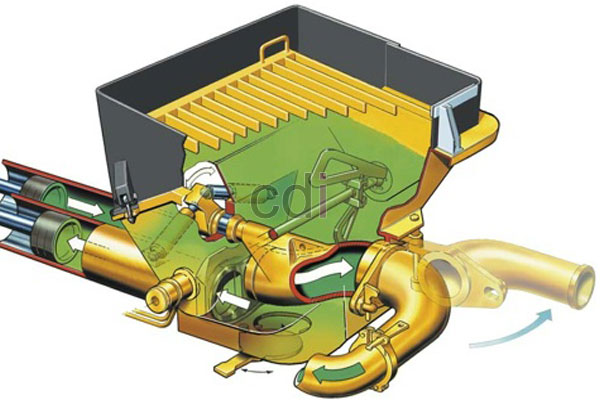

**Cara Kerja Pompa Beton Ready Mix** - Hai Mitra CDI! Mau tahu bagaimana proses pengecoran beton bisa lebih cepat dan efisien? Nah, jawabannya ada pada pompa beton ready mix. Alat ini jadi solusi andalan di banyak proyek konstruksi, mulai dari rumah tinggal hingga gedung bertingkat di (not detected). Ada berbagai jenisnya, lho, dari yang mini hingga super long boom. Intinya, pompa beton ini membantu menyalurkan beton cor siap pakai langsung ke lokasi yang sulit dijangkau truk mixer. Yuk, kita bahas lebih detail!

*cara kerja mesin pompa beton*

## Memahami Mekanisme Kerja Pompa Beton Ready Mix

Mesin pompa beton biasanya dipasang di atas truk colt diesel atau truk dengan ban ganda/enam. Pengoperasiannya cukup praktis, dikendalikan dengan *remote control* untuk menggerakkan lengan robot. Lengan robot inilah yang mengarahkan semprotan beton cor ke titik yang diinginkan. Pompa beton mini sangat ideal untuk proyek konstruksi skala kecil hingga menengah, terutama di lingkungan padat seperti kompleks perumahan di (not detected), jalanan gang, atau area sekolah.

Keunggulan utama menggunakan pompa beton adalah efisiensi tenaga kerja dan biaya yang lebih ekonomis. Pipa yang digunakan biasanya terbuat dari selang baja yang dirangkai secara manual dan terhubung ke *outlet* mesin. Panjang selang bisa disesuaikan sesuai jarak ke lokasi pengecoran. Karena kapasitas ketinggian pompa beton berkisar antara 16 hingga 60 meter, penambahan pipa mungkin diperlukan agar posisinya stabil dan horizontal. 

## Persiapan dan Setting Pompa Beton Ready Mix yang Tepat

Agar proses pengecoran berjalan lancar, sebaiknya pompa beton mini sudah berada di lokasi sekitar 1 jam sebelum truk mixer tiba. Hal ini memberikan waktu yang cukup untuk merakit pompa dan memastikan semuanya siap digunakan, sehingga tidak menghambat proses pengecoran. Penting juga untuk diingat bahwa beton tidak boleh terlalu lama berada di dalam drum mixer, karena kualitasnya bisa menurun. Jadi, jika Anda membutuhkan pompa beton untuk renovasi atau pembangunan di (not detected), pesanlah lebih awal dibandingkan pemesanan beton cornya.

Berikut adalah beberapa jenis pompa beton *ready mix* yang perlu Anda ketahui:

- 1. **Pompa mini dan standar** – Jenis ini memiliki jangkauan hingga 18 meter dan cocok digunakan untuk pengecoran *plate* rumah, dak, ruko, atau bangunan bertingkat 2 lantai.
- 2. **Pompa *long boom* dan *super long boom*** – Pompa ini menjangkau ketinggian 30 hingga 60 meter dan sering digunakan untuk pengecoran gudang, *sheet pile*, atau bangunan bertingkat 3 atau lebih.
- 3. **Pompa kodok/*portable*** – Pompa kodok mampu menembakkan coran hingga 120 meter dengan penyambungan selang baja dan pipa. Jenis ini sangat cocok untuk lokasi sempit yang sulit dijangkau mobil di (not detected).

> _Silakan pelajari spesifikasi lengkap pompa beton *ready mix* [DISINI](/blog/rental-pompa-beton-atau-concrete-pump)_

Semoga ulasan tentang pompa beton untuk pekerjaan pengecoran ini bermanfaat! Jangan ragu untuk menghubungi kami jika Anda membutuhkan pompa beton untuk proyek Anda. Cek informasi kontak di bagian atas website ini. Kami siap membantu!