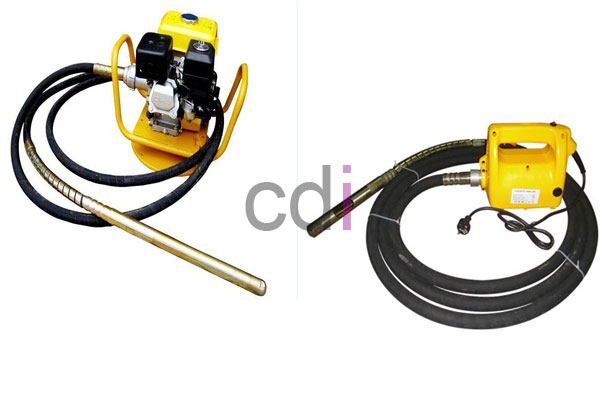

**Cara Memadatkan Cor Beton** - Hai Mitra CDI! Pernah bertanya-tanya, bagaimana caranya bikin cor beton jadi super kuat dan awet? Nah, salah satu kuncinya ada di proses pemadatan. Banyak yang mungkin belum tahu, tapi pemadatan cor beton itu wajib hukumnya supaya hasilnya nggak bolong-bolong dan tahan lama. Di (not detected), kami sering banget dapat pertanyaan soal ini. Yuk, simak panduan singkat dari kami!

*Memadatkan Cor Beton: Panduan Praktis*

Sebelum kita bahas tekniknya, penting nih untuk tahu dulu: **mengapa pemadatan cor beton itu penting?** Tujuannya sederhana, yaitu menghasilkan coran beton yang berkualitas tinggi – padat, halus, dan bebas dari rongga atau keropos yang bisa mengurangi kekuatannya. Hasilnya? Bangunan yang lebih aman dan tahan lama, khususnya di area seperti (not detected).

## Langkah-Langkah Memadatkan Cor Beton dengan Vibrator

Nah, kali ini kami akan berbagi tutorial cara memadatkan cor beton menggunakan vibrator. Ini adalah metode yang paling umum dan efektif:

- 1. Sewa vibrator dari penyedia jasa yang terpercaya. Biasanya, penyewaan ini bisa dilakukan bersamaan saat Anda memesan Ready Mix Beton di (not detected).
- 2. Proses pemadatan dimulai segera setelah beton *Ready Mix* dituang dari truk mixer ke area pengecoran. Hindari memadatkan beton yang sudah mulai mengeras.
- 3. Jangan gunakan vibrator untuk meratakan coran. Hindari juga meninggalkannya menyala di dalam coran sebelum beton benar-benar dituangkan.
- 4. Masukkan ujung vibrator ke dalam coran secara merata. Pastikan ujung vibrator tidak menyentuh besi tulangan karena bisa menggeser posisinya. Hindari juga menyentuh begisting (cetakan beton) agar tidak menyebabkan retakan karena getaran berlebih.
- 5. Vibrasi harus menjangkau seluruh area coran, terutama bagian yang rawan keropos.
- 6. Waktu pemadatan ideal untuk setiap m² adalah 5-15 detik. Terlalu lama atau terlalu sebentar sama-sama tidak efektif.

Mitra, itulah dia tutorial singkat cara memadatkan cor beton dengan vibrator. Semoga informasi ini bermanfaat dan menambah wawasan Anda. Untuk tahu lebih detail mengenai spesifikasi vibrator, silakan kunjungi halaman **"[Vibrator](/product/vibrator-cor)"**. Butuh jasa sewa vibrator? Jangan ragu untuk menghubungi kami melalui kontak yang tertera di website ini. Kami siap membantu proyek Anda di (not detected) dan sekitarnya! [Alas Cor Beton: Panduan Lengkap Jenis, Fungsi, dan Pemasangannya](/blog/alas-cor-beton/) untuk informasi tambahan tentang fondasi.