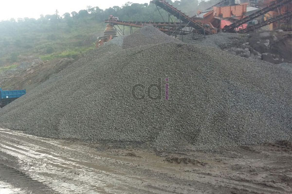
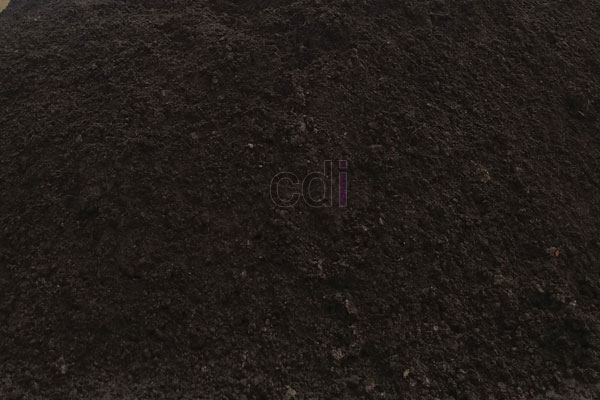

**Cara Membandingkan Harga Penjual Pasir dan Batu Online** - Hai Mitra CDI! Lagi cari cara terbaik untuk dapatkan harga termurah untuk material bangunan? Tepat sekali Anda berada di sini! Membeli pasir dan batu secara online memang menjanjikan kemudahan, tapi bagaimana memastikan Anda mendapat penawaran terbaik dan terhindar dari potensi masalah? Nah, kami punya beberapa tips jitu yang bisa langsung Anda terapkan. Yuk, simak panduan lengkapnya berikut ini! 

*Penjual Pasir dan Batu Online*

Dari pengalaman kami, banyak Mitra CDI yang kesulitan membandingkan harga secara efektif. Karenanya, kami hadirkan serangkaian tips Cara Membandingkan Harga Penjual pasir dan batu Online agar Anda dapat membeli bahan bangunan dengan aman, nyaman, dan tentunya, dengan harga yang paling bersahabat di kantong. Langsung saja kita bahas!

## Pastikan Informasi Harga Penjual Pasir dan Batu Online Selalu Terbaru

Ini adalah langkah krusial, Mitra. Informasi harga yang akurat adalah fondasi dari perbandingan yang tepat. Pastikan toko online yang Anda incar menampilkan daftar harga yang diperbarui secara berkala. Kalau tidak, jangan ragu untuk menghubungi mereka langsung via telepon atau chat untuk menanyakan harga terkini.

*Penjual Pasir dan Batu Online*

## Waspadai Harga yang Terlalu Menggiurkan

Hati-hati dengan penawaran yang terlihat "terlalu bagus untuk menjadi kenyataan". Di dunia online, modus penipuan bisa datang dalam berbagai bentuk. Salah satu yang paling umum adalah menjanjikan harga jauh di bawah rata-rata pasar. Ingat, kualitas umumnya sejalan dengan harga. Kecuali ada alasan khusus seperti promo atau diskon, harga yang terlalu murah patut dicurigai.

## Bandingkan Harga Berdasarkan Volume Kubikasi yang Jelas

Mengapa harus menghitung harga per meter kubik (m3)? Sederhana saja: karena ini cara paling adil dan akurat untuk membandingkan harga. Dengan menghitung volume kubikasi, Anda bisa meminimalkan potensi manipulasi dari penjual. Pastikan Anda menanyakan harga per m3 kepada setiap penjual yang Anda hubungi. Jika ada yang hanya menawarkan harga per truk, sebaiknya Anda berhati-hati. Ada kemungkinan muatan tidak sesuai dengan yang dijanjikan. Terutama jika Anda kurang paham tentang cara menghitung kubikasi, jangan ragu untuk meminta bantuan.

> _"Kalau Anda belum familiar dengan cara menghitung kubikasi, silakan kunjungi halaman **[Kalkulator Bangunan](/page/kalkulator-bangunan)** untuk panduan praktisnya."_

## Pastikan Jenis dan Kualitas Pasir dan Batu Sama

Jangan sampai Anda membandingkan apel dengan jeruk! Pastikan Anda membandingkan harga untuk jenis dan kualitas material yang sama. Misalnya, jika Anda mencari pasir gunung, pastikan semua penjual menawarkan jenis pasir gunung dengan kelas kualitas yang serupa. Pertimbangkan faktor seperti kandungan lumpur, ukuran butiran, dan sumber pasir (sungai atau gunung).

> _Bingung menentukan kualitas material yang tepat? Jangan sungkan untuk bertanya langsung kepada kami via telepon **0813 8050 0660**. Kami akan dengan senang hati membantu Anda._

## Beli Langsung dari Sumbernya: Quarry vs. Toko Material

Untuk mendapatkan harga paling kompetitif, cobalah membandingkan harga dari penjual yang mengambil langsung dari *quarry* (tambang). Biasanya, harga dari sumber pertama ini akan lebih murah dibandingkan dengan harga di toko material. Namun, perlu diingat bahwa volume muatan dari quarry mungkin berbeda dengan volume muatan di toko material. Selain itu, jarak pengiriman juga bisa menjadi pertimbangan penting. Toko material mungkin enggan menawarkan hitungan kubikasi untuk pengiriman jarak jauh karena potensi penyusutan material.

**_Sebagai informasi tambahan, ada praktik di mana toko material bisa mengubah volume 24 kubik dari quarry menjadi 30 kubik, bahkan dengan menambahkan material lain untuk menekan harga._**

## Pastikan Harga Sudah Termasuk Ongkos Kirim dan Penurunan

Jangan sampai Anda terkejut dengan biaya tambahan yang muncul di akhir transaksi. Pastikan harga yang Anda bandingkan sudah mencakup ongkos kirim dan biaya penurunan material di lokasi tujuan. Tanyakan secara detail kepada penjual apakah ada biaya tersembunyi lainnya.

Itulah beberapa tips penting untuk Membandingkan Harga Penjual pasir dan batu Online. Semoga panduan ini bermanfaat bagi Anda dalam mendapatkan bahan bangunan berkualitas dengan harga terbaik. Jika Anda tertarik untuk membeli pasir dan batu dari kami, jangan ragu untuk menghubungi kami kapan saja melalui telepon atau email yang tertera di website ini. Kami siap melayani Anda dengan sepenuh hati. Di (not detected), kualitas dan kepuasan pelanggan adalah prioritas utama kami! Jangan lupa cek juga  untuk penawaran menarik lainnya. Kami juga menyediakan jasa pemasangan dan konsultasi GRATIS untuk proyek Anda di area (not detected).