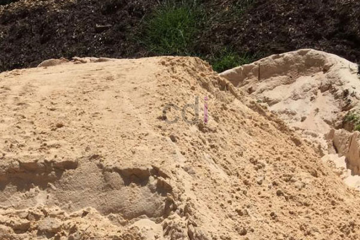

**Cara Membedakan Pasir Asli dan Oplosan** - Hai Mitra CDI! Apakah Anda sedang merencanakan pembangunan dan membutuhkan material pasir? Memilih pasir berkualitas adalah kunci utama untuk memastikan kekuatan dan ketahanan bangunan Anda. Nah, dalam artikel ini, kami akan membahas tuntas cara membedakan pasir asli dengan pasir oplosan, agar Anda tidak salah pilih dan mendapatkan hasil yang optimal untuk proyek Anda di (not detected).

*Mengenali Kualitas Pasir untuk Konstruksi*

## Mengapa Memilih Pasir Asli Lebih Baik?

Mitra, kita semua tentu ingin hasil bangunan yang kokoh dan awet, bukan? Memilih kualitas memang lebih penting daripada sekedar mencari harga murah. Pasir oplosan memang terlihat menggiurkan karena harganya yang lebih rendah, tetapi percayalah, investasi pada pasir asli akan jauh lebih menguntungkan dalam jangka panjang. Pasir oplosan dapat menurunkan kualitas bangunan dan bahkan memperpendek umurnya. Sementara itu, pasir asli menawarkan kekuatan dan stabilitas yang lebih terjamin. Jadi, mana yang lebih baik? Tentu saja pasir asli, demi keamanan dan ketenangan pikiran Anda!

## Tips Jitu Membedakan Pasir Asli dan Oplosan

Jangan sampai tertipu oleh oknum yang tidak bertanggung jawab! Sebagai pembeli cerdas, Anda perlu membekali diri dengan pengetahuan yang cukup untuk membedakan pasir asli dan campuran. Berikut beberapa tips sederhana yang bisa Anda terapkan langsung:

### 1. Perhatikan Warna Alami Pasir

Langkah pertama yang paling mudah adalah dengan memperhatikan warna pasir. Setiap jenis pasir memiliki warna khasnya. Misalnya, jika Anda membeli pasir bangka putih, pastikan warnanya sesuai dengan standar – apakah putih garam, putih kemerahan, atau putih kecoklatan. Warna yang tidak seragam atau terlalu kusam bisa menjadi indikasi adanya campuran.

### 2. Lakukan Uji Sederhana dengan Air

Cara ini cukup praktis untuk dilakukan. Ambil segenggam pasir dan masukkan ke dalam wadah berisi air bersih. Perhatikan bagaimana pasir bereaksi. Jika pasir cepat hancur atau terurai dalam air, kemungkinan besar itu adalah pasir oplosan. Sedangkan pasir asli akan tetap utuh dan tidak mudah larut.

### 3. Uji Kejernihan Air dengan Botol

Selain uji di atas, Anda juga bisa menggunakan botol air mineral transparan. Masukkan sekitar sepertiga bagian botol dengan pasir, lalu tambahkan air hingga sepertiga bagian juga. Kocok botol dengan kuat dan diamkan beberapa saat. Perhatikan tingkat kekeruhan air. Jika air menjadi sangat keruh dan endapan lumpur tinggi, itu menandakan adanya campuran. Jika air hanya sedikit keruh atau tetap jernih, berarti pasir tersebut asli.

### 4. Uji Kekuatan Genggaman

Ambil segenggam pasir dan genggam sekuat mungkin. Kemudian, lepaskan pasir tersebut ke tanah. Jika pasir masih menggumpal saat dijatuhkan, itu menunjukkan adanya kandungan lumpur atau bahan campuran lainnya. Namun, jika pasir langsung pecah dan bertebaran, kemungkinan besar itu adalah pasir asli tanpa campuran.

Penting untuk diingat, penggunaan pasir oplosan mungkin masih bisa diterima untuk pekerjaan ringan seperti alas batako untuk pelataran rumah. Akan tetapi, untuk konstruksi bangunan yang lebih penting seperti rumah, kantor, atau apalagi gedung bertingkat, penggunaan pasir asli sangatlah krusial demi keamanan dan ketahanan bangunan. Jangan kompromi soal kualitas!

Semoga tips ini bermanfaat bagi Anda, Mitra CDI! Jika Anda membutuhkan suplai pasir asli berkualitas tinggi langsung dari sumbernya di (not detected), jangan ragu untuk menghubungi kami. Kami siap menyediakan berbagai jenis pasir sesuai kebutuhan proyek Anda. Jangan lupa juga untuk mengecek [Jual Pasir Bangka di Babakan Pasar Bogor Gratis Ongkir](/pasir/jual-pasir-bangka-di-babakan-pasar-bogor-gratis-ongkir/) untuk informasi lebih lanjut dan penawaran menarik lainnya! Kami selalu siap membantu Anda mewujudkan bangunan impian yang kokoh dan tahan lama. Hubungi kami sekarang juga melalui tombol Telepon/WhatsApp di situs kami untuk penawaran terbaik!