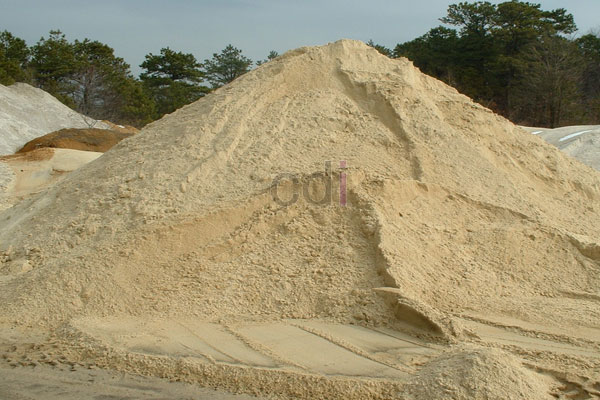

**Cara Membeli Pasir dan Batu Bata Online** - Hai Mitra CDI! Pernah gak sih merasa ribet kalau harus beli pasir atau batu bata langsung ke toko bangunan? Apalagi kalau proyek lagi sibuk-sibuknya. Nah, di era digital ini, ada solusi yang lebih praktis: belanja online! Tapi, sebelum Anda tergiur dengan kemudahan ini, ada beberapa hal yang perlu diperhatikan. Yuk, simak panduan lengkapnya!

Perkembangan teknologi memang mengubah banyak hal, termasuk cara kita berbelanja. Handphone dan internet bukan cuma alat komunikasi, tapi juga gerbang menuju kemudahan transaksi. Sekarang, mencari dan memesan material bangunan seperti pasir dan batu bata bisa dilakukan kapan saja dan di mana saja. 

## Untung Rugi Membeli Pasir dan Batu Bata Online

Kemudahan transaksi online tentu punya daya tarik tersendiri. Kita bisa menghemat waktu dan tenaga, tanpa perlu berkeliling toko bangunan. Cukup dengan membuka search engine seperti Google, Yahoo, atau Bing, berbagai pilihan langsung muncul di depan mata. 

Namun, perlu diingat juga, kemajuan teknologi juga membuka celah bagi oknum yang tidak bertanggung jawab. Penipuan berkedok online shop bisa saja terjadi. Itulah kenapa artikel ini hadir, Mitra! Kami ingin berbagi tips agar Anda bisa membeli pasir dan batu bata online dengan aman dan nyaman. Jadi, jual beli online bisa jadi solusi yang menguntungkan bagi kita semua.

## Cara Membeli Pasir dan Batu Bata Online dengan Aman

Berikut ini beberapa langkah yang bisa Anda ikuti untuk meminimalkan risiko saat membeli pasir dan batu bata secara online:

- 1. Pastikan website atau toko online yang Anda pilih memiliki reputasi yang baik dan menggunakan domain berbayar – hindari yang menggunakan domain gratisan seperti blogspot atau sejenisnya.
- 2. Verifikasi bahwa toko online tersebut memiliki alamat fisik dan nomor telepon yang jelas dan valid.
- 3. Perhatikan daftar harga material bangunan yang ditawarkan. Pastikan harga tersebut terupdate dan realistis. 
- 4. Waspadalah jika menemukan penawaran harga yang terlalu murah dan tidak masuk akal. Biasanya, harga yang terlalu rendah justru menjadi indikasi penipuan.
- 5. Sebelum melakukan pemesanan, coba minta sampel materialnya atau pastikan penjual bersedia mengirimkannya. Dengan begitu, Anda bisa mengecek kualitasnya secara langsung.
- 6. Cari tahu apakah penjual menyediakan opsi pembayaran COD (Cash on Delivery) atau sistem pembayaran setelah barang diterima. Ini bisa menjadi jaminan keamanan transaksi Anda.
- 7. Sepakati harga pembelian per meter kubik (m3), bukan per truk. Pembelian per truk seringkali membuat pembeli kesulitan memverifikasi volume yang sebenarnya.
- 8. Saat membandingkan harga dari beberapa penjual, bandingkan harga per kubiknya. Dengan begitu, Anda akan mendapatkan perbandingan yang lebih akurat.
- 9. Setelah material tiba di lokasi proyek, lakukan pengukuran volume dengan cara mengalikan panjang, lebar, dan tinggi isi bak truk.
- 10. Jangan lupa minta surat jalan dan kwitansi pembayaran sebagai bukti sah transaksi Anda.

Nah, itulah beberapa tips yang bisa Anda terapkan saat membeli pasir dan batu bata secara online. Dengan berhati-hati dan teliti, Anda bisa mendapatkan material bangunan berkualitas dengan harga terbaik.

[Cara Membandingkan Harga Penjual Pasir dan Batu Online](/blog/cara-membandingkan-harga-penjual-pasir-dan-batu-online/) membahas lebih lanjut tentang strategi perbandingan harga yang efektif.

Jika Anda mencari material alam berkualitas seperti pasir, batu pondasi, split cor, bata merah, batako, atau hebel di (not detected), jangan ragu untuk menghubungi kami! Kami siap melayani pesanan Anda dengan pengiriman gratis dan penurunan material di lokasi proyek. Jangan lewatkan juga penawaran menarik untuk pembelian Bata Merah di (not detected) [Jual Material Bata Merah di Abadijaya Depok Gratis Ongkir](/bata/jual-material-bata-merah-di-abadijaya-depok-gratis-ongkir/). Hubungi kami sekarang juga untuk informasi lebih lanjut dan penawaran harga terbaik! [[[PLACEHOLDER_N]]]