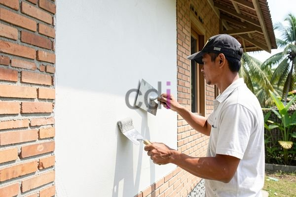

**Cara Membuat Adukan Acian yang Kuat dan Tahan Lama: Panduan Lengkap 2026** - Hai Mitra CDI! Seringkah Mitra CDI menjumpai masalah acian dinding yang retak, mengelupas, atau bahkan tidak rata? Hal ini seringkali merupakan indikasi adanya kesalahan pada campuran adukan. Padahal, kualitas acian sangat berperan dalam menentukan keindahan dan kekuatan bangunan. Jangan khawatir, Kami akan memandu Anda!

### Kenapa Adukan Acian yang Tepat Itu Krusial?

Adukan acian lebih dari sekadar lapisan pelindung dan perata dinding. Adukan yang berkualitas baik akan menciptakan permukaan yang halus, tahan lama, dan bebas dari retakan. Selain itu, adukan yang tepat membuat proses pengecatan lebih mudah dan memberikan hasil akhir yang memuaskan. Di Creative Design Interior, kami memahami detail konstruksi ini dan siap membantu Anda mencapainya.

## Membongkar Rahasia Komposisi Adukan Acian

Komposisi ideal adukan acian terdiri dari tiga elemen utama: semen, pasir, dan air. Perbandingan yang tepat dari ketiga bahan ini adalah kunci untuk mendapatkan kekuatan, daya rekat, dan kemudahan saat aplikasi. Ada beberapa variasi takaran yang bisa Anda coba, disesuaikan dengan kebutuhan dan kondisi proyek. Namun, rasio yang paling umum digunakan adalah 1:2:3 (semen:pasir:air).

### Mengatur Takaran Adukan Acian Sesuai Kebutuhan

Meskipun rasio 1:2:3 menjadi patokan umum, jenis pekerjaan tertentu memerlukan proporsi yang sedikit berbeda. Misalnya, untuk acian dinding luar yang kerap terpapar cuaca ekstrem, rasio 1:1,5:2 lebih disarankan untuk meningkatkan kekuatan dan ketahanan terhadap air. Sebaliknya, untuk acian dinding dalam ruangan yang lebih terlindung, rasio 1:2:3 sudah cukup optimal.

### Memilih Material Berkualitas untuk Hasil Maksimal

Kualitas bahan baku sangat memengaruhi kualitas akhir acian. Pastikan semen yang digunakan masih segar dan memenuhi standar mutu (seperti SNI). Pasir yang dipakai sebaiknya adalah pasir pasang yang bersih dari kotoran organik dan lumpur. Air pun harus bersih dan bebas dari zat kimia yang dapat menghambat proses pengerasan adukan.

## Panduan Langkah Demi Langkah Membuat Adukan Acian yang Kuat

Berikut adalah panduan detail untuk membuat adukan acian yang kokoh dan tahan lama:

1.  **Persiapkan Segala Perlengkapan:** Siapkan semen, pasir pasang, air bersih, ember atau wadah adukan, sekop, dan alat pengaduk (manual atau mesin).
2.  **Campurkan Semen dan Pasir Secara Merata:** Masukkan semen dan pasir ke dalam wadah adukan sesuai rasio yang dipilih (contohnya, 1:2). Aduk keduanya sampai benar-benar tercampur rata.
3.  **Tambahkan Air Sedikit Demi Sedikit:** Tuangkan air secara bertahap sambil terus mengaduk. Perhatikan konsistensi adukan. Terus aduk hingga mencapai konsistensi yang pas – tidak terlalu cair, tidak terlalu padat.
4.  **Lakukan Uji Coba Kekuatan Aduk:** Ambil sedikit adukan dan tempelkan ke permukaan dinding. Jika adukan menempel kuat dan tidak mudah lepas, berarti adukan siap digunakan.

### Tingkatkan Kualitas Adukan dengan Bahan Tambahan

Untuk hasil yang lebih optimal, Anda bisa menambahkan bahan-bahan berikut ke dalam adukan:

*   **Kapur:** Meningkatkan daya rekat dan fleksibilitas adukan.
*   **Lem Latex:** Meningkatkan elastisitas dan ketahanan terhadap keretakan.
*   **Plasticizer:** Mempermudah proses pengerjaan dan mengurangi kebutuhan air.

## Estimasi Biaya Pembuatan Adukan Acian dan Pertimbangan Penting

Untuk informasi harga yang lebih presisi dan sesuai dengan spesifikasi proyek Anda di (not detected), silakan hubungi Kami.

Secara umum, biaya pembuatan adukan acian akan bervariasi tergantung harga material dan tarif tenaga kerja. Berikut adalah estimasi biaya per meter persegi untuk pekerjaan acian:

*   **Material (semen, pasir, kapur, lem latex):** Rp 30.000 – Rp 50.000
*   **Upah Tenaga Kerja:** Rp 40.000 – Rp 80.000

Estimasi total biaya per meter persegi berkisar antara Rp 70.000 – Rp 130.000. Perlu diingat bahwa angka ini bisa berbeda berdasarkan lokasi, kompleksitas pekerjaan, dan penyedia jasa.

Butuh informasi lebih lanjut atau konsultasi proyek? Jangan ragu untuk menghubungi Kami melalui tombol **Telepon** atau **WhatsApp** yang tersedia di bawah ini. Kami siap membantu! [Rahasia Adukan yang Kuat dan Tahan Lama untuk Konstruksi Impian Anda](/blog/adukan/) — artikel ini membahas lebih dalam tentang fondasi adukan yang kokoh untuk bangunan impian Anda.