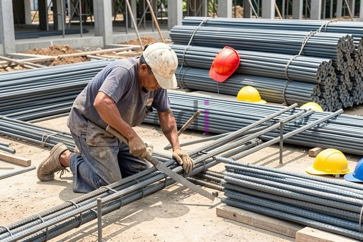

**Cara Membuat Behel Besi: Panduan Lengkap untuk Proyek Konstruksi Anda** - Hai Mitra CDI! Pernahkah terbayang, kualitas sebuah bangunan itu sangat ditentukan oleh detail-detail kecil? Salah satunya adalah behel besi. Seringkali terlupakan, padahal sekitar 60% kegagalan struktur beton disebabkan oleh pembesian yang kurang tepat. Nah, penting banget kan untuk memahami cara membuat behel besi yang benar? Artikel ini hadir untuk membantu Mitra CDI memastikan kekuatan dan durabilitas bangunan!

## Mengapa Behel Besi Begitu Vital dalam Konstruksi?

Behel besi, atau sengkang, itu ibarat 'penjaga' besi utama dalam struktur beton. Tugas utamanya? Mencegah besi utama melengkung atau bergeser saat beton dicor dan juga saat bangunan menerima beban. Tanpa behel yang kuat, struktur beton bisa jadi rentan terhadap retak dan kerusakan. Intinya, behel besi ini mendistribusikan tegangan secara merata, sehingga ketahanan tarik dan geser beton meningkat pesat.

Lebih dari itu, penggunaan behel besi yang tepat memastikan bangunan Mitra CDI memenuhi standar keamanan dan kualitas yang diatur dalam Standar Nasional Indonesia (SNI). Kami dari Creative Design Interior selalu memprioritaskan penggunaan material yang 100% sesuai SNI dalam setiap proyek. Dengan begitu, Anda bisa tenang dan yakin akan kualitas bangunan.

## Apa Saja yang Dibutuhkan untuk Membuat Behel Besi?

Yuk, kita siapkan dulu peralatan dan materialnya! Membuat behel besi ini sebenarnya tidak terlalu sulit, kok. Yang dibutuhkan antara lain:

*   **Mesin Potong Besi:** Untuk memotong besi beton sesuai ukuran yang presisi.
*   **Mesin Bengkok Besi:** Alat ini membantu membengkokkan besi beton menjadi bentuk behel yang diinginkan.
*   **Penggaris Besi (Meteran):** Penting untuk mengukur dan menandai dimensi behel dengan akurat.
*   **Tang Kombinasi:** Berguna untuk membantu proses pembengkokan dan pemasangan behel.
*   **Alas Kerja:** Gunakan permukaan datar dan stabil supaya proses pembuatan behel lebih mudah.
*   **Perlengkapan Keselamatan:** Jangan lupakan sarung tangan dan kacamata pelindung untuk keselamatan kerja!

Material utamanya jelas besi beton. Diameter besi yang digunakan bervariasi, tergantung ukuran dan beban struktur bangunan. Biasanya, diameter 8 mm, 10 mm, dan 12 mm sering digunakan. Pemilihan diameter besi harus disesuaikan dengan perhitungan struktur dan selalu konsultasikan dengan ahli konstruksi, ya!

## Langkah Demi Langkah Membuat Behel Besi yang Benar

Oke, sudah siap? Sekarang mari kita ikuti langkah-langkahnya:

1.  **Pengukuran dan Pemotongan:** Pertama, ukur panjang besi beton sesuai dengan dimensi behel yang dibutuhkan. Gunakan mesin potong besi untuk memotongnya dengan presisi.
2.  **Pembengkokan:** Selanjutnya, gunakan mesin bengkok besi untuk membentuk besi beton sesuai desain. Bentuk behel yang umum adalah huruf U atau persegi. Pastikan sudut dan jari-jari pembengkokannya sesuai dengan gambar kerja.
3.  **Penyusunan:** Susun behel-behel yang sudah dibentuk sesuai pola pembesian yang ada di gambar kerja. Perhatikan jarak antar behel dan posisinya terhadap besi utama.
4.  **Pengikatan:** Terakhir, ikat behel besi menggunakan besi bendrat atau kawat beton agar membentuk satu kesatuan yang kokoh. Pastikan ikatannya kuat supaya behel tetap pada posisinya selama pengecoran.

## Perkiraan Biaya: Apakah Lebih Hemat Membuat Sendiri?

Membuat behel besi sendiri bisa jadi pilihan hemat, terutama untuk proyek konstruksi skala kecil di (not detected). Tapi, kita perlu menghitung dulu biayanya. Kira-kira apa saja yang perlu diperhitungkan?

*   **Biaya Material:** Harga besi beton bisa bervariasi tergantung ukuran dan kualitasnya.
*   **Biaya Peralatan:** Harga mesin potong dan mesin bengkok besi juga berbeda-beda, tergantung merek dan kapasitasnya.
*   **Biaya Operasional:** Biaya listrik atau bahan bakar untuk mengoperasikan mesin juga perlu diperhitungkan.
*   **Biaya Tenaga Kerja:** Kalau Mitra CDI tidak mengerjakannya sendiri, biaya tenaga kerja juga harus masuk dalam perhitungan.

Sebagai gambaran, untuk membuat 100 buah behel besi diameter 10 mm dengan panjang 50 cm, kira-kira dibutuhkan 1 kg besi beton. Biaya total pembuatan akan bervariasi tergantung skala proyek dan metode yang digunakan. Untuk informasi harga terkini dan penawaran khusus yang disesuaikan dengan kebutuhan proyek Mitra CDI di (not detected), silakan hubungi Kami.

Butuh penjelasan lebih lanjut? Jangan ragu untuk menghubungi Kami melalui tombol **Telepon** atau **WhatsApp** di bawah ini. Tim ahli Kami siap membantu! Jangan lupa, dengan material yang tepat dan teknik yang benar, bangunan Mitra CDI akan semakin kokoh dan tahan lama. [Adhimix Lenteng Agung: Solusi Praktis untuk Fondasi Kuat dan Proyek Konstruksi Anda](/blog/adhimix-lenteng-agung/) — untuk memastikan fondasi kuat dan tahan lama, Kami juga menyediakan layanan dan material dari Adhimix, lho!