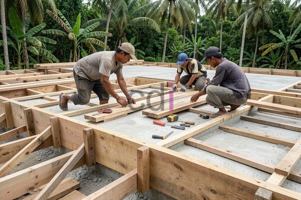

**Cara Membuat Bekisting Dak Teras: Panduan Lengkap & Praktis 2026** - Hai Mitra CDI! Punya rencana membangun atau merenovasi dak teras? Pernahkah Mitra melihat hasil pengecoran dak teras yang kurang memuaskan – misalnya, permukaan tidak rata, retak-retak, atau bahkan ada bagian yang ambles? Nah, masalah itu seringkali berasal dari bekisting yang kurang tepat. Bekisting adalah kunci utama untuk menciptakan dak teras yang kokoh, presisi, dan tahan lama. Yuk, simak panduan lengkap ini!

### Mengapa Bekisting yang Tepat Sangat Penting untuk Dak Teras?

Bekisting itu seperti cetakan kue untuk beton. Tugasnya menahan bentuk dan berat beton cair sampai mengeras sempurna. Untuk dak teras, kualitas bekisting sangat menentukan kekuatan dan keindahan hasil akhir. Bayangkan kalau cetakan kue bolong atau tidak kuat – hasilnya pasti berantakan, kan? Begitu juga dengan bekisting. Bekisting yang kokoh dan akurat akan menghasilkan permukaan dak yang rata, kuat menahan beban, dan terhindar dari masalah keretakan atau penurunan kualitas. Penting diingat, selalu ikuti standar SNI agar bekisting yang dibuat sesuai ketentuan.

### Material-Material yang Dibutuhkan untuk Bekisting Dak Teras

Memilih material yang tepat adalah langkah awal yang krusial. Dengan material berkualitas, bekisting Mitra akan lebih kuat dan tahan lama. Berikut adalah material utama yang biasanya digunakan:

*   **Kayu:** Papan kayu (seperti kayu malang atau kayu borneo) adalah material dasar untuk struktur bekisting. Pilih kayu yang kering, lurus, dan bebas dari retakan besar atau serangan hama.
*   **Baja:** Baja profil atau besi beton digunakan untuk memperkuat rangka bekisting, terutama pada bagian-bagian yang menanggung beban berat.
*   **Triplek:** Triplek berfungsi sebagai lapisan permukaan bekisting yang bersentuhan langsung dengan beton. Triplek akan menghasilkan permukaan beton yang lebih halus dan rata.
*   **Kawat Bendrat:** Kawat bendrat digunakan untuk mengikat dan mengencangkan semua elemen bekisting agar lebih stabil.
*   **Paku dan Sekrup:** Digunakan untuk menyambung elemen-elemen kayu dengan kuat.

Selain material utama, jangan lupa sediakan alat-alat seperti gergaji, palu, bor, meteran, waterpass, dan selang air untuk memudahkan proses pembuatan.

### Panduan Langkah Demi Langkah Membuat Bekisting Dak Teras

Sekarang, mari kita bahas langkah-langkah praktis membuat bekisting dak teras:

1.  **Perencanaan & Pengukuran:** Ukur dan tentukan dimensi pasti dak teras yang akan dibuat. Buat gambar rencana yang detail, termasuk posisi kolom, balok, dan semua detail bekisting yang diperlukan.
2.  **Pembuatan Rangka Bekisting:** Potong kayu sesuai ukuran yang sudah direncanakan. Rangkai kayu-kayu tersebut menjadi rangka bekisting yang kuat dan stabil menggunakan paku, sekrup, dan kawat bendrat.
3.  **Pemasangan Penyangga (Shoring):** Pasang penyangga (shoring) di bawah rangka bekisting untuk menopang berat beton. Jarak antar penyangga harus disesuaikan dengan beban yang akan ditanggung. Kami sarankan jarak maksimum 1 meter antar penyangga.
4.  **Pemasangan Triplek:** Pasang triplek di atas rangka bekisting menggunakan paku atau sekrup. Pastikan triplek terpasang rapat, rata, dan tidak ada celah.
5.  **Pengecekan Kemiringan & Kerataan:** Gunakan waterpass untuk memastikan permukaan bekisting benar-benar rata dan memiliki kemiringan yang tepat untuk saluran pembuangan air hujan.
6.  **Pelapisan Minyak Bekisting (Coating Agent):** Oleskan minyak bekisting secara merata pada seluruh permukaan triplek untuk mencegah beton menempel dan memudahkan pembongkaran setelah beton mengeras.

### Perkiraan Biaya Pembuatan Bekisting Dak Teras

Biaya pembuatan bekisting dak teras akan berbeda-beda tergantung ukuran dak, jenis material yang dipilih, dan tingkat kesulitan proyek. Perkiraan biaya bekisting biasanya berkisar antara 20-30% dari total biaya pengecoran dak teras. 

Sebagai gambaran, untuk dak teras berukuran 4x5 meter dengan ketebalan 12 cm, perkiraan biaya bekisting bisa mencapai Rp 2.000.000 – Rp 4.000.000. Informasi harga ini bersifat estimasi dan dapat berubah sewaktu-waktu — hubungi Kami untuk mendapatkan penawaran harga terkini yang disesuaikan dengan kebutuhan proyek Mitra CDI!

### Tips Penting untuk Hasil Bekisting Dak Teras yang Optimal

*   **Pilih Kayu Berkualitas:** Kayu yang digunakan harus dalam kondisi baik, kering, dan bebas dari cacat seperti retak atau serangan rayap.
*   **Utamakan Keselamatan Kerja:** Pastikan semua pekerja menggunakan alat pelindung diri (APD) seperti helm, sarung tangan, dan sepatu keselamatan.
*   **Cek Kekuatan Penyangga:** Sebelum pengecoran, periksa kembali kekuatan dan kestabilan penyangga untuk memastikan mampu menopang beban beton dengan aman.
*   **Konsultasi dengan Profesional:** Jika Mitra kurang yakin, jangan ragu untuk berkonsultasi dengan ahli konstruksi atau menggunakan jasa kontraktor profesional.

Dengan mengikuti panduan ini dan memperhatikan tips-tips penting, Mitra CDI bisa membuat bekisting dak teras yang kuat, presisi, dan tahan lama. [Bekisting Balok dan Plat: Panduan Lengkap Material, Perhitungan, dan Biaya 2026](/blog/bekisting-balok-dan-plat/) juga bisa menjadi referensi tambahan yang berguna bagi Mitra.

Butuh bantuan lebih lanjut? Jangan sungkan untuk menghubungi Kami! Tombol **Telepon** dan **WhatsApp** di bawah halaman ini siap membantu Mitra CDI.