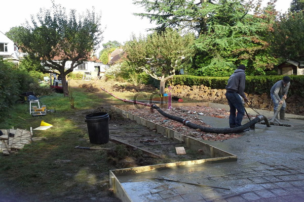

**Cara Membuat Bekisting Jalan Beton: Panduan Lengkap dan Biaya 2026** - Hai Mitra CDI! Pernahkah Anda berpikir soal bagaimana fondasi sebuah jalan beton yang kuat itu dibangun? Kualitas bekisting adalah kunci utama, lho. Bekisting yang kurang baik bisa bikin jalan cepat rusak, retak-retak, bahkan berpotensi membahayakan. Yuk, simak panduan lengkap ini supaya proyek jalan beton Anda sukses dan awet!

## Memilih Material Bekisting Jalan Beton: Apa yang Paling Tepat?

Soal material, ada beberapa opsi yang bisa dipilih untuk bekisting jalan beton, seperti kayu, baja, dan aluminium. Masing-masing punya kelebihan dan kekurangan. Kayu memang ekonomis, terutama buat proyek kecil. Tapi ingat, kayu butuh perawatan ekstra biar gak lapuk atau berubah bentuk karena cuaca. Kalau baja, jelas lebih kuat dan tahan lama – cocok buat proyek yang butuh daya dukung tinggi. Nah, aluminium itu ringan dan gak gampang berkarat, tapi harganya memang lebih mahal.

Berikut ini perbandingan singkatnya, biar Mitra lebih jelas:

<table class="table">
  <caption>Perbandingan Material Bekisting Jalan Beton</caption>
  <thead>
    <tr><th>Material</th><th>Kekuatan</th><th>Biaya</th><th>Daya Tahan</th><th>Kemudahan Pemasangan</th></tr>
  </thead>
  <tbody>
    <tr><td>Kayu</td><td>Sedang</td><td>Rendah</td><td>Rendah (perlu perawatan)</td><td>Sedang</td></tr>
    <tr><td>Baja</td><td>Tinggi</td><td>Sedang - Tinggi</td><td>Tinggi</td><td>Sedang</td></tr>
    <tr><td>Aluminium</td><td>Sedang - Tinggi</td><td>Tinggi</td><td>Tinggi</td><td>Tinggi</td></tr>
  </tbody>
</table>

Pastikan material bekisting yang digunakan sudah memenuhi standar mutu, ya. Kami sarankan memilih material yang bersertifikasi SNI. Ini penting banget untuk keamanan dan ketahanan jalan beton yang Anda bangun di (not detected).

## Langkah-Langkah Membuat Bekisting Jalan Beton: Panduan Praktis

Gimana sih cara bikin bekisting jalan beton yang benar? Prosesnya terbagi jadi beberapa tahap. Pertama, ukur dan rencanakan dulu dengan akurat sesuai desain jalan. Pastikan ukuran bekisting pas dengan spesifikasi teknisnya. Kedua, potong dan rakit material bekisting sesuai ukuran yang sudah ditentukan. Gunakan alat yang tepat dan pastikan sambungannya kuat dan rapat. Ketiga, pasang bekisting di atas lahan yang sudah dipersiapkan. Pastikan bekisting berdiri tegak dan stabil sebelum beton dicor.

Jangan lupa gunakan sistem penyangga yang memadai, ya. Jarak antar penyangga harus sesuai dengan beban bekisting. Nah, sebelum pengecoran, lapisi bekisting dengan *form release agent*. Ini buat mempermudah pembongkaran nanti dan bikin permukaan beton jadi lebih halus. Untuk memperdalam pemahaman Anda tentang proses konstruksi jalan beton, silakan baca artikel kami tentang [5 Tahapan Kontruksi Dasar Jalan Beton] juga.

## Memperkirakan Biaya Bekisting Jalan Beton: Apa Saja yang Mempengaruhi?

Biaya pembuatan bekisting jalan beton itu bervariasi, tergantung beberapa hal: jenis material, skala proyek, dan lokasi (not detected). Biasanya, biaya bekisting bisa mencapai 10-15% dari total biaya konstruksi jalan beton. Misalnya, untuk proyek jalan beton lebar 7 meter sepanjang 1 kilometer, perkiraan biayanya sekitar Rp 150.000.000,- sampai Rp 300.000.000,-.

Perlu diingat, harga ini hanya estimasi dan bisa berubah sewaktu-waktu. Untuk penawaran yang lebih akurat sesuai kebutuhan proyek Anda, yuk hubungi Kami!

Faktor lain yang memengaruhi biaya adalah ongkos tenaga kerja, biaya transportasi material, dan biaya perawatan bekisting. Untuk menghemat biaya, pertimbangkan menggunakan material yang bisa dipakai ulang atau menyewa bekisting kalau memungkinkan.

## Perawatan dan Pembongkaran Bekisting: Agar Awet dan Efisien

Setelah beton mengeras, bekisting harus dibongkar dengan hati-hati. Pastikan beton sudah cukup kuat dulu sebelum dibongkar. Pembongkaran yang terlalu cepat bisa merusak struktur beton. Setelah dibongkar, periksa kondisi bekisting – apakah ada bagian yang rusak atau perlu diperbaiki? Kalau masih layak pakai, bekisting bisa digunakan lagi untuk proyek lain.

Jangan lupa rawat bekisting secara berkala, ya. Bersihkan dari sisa beton dan kotoran. Simpan di tempat yang kering dan terlindung dari cuaca ekstrem. Dengan perawatan yang baik, bekisting bisa dipakai berulang kali dan menghemat biaya proyek Anda. Kalau ingin tahu lebih lanjut tentang menghitung kebutuhan bekisting, Anda bisa baca panduan lengkapnya di artikel [1 m3 beton berapa m2 bekisting: Panduan Praktis Menghitung dan Mengoptimalkan].

Butuh bantuan atau konsultasi lebih lanjut? Jangan sungkan untuk menghubungi Kami melalui tombol **WhatsApp** atau **Telepon** yang ada di halaman ini. Kami siap membantu! Kami juga menyediakan berbagai material konstruksi berkualitas di (not detected).