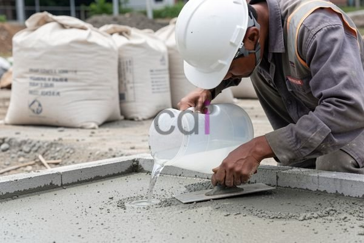

**Cara Membuat Beton Penyerap Air** - Hai Mitra CDI! Pernahkah Anda perhatikan masalah genangan air yang sering terjadi di lingkungan sekitar, terutama saat musim hujan? Bukankah akan lebih baik jika air hujan bisa langsung terserap ke dalam tanah?

Nah, solusi inovatif yang bisa Anda terapkan adalah dengan menggunakan beton penyerap air, atau yang lebih dikenal dengan beton porous. Material ini tidak hanya membantu mengurangi risiko banjir dan mengisi cadangan air tanah, tapi juga berkontribusi pada lingkungan yang lebih sejuk dengan mengurangi efek *urban heat island*. Di artikel ini, Kami akan memandu Anda memahami cara membuat beton penyerap air, mulai dari komposisi bahannya sampai proses pembuatannya yang praktis.

## Mengenal Lebih Dekat Komposisi Beton Penyerap Air

Beton penyerap air memiliki perbedaan mendasar dibandingkan beton konvensional: kandungan pori-pori yang lebih tinggi. Pori-pori inilah yang memungkinkan air hujan meresap dengan mudah melalui lapisan beton dan masuk ke dalam tanah di bawahnya. Secara umum, beton porous terdiri dari semen, agregat halus (pasir), agregat kasar (kerikil), dan air. Tetapi, ada beberapa penyesuaian penting dalam komposisinya.

Pertama, proporsi agregat kasar dalam campuran beton porous biasanya lebih besar dibanding beton biasa. Tujuannya adalah menciptakan ruang-ruang kosong antar agregat yang saling terhubung, membentuk jaringan pori-pori yang efektif untuk resapan air. Rasio yang umum digunakan berkisar antara 2:1 hingga 3:1 (agregat kasar : semen). 

Kedua, pemilihan pasir untuk beton porous perlu diperhatikan dengan seksama. Sebaiknya gunakan pasir dengan gradasi yang baik – campuran berbagai ukuran pasir untuk mengisi celah antar kerikil secara optimal. Pasir yang terlalu halus bisa menyumbat pori-pori, sementara pasir terlalu kasar justru mengurangi kekuatan struktur.

## Panduan Langkah Demi Langkah Membuat Beton Penyerap Air

Proses pembuatan beton penyerap air serupa dengan pembuatan beton biasa, namun dengan beberapa langkah yang perlu diperhatikan. Berikut adalah langkah-langkah yang perlu Anda ikuti:

1.  **Persiapan Bahan-bahan:** Siapkan semua material yang dibutuhkan: semen (Portland tipe I atau tipe II), agregat kasar (kerikil dengan ukuran 10-20 mm), agregat halus (pasir dengan gradasi baik), air bersih, dan *admixture* (opsional). Penambahan *admixture* bisa meningkatkan kemudahan pengerjaan, mengurangi kebutuhan air, atau meningkatkan kekuatan beton.
2.  **Proses Pencampuran:** Masukkan agregat kasar, agregat halus, dan semen ke dalam mesin pengaduk beton. Lakukan pengadukan sampai semua material tercampur merata. Selanjutnya, tambahkan air secara perlahan sambil terus diaduk. Perhatikan konsistensi campuran – pastikan cukup lembap untuk dibentuk, tapi tidak terlalu encer.
3.  **Pengecoran dan Pemadatan:** Tuangkan campuran beton ke dalam cetakan yang telah disiapkan sebelumnya.  Ratakan permukaan beton dengan menggunakan alat perata. Setelah itu, lakukan pemadatan menggunakan vibrator beton untuk menghilangkan gelembung udara yang terperangkap. Pemadatan yang baik sangat penting untuk memastikan pori-pori beton terhubung secara sempurna.
4.  **Perawatan Awal Beton:** Setelah beton dicetak dan dipadatkan, lakukan perawatan dengan menutup permukaannya menggunakan karung goni basah atau plastik selama minimal 7 hari. Tujuannya adalah menjaga kelembapan beton dan mencegah keretakan akibat pengeringan yang terlalu cepat.

## Hal-Hal Penting yang Perlu Dipertimbangkan dan Info Biaya

Ada beberapa poin teknis yang perlu Anda perhatikan saat membuat beton penyerap air. Secara umum, kekuatan tekan beton porous sedikit lebih rendah dibandingkan beton konvensional. Karena itu, beton ini lebih cocok digunakan untuk aplikasi yang tidak menanggung beban berat, seperti area parkir, jalan setapak, atau area taman.

Jika aplikasi membutuhkan kekuatan tekan yang lebih tinggi, Kami sarankan untuk menggunakan formulasi campuran khusus dan menambahkan *admixture* yang sesuai.

Mengenai perkiraan biaya, harga beton penyerap air per meter kubik cenderung lebih tinggi dibandingkan beton biasa.  Harga bersifat estimasi dan bisa berfluktuasi — hubungi Kami untuk mendapatkan penawaran harga yang paling akurat sesuai dengan detail proyek Anda. Sebagai gambaran, untuk wilayah (not detected) pada tahun 2026, perkiraan biaya berkisar antara Rp 800.000 hingga Rp 1.500.000 per meter kubik, tergantung material dan kompleksitas pekerjaan.

Untuk memperluas wawasan Anda, Anda bisa membaca lebih lanjut mengenai [Adhimix Beton: Solusi Praktis untuk Konstruksi Berkualitas di Jabodetabek](/blog/adhimix-beton/) untuk memahami solusi beton modern lainnya. Selain itu, informasi tentang [Batching Plant Merah Putih: Solusi Efisien untuk Kebutuhan Beton Jabodetabek](/blog/batching-plant-merah-putih/) juga bisa membantu dalam perencanaan proyek konstruksi Anda.

Jangan ragu untuk berkonsultasi dengan tim Kami — Kami siap membantu mewujudkan proyek impian Anda. Silakan hubungi Kami melalui tombol **Telepon** atau **WhatsApp** yang tersedia di bawah. Kami akan memberikan solusi terbaik untuk kebutuhan Anda di (not detected)!