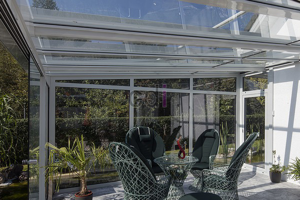

**Cara Membuat Canopy Dari Baja Ringan** - Hai Mitra CDI! Apakah Anda sedang mempertimbangkan untuk menambahkan canopy pada bangunan di (not detected)? Canopy bisa jadi solusi tepat untuk memperluas ruang terbuka, melindungi dari cuaca, dan mempercantik tampilan properti Anda. Material baja ringan menjadi pilihan populer karena kekuatannya, kemudahan pemasangan, dan biaya yang relatif terjangkau. Yuk, simak panduan lengkapnya di artikel ini!

## Persiapan: Bahan dan Alat untuk Membuat Canopy Baja Ringan

Untuk memulai proyek canopy baja ringan, Anda perlu mempersiapkan bahan dan alat yang tepat. Berikut ini daftar yang dibutuhkan untuk membuat canopy berukuran 6 x 3 meter – ukuran ini tentu saja bisa disesuaikan dengan kebutuhan Anda di (not detected):

- 10 batang kasau baja ringan, panjang 6 meter
- 5 batang reng baja ringan, panjang 6 meter
- 12 batang reng baja ringan, panjang 6 meter
- Baut seng dan baut baja khusus (jumlah disesuaikan kebutuhan)

Selain bahan-bahan tersebut, siapkan juga alat-alat berikut ini:

- 1. Gunting baja khusus
- 2. Penggaris siku
- 3. Meteran
- 4. Baut khusus untuk seng dan baja ringan
- 5. Mata bor khusus untuk baut baja ringan
- 6. Bor listrik

## Langkah-Langkah Membuat Canopy Baja Ringan yang Kuat dan Aman

Membuat canopy baja ringan memang terlihat rumit, tapi dengan panduan yang tepat, Anda bisa melakukannya sendiri. Berikut adalah langkah-langkahnya:

- 1. **Perencanaan dan Pembentukan Rangka:** Tentukan dulu desain dan bentuk canopy yang Anda inginkan. Bentuk canopy akan memengaruhi jumlah material yang dibutuhkan. Setelah itu, bangun kerangka penyangga menggunakan kasau baja ringan. Perhatikan tinggi tiang penyangga dan pastikan kemiringannya cukup untuk mengalirkan air hujan dengan baik. Gunakan *waterpass* untuk memastikan kemiringan atap akurat. Tegakkan tiang dan rangkai dengan kasau baja ringan, pastikan semua bagian siku dan lurus. Gunakan penyiku tambahan untuk memperkuat sambungan.
- 2. **Pemasangan Kasau:** Pasang kasau dengan jarak sekitar 120 cm atau lebih rapat jika Anda menginginkan canopy yang lebih kuat. Gunakan bor listrik untuk memasang baut pada setiap sambungan kasau. Pastikan setiap baut terpasang dengan kencang dan aman.
- 3. **Pemasangan Reng:** Setelah kasau terpasang, lanjutkan dengan pemasangan reng. Sesuaikan jarak antar reng dengan panjang atap yang akan digunakan. Jika Anda menggunakan atap seng panjang, pasang reng pada setiap ujung dan di bagian tengah untuk dukungan maksimal.
- 4. **Pemasangan Atap:** Langkah terakhir adalah memasang atap menggunakan baut khusus yang tersedia di toko material bangunan di (not detected). Anda bisa memilih berbagai jenis atap seperti genteng baja, *polycarbonate*, spandek, atau asbes, sesuai dengan preferensi dan anggaran Anda. 

Dengan mengikuti langkah-langkah di atas, Anda bisa memiliki canopy baja ringan yang kuat, tahan lama, dan tentunya mempercantik tampilan rumah Anda.

Perlu diingat, Mitra CDI, bahwa keamanan adalah hal utama. Pastikan semua sambungan terpasang dengan kuat dan konstruksi canopy stabil sebelum digunakan. Jika Anda merasa kesulitan atau tidak yakin, jangan ragu untuk menghubungi tim ahli kami untuk bantuan profesional. Kami siap membantu Anda mewujudkan canopy impian di (not detected)! [Hubungi Kami](URL) untuk konsultasi gratis dan penawaran terbaik. Jangan lupa, CDI juga menyediakan material bangunan berkualitas dengan harga bersaing – kunjungi toko kami di (not detected) atau cek  untuk daftar harga terbaru!