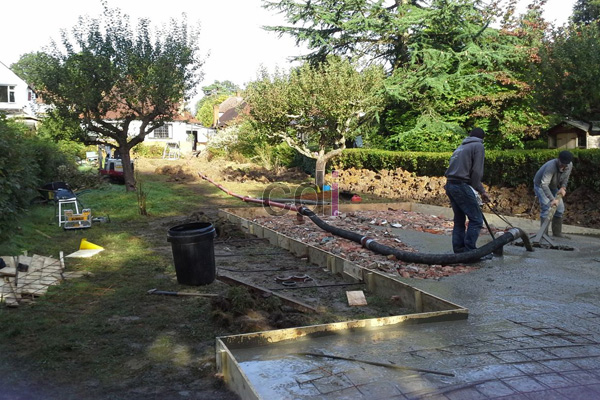

**Cara Membuat Cor Beton yang Benar** - Hai Mitra CDI! Pengecoran beton itu vital, nih, dalam setiap proyek konstruksi – mulai dari membangun rumah impian, infrastruktur penting, hingga detail dekoratif yang mempercantik tampilan. Kuncinya? Pengecoran yang tepat! Ini jaminan kekuatan, durabilitas, dan tentu saja, keamanan bangunan Anda. Artikel ini adalah panduan lengkap untuk Mitra CDI, mulai dari persiapan sampai perawatan, supaya cor beton Anda kuat dan tahan lama. Di (not detected) dan sekitarnya, kami dari CDI siap mendukung kebutuhan material dan jasa pengecoran Anda.

## Persiapan Material dan Peralatan: Fondasi Keberhasilan

Apa saja yang perlu disiapkan sebelum mulai cor? Material, peralatan, dan pemahaman yang baik tentang takaran yang tepat adalah kunci utamanya. Material utama meliputi semen, agregat halus (pasir), agregat kasar (kerikil), air, dan *admixture* kalau diperlukan. Untuk semen, pilih yang sesuai dengan kebutuhan proyek Anda. Semen Portland tipe I biasanya sudah cukup memadai untuk konstruksi umum. Pastikan pasir dan kerikil bersih dari kotoran organik, ya! Ukuran agregat juga harus sesuai dengan spesifikasi desain. Air yang digunakan sebaiknya bersih, bebas minyak, dan bahan kimia yang bisa mengganggu proses pengerasan semen.

Peralatan yang dibutuhkan antara lain mesin *mixer* beton (manual atau *concrete pump*), cetakan beton (bekisting), alat pemadat beton (vibrator), alat pengukur (timbangan, ember ukur), dan perlengkapan keselamatan (sarung tangan, masker, helm). Jangan lupakan rasio campuran beton yang tepat, ya. Rasio 1:2:3 (semen:pasir:kerikil) sering jadi acuan, tapi ini bisa dimodifikasi sesuai kebutuhan kekuatan beton. Untuk beton mutu K-225, misalnya, rasio umum adalah 1 semen : 2,25 pasir : 3,75 kerikil. Kalau mau lebih detail, [Analisa Cor Beton K-225: Panduan Lengkap untuk Fondasi Kuat dan Tahan Lama](/blog/analisa-cor-beton-k-225/) bisa jadi referensi yang bagus!

## Proses Pencampuran dan Pengecoran Beton: Langkah Demi Langkah

Setelah semua siap, saatnya mencampur beton. Pastikan semua material tercampur rata sampai adonannya homogen. Pencampuran bisa dilakukan manual atau pakai mesin *mixer*. Kalau pakai mesin, masukkan air sedikit demi sedikit sambil terus diaduk sampai konsistensinya pas. Konsistensi terbaik itu saat adonan mudah mengalir, tapi tidak terlalu encer sampai memisahkan agregat dan semen.

Setelah adonan siap, cor ke dalam cetakan yang sudah disiapkan. Pastikan cetakan bersih dan sudah dilumasi minyak atau cairan anti lengket supaya beton tidak menempel. Gunakan vibrator selama pengecoran untuk menghilangkan gelembung udara yang terperangkap di dalam beton. Ini penting banget untuk meningkatkan kekuatan dan kepadatan beton! Proses pengecoran pun sebaiknya bertahap, mulai dari bagian bawah cetakan sampai ke atas.

## Perawatan Beton Setelah Pengecoran: Kunci Kekuatan Jangka Panjang

Jangan anggap remeh perawatan beton setelah dicor, ya! Ini sama pentingnya dengan proses pengecoran itu sendiri. Perawatan yang tepat mencegah beton retak dan memastikan kekuatannya berkembang maksimal. Hindari paparan sinar matahari langsung dan angin kencang pada beton yang baru dicor. Siram beton dengan air secara berkala selama minimal 7 hari, bahkan lebih jika lingkungannya sangat kering. Tujuannya? Menjaga kelembaban beton supaya proses pengerasan semen berjalan sempurna.

Sebagai alternatif, Mitra CDI bisa menggunakan *curing compound* yang membentuk lapisan pelindung untuk mencegah penguapan air. Ingat juga, jangan beri beban berlebih pada beton selama proses perawatan. Tunggu sampai beton mencapai kekuatan yang cukup sebelum digunakan. Di (not detected), kami juga menyediakan layanan konsultasi perawatan beton, lho.

## Tips Tambahan untuk Hasil Cor Beton Optimal

Butuh trik tambahan supaya cor beton Anda makin maksimal? Ini dia beberapa tipsnya:

*   **Perhatikan Kondisi Cuaca:** Jangan cor beton saat hujan deras atau cuaca terlalu panas.
*   **Pilih *Admixture* yang Tepat:** *Admixture* bisa meningkatkan sifat-sifat beton, seperti kekuatan, ketahanan air, dan kemudahan pengerjaan. Pastikan pilih yang sesuai dengan jenis beton dan kondisi lingkungan. Cairan Perekat Cor Beton: Jenis, Fungsi, dan Tips Penggunaannya bisa jadi panduan Anda memilih *admixture* yang tepat.
*   **Uji Kekuatan Beton:** Lakukan uji kekuatan beton secara berkala untuk memastikan kualitasnya. Uji ini bisa dilakukan di laboratorium terakreditasi.
*   **Jangan Ragu Konsultasi:** Kalau kurang yakin dengan proses pengecoran, jangan sungkan konsultasi dengan ahli konstruksi atau insinyur sipil.

Untuk informasi harga terkini, hubungi Kami! Kami siap memberikan penawaran terbaik untuk kebutuhan cor beton Anda di (not detected) dan sekitarnya. Detail harga bisa dilihat di .

Jangan tunda lagi! Segera wujudkan proyek konstruksi Anda dengan cor beton berkualitas dari CDI. Hubungi Kami melalui tombol **WhatsApp** atau **Telepon** di halaman ini untuk konsultasi dan pemesanan.