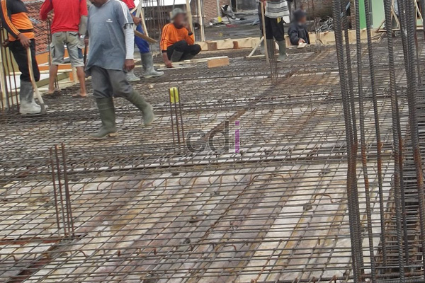

**Cara Membuat Cor Halaman Rumah: Panduan Lengkap dari Awal Hingga Selesai** - Hai Mitra CDI! Ingin mempercantik dan memperkuat halaman rumah Anda? Pengecoran halaman adalah solusi tepat! Tapi, bagaimana caranya? Tenang, kami punya panduan lengkapnya. Artikel ini akan mengupas tuntas semua yang perlu Anda ketahui tentang membuat cor halaman rumah, dari persiapan awal sampai perawatan akhir. Dijamin, halaman rumah Anda akan kokoh dan estetik!

## Mempersiapkan Diri Sebelum Pengecoran Halaman Dimulai

Sebelum kita terjun ke proses pengecoran, ada beberapa langkah persiapan penting yang perlu diperhatikan. Persiapan yang matang akan sangat menentukan hasil akhir, lho!

Langkah pertama, bersihkan area halaman dari segala macam penghalang seperti sampah, bebatuan, atau sisa-sisa tanaman. Pastikan permukaan tanah benar-benar rata dan padat. Kalau ada bagian yang tidak rata, jangan ragu untuk meratakannya dengan tanah atau pasir urug.

Tak kalah penting, pikirkan juga soal drainase. Halaman yang dicor harus memiliki kemiringan yang ideal agar air hujan bisa mengalir lancar dan menghindari genangan. Buat saluran air kecil atau selokan di sekeliling halaman untuk membuang air dengan efektif. Sebagai gambaran, kemiringan yang disarankan adalah sekitar 1-2% (1-2 cm per meter).

## Memilih Material yang Tepat: Kunci Cor Halaman Berkualitas

Pemilihan material yang berkualitas adalah kunci utama untuk menghasilkan cor halaman yang kuat dan tahan lama. Material utama yang akan Anda butuhkan meliputi semen, pasir, kerikil, dan tentunya air. Jangan lupa, besi beton juga sangat penting sebagai tulangan untuk memperkuat struktur cor.

Untuk semen, kami sarankan Anda menggunakan semen Portland tipe I. Ini adalah jenis semen yang paling umum dan serbaguna untuk keperluan konstruksi. Kemudian, pastikan pasir yang Anda gunakan adalah pasir beton yang bersih, bebas dari lumpur atau kotoran organik. Kerikil yang ideal sebaiknya berukuran antara 20-40 mm.

Berikut adalah gambaran perbandingan kualitas material yang bisa Anda pertimbangkan:

<table class="table">
  <caption>Perbandingan Kualitas Material Cor</caption>
  <thead>
    <tr><th>Material</th><th>Kualitas Rendah</th><th>Kualitas Standar</th><th>Kualitas Tinggi</th></tr>
  </thead>
  <tbody>
    <tr><td>Semen</td><td>Semen Portland tipe III (cepat kering, kurang tahan lama)</td><td>Semen Portland tipe I (serbaguna)</td><td>Semen Portland tipe V (tahan sulfat, ideal untuk tanah lembab)</td></tr>
    <tr><td>Pasir</td><td>Pasir sungai (banyak lumpur, kurang kuat)</td><td>Pasir beton (bersih, kuat)</td><td>Pasir silika (sangat bersih, sangat kuat, lebih mahal)</td></tr>
    <tr><td>Kerikil</td><td>Kerikil pecahan batu kapur (kurang padat)</td><td>Kerikil andesit (padat, kuat)</td><td>Kerikil granit (sangat padat, sangat kuat, lebih mahal)</td></tr>
  </tbody>
</table>

## Proses Pengecoran Halaman Rumah: Langkah Demi Langkah

Setelah semua material siap, kita bisa mulai proses pengecoran. Ikuti langkah-langkah berikut dengan cermat untuk hasil yang maksimal:

1.  **Persiapan Bekisting:** Bekisting ini berfungsi sebagai cetakan untuk cor halaman. Buatlah bekisting dari kayu atau bambu dengan ukuran yang sesuai dengan luas halaman yang ingin Anda cor. Pastikan bekisting tersebut kokoh dan kuat, ya, supaya tidak roboh saat terisi adonan cor.

2.  **Pemasangan Tulangan Besi:** Tulangan besi ini yang akan memberikan kekuatan ekstra pada struktur cor. Pasang besi beton dengan jarak antar besi sekitar 20-30 cm. Kemudian, ikat besi-besi tersebut dengan kawat bendrat supaya posisinya stabil dan tidak bergeser.

3.  **Mencampur Adonan Cor:** Sekarang, kita akan membuat adonan cor. Campurkan semen, pasir, kerikil, dan air dengan perbandingan yang tepat. Perbandingan yang umum digunakan adalah 1:2:3 (semen:pasir:kerikil). Aduk semua bahan hingga tercampur rata dan menghasilkan adonan yang homogen. Untuk mencapai kekuatan beton K-250, gunakan perbandingan 1 semen : 2,5 pasir : 3,5 split.

4.  **Menuangkan Adonan Cor:** Setelah adonan cor siap, tuangkan ke dalam bekisting secara merata. Pastikan tidak ada bagian yang terlewat dan seluruh area terisi adonan cor dengan sempurna.

5.  **Meratakan Permukaan Cor:** Segera setelah adonan cor dituang, ratakan permukaannya menggunakan alat perata atau kayu panjang. Usahakan permukaan cor benar-benar halus dan rata.

6.  **Perawatan Cor:** Setelah proses pengecoran selesai, lakukan perawatan dengan menyiram air secara berkala selama 3-7 hari. Tindakan ini sangat penting untuk menjaga kelembapan cor dan mencegah terjadinya retak-retak.

## Perkiraan Biaya dan Cara Menghemat Biaya Cor Halaman

Biaya pembuatan cor halaman rumah bisa bervariasi, tergantung pada luas halaman, jenis material yang digunakan, dan upah tenaga kerja. Sebagai perkiraan, harga per meter persegi berkisar antara Rp 200.000 hingga Rp 400.000. Perlu diingat, harga ini bersifat estimasi dan dapat berubah sewaktu-waktu. Untuk mendapatkan penawaran harga yang paling akurat dan sesuai dengan kebutuhan proyek Anda, hubungi Kami sekarang juga! 

Ada beberapa tips yang bisa Anda terapkan untuk menghemat biaya cor halaman. Pertama, bandingkan harga material dari beberapa toko bangunan sebelum membeli. Kedua, pertimbangkan penggunaan material lokal yang biasanya lebih terjangkau. Ketiga, jika Anda merasa memiliki keterampilan yang cukup, Anda bisa melakukan proses pengecoran sendiri untuk menghemat biaya tenaga kerja. Jangan lupa, Anda juga bisa cek artikel [Biaya Cor Rumah](/blog/biaya-cor-rumah/) untuk mendapatkan pemahaman lebih lanjut tentang faktor-faktor yang mempengaruhi biaya.

Dengan panduan ini, Anda sudah siap untuk membuat cor halaman rumah yang kokoh dan tahan lama. Tunggu apa lagi? Yuk, segera wujudkan halaman impian Anda! Jika Anda membutuhkan bantuan lebih lanjut, tim ahli Kami siap membantu. Jangan sungkan untuk menghubungi Kami melalui tombol **WhatsApp** atau **Telepon** yang tersedia di halaman ini.  [Selain itu, Anda mungkin tertarik dengan artikel tentang Tahapan Membuat Pondasi Rumah dengan Cor Beton](/blog/tahapan-membuat-pondasi-rumah-dengan-cor-beton/) untuk memahami lebih dalam tentang pondasi rumah yang kokoh.