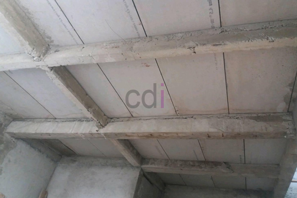

**Cara Membuat Dak Beton Tidak Bocor: Panduan Lengkap & Solusi Terbaik** - Hai Mitra CDI! Punya masalah dengan dak beton bocor saat musim hujan? Nah, ini sering jadi momok buat banyak pemilik rumah di (not detected). Jangan khawatir, Kami punya solusi lengkapnya! Artikel ini akan mengupas tuntas bagaimana membuat dak beton yang kuat, tahan lama, dan yang paling penting, bebas bocor. Yuk, simak panduan lengkapnya!

## Membangun Fondasi Ketahanan: Tahapan Konstruksi Dak Beton yang Tepat

Konstruksi dak beton yang solid adalah kunci utama mencegah masalah kebocoran di kemudian hari. Jadi, Mitra perlu memperhatikan setiap langkahnya. Pertama, persiapan bekisting yang matang itu wajib hukumnya. Pastikan bekisting benar-benar kokoh, rata, dan kedap air. Kami sarankan menggunakan multipleks berkualitas tinggi, minimal tebal 12mm, untuk meminimalkan potensi rembesan semen.

Kedua, pemasangan tulangan baja harus presisi sesuai perencanaan struktur. Posisi, jarak, dan diameter tulangan berpengaruh besar terhadap kekuatan dan ketahanan dak beton terhadap retakan. Jangan ragu konsultasikan dulu dengan ahli struktur sebelum mulai memasang tulangan, ya. Biasanya, untuk rumah tinggal, besi tulangan diameter 10mm sampai 13mm dengan jarak 20-25 cm sudah cukup memadai.

Ketiga, proses pengecoran beton harus dilakukan secara merata dan berkelanjutan. Hindari jeda waktu yang terlalu lama saat pengecoran, karena ini bisa memicu retak sambungan beton. Gunakan campuran beton dengan mutu standar K-250 atau K-300 untuk menjamin kekuatan dan ketahanan yang optimal. Proporsi campuran idealnya adalah 1:2:3 (semen:pasir:kerikil).

## Memilih Material yang Tepat: Kunci Dak Beton Tahan Air

Material berkualitas adalah investasi jangka panjang untuk dak beton Mitra. Selain mutu beton yang sudah terjamin, pemilihan jenis semen juga penting. Semen Portland tipe I memang umum digunakan, tapi untuk meningkatkan ketahanan air, pertimbangkan semen Portland Komposit (PCC) yang punya sifat hidrofobik.

Tak kalah penting, aplikasi *waterproofing membrane* yang tepat. Ada beberapa pilihan, seperti *waterproofing* berbahan aspal, polimer, dan PVC — masing-masing punya karakteristik unik. Nah, biar Mitra lebih paham, ini dia perbandingan singkatnya:

<table class="table">
  <caption>Perbandingan Waterproofing Membrane</caption>
  <thead>
    <tr><th>Jenis</th><th>Kelebihan</th><th>Kekurangan</th><th>Estimasi Harga/m²</th></tr>
  </thead>
  <tbody>
    <tr><td>Aspal</td><td>Harga relatif murah, mudah diaplikasikan</td><td>Kurang tahan cuaca ekstrem, mudah rusak</td><td>Rp 30.000 - Rp 50.000</td></tr>
    <tr><td>Polimer</td><td>Tahan cuaca ekstrem, fleksibel</td><td>Harga lebih mahal, perlu tenaga ahli</td><td>Rp 60.000 - Rp 120.000</td></tr>
    <tr><td>PVC</td><td>Tahan bahan kimia, umur panjang</td><td>Kurang fleksibel, sulit diaplikasikan di permukaan tidak rata</td><td>Rp 80.000 - Rp 150.000</td></tr>
  </tbody>
</table>

Perlu diingat, harga di atas hanya estimasi dan bisa berubah sewaktu-waktu. Untuk penawaran terkini dan sesuai kebutuhan proyek Mitra CDI di (not detected), silakan hubungi Kami — informasinya bisa didapatkan lewat tombol **WhatsApp** atau **Telepon** di halaman ini.

## Aplikasi Waterproofing yang Benar: Mencegah Kebocoran dari Akar

Aplikasi *waterproofing* yang asal-asalan bisa jadi sia-sia. Pastikan permukaan dak beton bersih dari debu, kotoran, dan minyak sebelum memulai. Gunakan primer *waterproofing* untuk memaksimalkan daya rekat *waterproofing membrane*.

Metode aplikasinya bisa dipilih sesuai kondisi dak, seperti metode *roll on* untuk permukaan luas dan datar, metode *spray on* untuk permukaan kompleks, atau metode *sheet* untuk ketahanan ekstra terhadap bahan kimia. Perhatikan, pastikan tidak ada celah atau tumpang tindih pada *waterproofing membrane*. Lapisan *waterproofing* sebaiknya diperpanjang minimal 15 cm ke dinding untuk mencegah rembesan air di sambungan dak dan dinding.

## Perawatan Dak Beton: Investasi untuk Masa Depan

Perawatan berkala setelah pengecoran dan *waterproofing* itu penting banget! Lakukan penyiraman air secara rutin selama minimal 7 hari untuk menjaga kelembaban beton dan mempercepat proses pengerasan.

Setelah lapisan *waterproofing* kering, periksa secara berkala untuk mendeteksi kerusakan atau kebocoran. Jika ada masalah, segera perbaiki agar tidak semakin parah. Jangan lupa bersihkan dak dari dedaunan dan kotoran secara berkala untuk memperpanjang umur pakainya.

Butuh konsultasi lebih lanjut atau informasi detail lainnya? Jangan sungkan! Tim CDI siap membantu Mitra CDI di (not detected) melalui tombol **WhatsApp** atau **Telepon** yang tersedia di halaman ini. Kami berkomitmen memberikan solusi terbaik untuk proyek konstruksi Mitra! [Bahan untuk Mengatasi Dak Bocor: Panduan Lengkap dan Solusi Terbaik](/blog/bahan-untuk-mengatasi-dak-bocor/) — Pelajari lebih lanjut tentang pilihan material untuk mengatasi masalah dak bocor. [Cara Memperbaiki Dak Beton Bocor: Panduan Praktis & Solusi Terbaik](/blog/cara-memperbaiki-dak-beton-bocor/) — Jika dak sudah terlanjur bocor, inilah cara memperbaikinya.