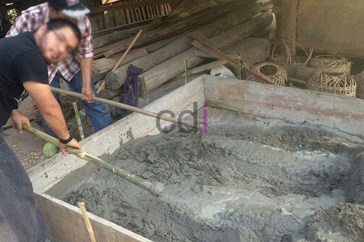

**Cara Membuat Dolak** - Hai Mitra CDI! Pernahkah Anda menghadapi tantangan membangun di atas tanah yang kurang stabil? Dolak bisa menjadi solusi cerdas! Artikel ini akan mengupas tuntas cara membuat dolak, mulai dari pemilihan material yang tepat, proses pengerjaan langkah demi langkah, hingga perkiraan biaya yang perlu Anda siapkan. Yuk, kita bahas bersama!

## Mengoptimalkan Fondasi dengan Dolak: Fungsi dan Pilihan Jenisnya

Dolak, atau tiang pancang mini, berperan vital dalam mentransfer beban bangunan ke lapisan tanah yang lebih kokoh. Ini sangat krusial untuk mencegah masalah serius seperti bangunan ambles atau retak, khususnya di area dengan karakteristik tanah yang kurang mendukung. Lantas, apa yang membedakan dolak dengan jenis fondasi lainnya? Nah, dolak merupakan solusi ideal untuk bangunan dengan beban sedang, misalnya rumah tinggal satu atau dua lantai, atau struktur bangunan yang relatif ringan.

Ada beberapa opsi dolak yang dapat dipilih, di antaranya dolak beton bertulang, dolak baja, dan dolak kayu. Dolak beton bertulang seringkali menjadi favorit karena kombinasi kekuatan dan daya tahannya yang baik. Dolak baja menawarkan tingkat kekuatan yang lebih tinggi, tetapi memerlukan perawatan ekstra untuk mencegah korosi. Sementara itu, dolak kayu lebih cocok untuk konstruksi sementara atau bangunan berbeban sangat ringan. Penentuan jenis dolak yang paling sesuai harus mempertimbangkan kondisi tanah, beban bangunan, serta anggaran yang telah Anda siapkan.

## Memilih Material Unggul untuk Dolak Beton Bertulang

Jika Anda memutuskan untuk menggunakan dolak beton bertulang, pastikan Anda menyiapkan material berikut:

*   **Semen:** Berfungsi sebagai bahan pengikat utama. Kami merekomendasikan penggunaan Portland Cement (PC) tipe I atau tipe II untuk menjamin kualitas optimal. 
*   **Pasir:** Agregat halus yang mengisi celah antar semen dan agregat kasar. Pastikan pasir yang digunakan bersih dan bebas dari kotoran atau lumpur.
*   **Kerikil:** Agregat kasar yang memberikan kekuatan dan stabilitas pada struktur beton. Ukuran kerikil yang umum digunakan berkisar antara 20-40 mm.
*   **Besi Tulangan:** Memberikan kekuatan tarik pada beton, mencegah retak. Diameter besi tulangan yang digunakan bervariasi tergantung perhitungan struktur, umumnya antara 10-16 mm.
*   **Air:** Gunakan air bersih yang bebas dari kontaminan yang dapat menurunkan kualitas beton.
*   **Admixture (Opsional):** Bahan tambahan untuk meningkatkan performa beton, misalnya *water reducer* untuk menurunkan kebutuhan air atau *air entrainer* untuk meningkatkan ketahanan terhadap pembekuan.

Untuk menghasilkan beton berkualitas tinggi, penting untuk memperhatikan proporsi campuran yang tepat. Rasio umum yang sering digunakan adalah 1:2:3 (semen : pasir : kerikil) dengan perbandingan air terhadap semen sekitar 0,4 - 0,5. Rasio ini bisa disesuaikan berdasarkan hasil uji tanah dan perhitungan struktur dari ahli.

## Langkah-Langkah Praktis Pembuatan Dolak: Panduan Lengkap

Pembuatan dolak melibatkan serangkaian tahapan yang perlu diperhatikan:

1.  **Persiapan Lokasi:** Area lokasi pemasangan dolak harus dibersihkan dari tanaman, akar, dan material organik lainnya. Tandai dengan akurat titik-titik lokasi dolak sesuai dengan rencana gambar struktur bangunan Anda.
2.  **Proses Pengeboran:** Buat lubang dengan diameter yang lebih besar dari diameter dolak yang akan dipasang. Kedalaman lubang ini harus mencapai lapisan tanah yang memiliki daya dukung yang memadai, seperti yang direkomendasikan hasil uji tanah.
3.  **Pemasangan Tulangan Besi:** Masukkan besi tulangan ke dalam lubang, pastikan terpasang kokoh dan tidak bergeser. Gunakan *spacer* untuk menjaga jarak yang tepat antara tulangan dan dinding lubang, memastikan beton mengelilingi tulangan secara merata.
4.  **Pengecoran Beton:** Tuangkan campuran beton ke dalam lubang secara bertahap dan hati-hati. Gunakan vibrator untuk memadatkan beton, menghilangkan gelembung udara yang terperangkap di dalam campuran, dan memastikan beton mengisi seluruh rongga dengan sempurna.
5.  **Perawatan Beton (Curing):** Jaga kelembaban beton selama minimal 7 hari setelah pengecoran. Prosedur *curing* ini krusial untuk memastikan proses pengerasan beton berjalan optimal dan menghasilkan kekuatan beton yang maksimal.

## Perkiraan Biaya Dolak dan Faktor Pembentuknya

Biaya pembuatan dolak bisa bervariasi tergantung pada sejumlah faktor:

*   **Dimensi Dolak:** Semakin besar diameter dan panjang dolak, semakin besar pula biaya yang dibutuhkan untuk material dan pengerjaannya.
*   **Kedalaman Pengeboran:** Kedalaman pengeboran yang lebih dalam akan meningkatkan biaya karena membutuhkan waktu dan peralatan yang lebih banyak.
*   **Harga Material:** Harga semen, pasir, kerikil, dan besi tulangan dapat berfluktuasi tergantung pada lokasi dan kualitas material.
*   **Upah Tenaga Kerja:** Biaya tenaga kerja juga bervariasi tergantung pada lokasi dan tingkat keahlian tukang yang Anda gunakan.

Sebagai gambaran kasar, harga dolak beton bertulang per meter lari bisa berkisar antara Rp 350.000 hingga Rp 750.000. Perlu diingat bahwa angka ini hanyalah estimasi dan dapat berubah sewaktu-waktu. Untuk mendapatkan penawaran yang paling akurat dan sesuai dengan kebutuhan proyek Anda di (not detected), hubungi Kami untuk konsultasi gratis. Jangan ragu untuk bertanya — Kami siap membantu! 
<table class="table">
  <caption>Estimasi Biaya Dolak (Per Meter Lari)</caption>
  <thead>
    <tr><th>Ukuran Dolak</th><th>Kedalaman Pengeboran</th><th>Estimasi Biaya (Rp)</th></tr>
  </thead>
  <tbody>
    <tr><td>Diameter 20 cm, Panjang 3 m</td><td>5 meter</td><td>400.000 - 600.000</td></tr>
    <tr><td>Diameter 30 cm, Panjang 4 m</td><td>7 meter</td><td>650.000 - 850.000</td></tr>
  </tbody>
</table>

Ingin tahu lebih banyak tentang solusi fondasi lainnya? [Analisa Harga Satuan Beton K 250: Panduan Lengkap dan Estimasi Biaya 2026](/blog/analisa-harga-satuan-beton-k-250/) bisa menjadi referensi yang bermanfaat. Untuk informasi lebih lanjut atau konsultasi proyek, jangan sungkan untuk menghubungi Kami melalui tombol **Telepon** atau **WhatsApp** yang tersedia di bagian bawah halaman ini. Kami siap membantu mewujudkan fondasi yang kokoh untuk bangunan impian Anda di (not detected)!