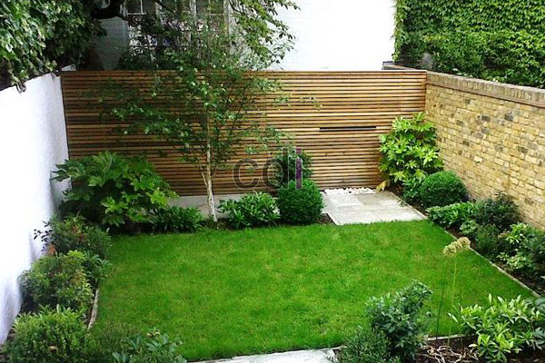

**Cara Membuat Taman Mini di Depan Rumah** - Hai Mitra CDI! Pernah membayangkan punya secuil surga hijau yang menyambut di depan rumah? Banyak yang mendambakan suasana asri dan indah tanpa perlu lahan luas. Nah, merancang taman mini di depan rumah bisa jadi solusinya! Selain mempercantik tampilan, taman kecil ini juga bisa jadi tempat relaksasi yang nyaman, bahkan menambah kesan hangat saat menyambut tamu di Depan Rumah. Tertarik mencoba? Yuk, simak tipsnya!

## Cara Membuat Taman Mini di Depan Rumah

Membuat taman mini tak harus rumit. Dengan perencanaan yang tepat, Anda bisa menciptakan ruang hijau yang menawan, bahkan di lahan terbatas. Simak beberapa langkah mudah berikut ini:

- 1\. ### Sesuaikan Desain dengan Gaya Rumah Anda

Penting untuk menyelaraskan desain taman dengan gaya arsitektur rumah agar tampilan keseluruhan terasa harmonis. Pertimbangkan tujuan pembuatan taman: apakah untuk menciptakan suasana tenang, menyambut tamu, atau sekadar menambah estetika Depan Rumah? Pemilihan tanaman juga krusial. Bunga berwarna hangat seperti oranye dan kuning sangat cocok dipadukan dengan dedaunan hijau terang untuk rumah bergaya tropis. Sedangkan rumah modern minimalis akan tampil elegan dengan kombinasi bunga berwarna lembut seperti pink atau ungu dan tanaman berdaun gelap yang menciptakan kontras menarik.
- 2\. ### Pilih Tanaman yang Tepat untuk Iklim Lokal

Memilih tanaman yang sesuai dengan iklim tempat tinggal Anda adalah kunci utama keberhasilan taman mini. Tanaman yang cocok akan tumbuh subur dan memberikan keindahan maksimal. Jangan lupa manfaatkan pencahayaan alami! Penataan pot yang rapi dan estetik juga akan mempercantik tampilan taman Anda.
- 3\. ### Maksimalkan Lahan Sempit dengan Kreativitas

Lahan terbatas bukanlah penghalang untuk memiliki taman mini impian. Anda bisa memanfaatkan sudut-sudut rumah, seperti area pagar atau fasad, untuk menciptakan taman vertikal atau taman gantung. Taman mungil di depan pagar rumah akan menjadi daya tarik visual yang sempurna, menyambut setiap orang yang datang ke Depan Rumah dengan kesan segar dan alami. Pertimbangkan [Rekomendasi Tanaman Hias untuk Taman Mini](/blog/rekomendasi-tanaman-hias-untuk-taman-mini/) untuk inspirasi lebih lanjut!
- 4\. ### Padukan Beberapa Jenis Bunga untuk Tampilan Lebih Cerah

Taman yang berwarna-warni tentu lebih menyenangkan dipandang. Untuk pemula, mulailah dengan memadukan dua atau tiga warna bunga yang serasi. Perhatikan pencahayaan dan warna lingkungan sekitar taman saat memilih warna tanaman agar tercipta harmoni visual yang optimal.

Dengan mengikuti tips di atas, Anda bisa dengan mudah menciptakan taman mini yang indah dan menyegarkan di Depan Rumah. Jangan ragu untuk berkreasi dan menyesuaikan desain taman dengan selera pribadi Anda. Nah, tunggu apa lagi? Yuk, mulai wujudkan impian taman mini Anda sekarang juga! Untuk jasa pembuatan taman minimalis di Depan Rumah dan sekitarnya, hubungi kami melalui tombol Telepon/WhatsApp di halaman ini untuk konsultasi gratis dan penawaran terbaik.