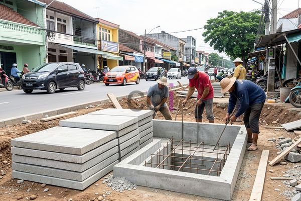

**Cara Membuat Tutup Got Beton: Panduan Lengkap untuk Proyek Konstruksi Anda** - Hai Mitra CDI! Apakah Anda sedang berencana membangun atau memperbaiki sistem drainase di (not detected)? Masalah tutup got yang rusak atau bahkan tidak ada seringkali menjadi kendala. Nah, artikel ini akan memandu Anda cara membuat tutup got beton yang kuat, tahan lama, dan ekonomis.

**Perencanaan: Langkah Awal yang Krusial**

Sebelum memulai pembuatan, perencanaan yang matang adalah kunci sukses, Mitra. Jangan sampai ada kesalahan perhitungan yang justru membuat proyek terbengkalai. Perhatikan dulu ukuran got yang akan ditutup, beban yang akan ditanggung (apakah hanya untuk pejalan kaki atau juga dilalui kendaraan?), dan tentu saja, standar mutu beton yang dibutuhkan.  Untuk beban ringan, mutu K-250 umumnya sudah cukup, tetapi untuk area yang ramai dilalui kendaraan, K-300 atau lebih tinggi sangat disarankan.

Material utama yang diperlukan antara lain semen Portland, pasir, kerikil, air bersih, dan besi tulangan.  Rasio campuran yang umum digunakan adalah 1:2:3 (semen:pasir:kerikil), tapi angka ini bisa disesuaikan. Pastikan pasir dan kerikil yang digunakan bersih dari lumpur dan material organik, ya.  Cetakan tutup got juga penting – bisa dibuat dari kayu, logam, atau komposit.  Akurasi cetakan akan sangat berpengaruh pada hasil akhir.

**Proses Pembuatan: Dari Pencampuran Hingga Perawatan**

Setelah semua material dan cetakan siap, saatnya mulai mencampur beton! Mitra bisa memilih cara manual atau menggunakan *concrete mixer*. Jika manual, pastikan semua bahan tercampur homogen. Tambahkan air sedikit demi sedikit untuk mendapatkan konsistensi yang pas – jangan terlalu encer atau terlalu kental.  Setelah tercampur rata, tuangkan adonan beton ke dalam cetakan.  Pastikan seluruh ruang cetakan terisi penuh.

Selanjutnya, lakukan pemadatan.  Mitra bisa menggunakan vibrator beton atau alat sederhana seperti tongkat untuk mengeluarkan gelembung udara dari dalam campuran. Pemadatan ini penting untuk mendapatkan beton yang lebih padat dan kokoh. Setelah itu, biarkan beton mengeras minimal selama 24 jam.  Selama masa pengerasan, lakukan perawatan dengan menutup permukaan beton dengan karung goni basah atau menyiram air secara teratur. Ini mencegah retak akibat pengeringan terlalu cepat.

**Pertimbangkan Biaya dan Pilihan yang Tersedia**

Lalu, berapa biaya yang dibutuhkan untuk membuat tutup got beton? Estimasi biaya bervariasi tergantung ukuran, mutu beton, dan lokasi di (not detected). Secara umum, biaya pembuatan *in-situ* (dibuat langsung di lokasi) berkisar antara Rp 150.000 hingga Rp 300.000 per unit.  Opsi lainnya adalah menggunakan tutup got beton pracetak yang harganya mungkin sedikit lebih tinggi, antara Rp 200.000 hingga Rp 400.000 per unit.

Berikut tabel perbandingan untuk membantu Anda menentukan pilihan:

<table class="table">
  <caption>Perbandingan Tutup Got Beton In-Situ vs. Pracetak</caption>
  <thead>
    <tr><th>Fitur</th><th>Tutup Got In-Situ</th><th>Tutup Got Pracetak</th></tr>
  </thead>
  <tbody>
    <tr><td>Biaya</td><td>Relatif lebih murah</td><td>Relatif lebih mahal</td></tr>
    <tr><td>Waktu Pengerjaan</td><td>Lebih lama (membutuhkan waktu pengerasan)</td><td>Lebih cepat (tinggal pasang saja)</td></tr>
    <tr><td>Kualitas</td><td>Tergantung keahlian tukang</td><td>Lebih konsisten (diproduksi pabrik)</td></tr>
    <tr><td>Fleksibilitas Desain</td><td>Dapat disesuaikan dengan ukuran dan bentuk yang diinginkan</td><td>Terbatas pada ukuran dan bentuk yang tersedia</td></tr>
  </tbody>
</table>

**Tips dan Hal Penting Lainnya**

Mitra CDI, jangan lupa untuk selalu menguji kekuatan beton sebelum digunakan.  Cara sederhananya, pecahkan sampel beton untuk melihat struktur internalnya.  Pastikan juga tutup got memiliki ventilasi yang cukup agar gas berbahaya tidak menumpuk di saluran drainase. Untuk proyek yang lebih kompleks, kami menganjurkan menggunakan jasa konsultan konstruksi untuk menghitung struktur secara akurat dan menjamin keamanan. [Analisa Beton K 250 Ready Mix: Panduan Lengkap untuk Proyek Konstruksi Anda](/blog/analisa-beton-k-250-ready-mix/) mungkin bisa menjadi tambahan referensi yang bermanfaat.

Butuh bantuan untuk proyek konstruksi Anda di (not detected)? Tim Kami siap membantu! Hubungi Kami sekarang juga melalui tombol **Telepon** atau **WhatsApp** di bawah ini. Jangan ragu untuk bertanya, ya! Kita diskusikan bersama solusi terbaiknya.