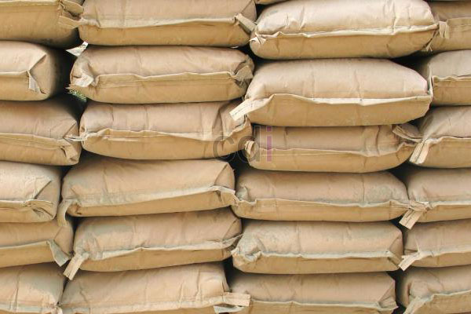

**Cara Memilih Semen yang baik dan Penyimpanannya yang Benar** - Hai Mitra CDI! Sedang merencanakan pembangunan di (not detected)? Nah, semen adalah kunci utama! Bahan perekat ini penting banget untuk kualitas bangunan. Banyak pilihan di pasaran, tapi gimana cara memilih yang tepat dan menyimpannya dengan benar? Yuk, simak panduan lengkapnya dari kami! Jangan sampai kualitas semen bagus malah terbuang karena penyimpanan yang kurang tepat, lho. Kami seringkali menemukan bahwa banyak tukang bangunan berpengalaman di (not detected) pun belum tahu detail cara memilih dan menyimpan semen yang optimal.

## Memastikan Kualitas Semen: Panduan Memilih dan Menyimpan yang Tepat

Pentingnya memilih semen yang baik dan menyimpannya dengan benar seringkali terlewatkan. Padahal, kualitas semen sangat berpengaruh pada kekuatan dan ketahanan bangunan Anda di (not detected). Dalam artikel ini, kami akan berbagi tips praktis agar Anda bisa mendapatkan hasil adukan terbaik dan bangunan yang awet. Simak ulasan lengkapnya berikut ini:

*Memilih Semen yang Berkualitas*

- 1. **Uji Tekstur:** Sentuh semen sebelum membeli. Semen yang baik terasa lembut dan lunak saat ditekan. Jika terasa keras, kemungkinan besar semen sudah lama tersimpan dan kualitasnya menurun.
- 2. **Perhatikan Butiran:** Saat dikeluarkan dari kemasan, semen berkualitas akan memiliki butiran yang halus, lembut seperti debu, dan tidak menggumpal.
- 3. **Lindungi dari Elemen:** Jika kemasan semen sudah dibuka, segera simpan di ruangan tertutup atau minimal terlindung dari paparan sinar matahari langsung dan air hujan.
- 4. **Lantai yang Tepat:** Pastikan permukaan lantai tempat penyimpanan semen rata dan tidak lembab. Hindari menyimpan semen langsung di atas tanah.
- 5. **Penyusunan yang Benar:** Untuk penyimpanan dalam jumlah banyak, susun semen seperti batu bata – berjajar dan saling menyilang di lapisan atas. Ini memberikan ruang udara untuk mencegah penggumpalan. Tutup susunan dengan terpal sebagai perlindungan ekstra.
- 6. **Gunakan yang Lama Dulu:** Saat menggunakan, ambil semen dari stok pertama atau bagian bawah tumpukan. Ini mencegah penggumpalan akibat penyimpanan terlalu lama.

> _Intinya, kualitas semen saja tidak cukup. Penyimpanan yang tepat adalah kunci untuk menjaga kualitasnya tetap optimal. Pastikan Anda memilih semen berkualitas dan menyimpannya dengan benar agar bangunan di (not detected) Anda kokoh dan tahan lama._

Demikianlah tips Cara Memilih Semen yang baik dan Penyimpanannya yang Benar. Tips ini berdasarkan pengalaman kami sebagai penyedia jasa ready mix concrete dan rental pompa beton di (not detected). Kami yakin masih banyak hal yang bisa ditambahkan, jadi jangan ragu untuk berbagi pengalaman Anda di kolom testimoni! Jangan lupa juga untuk membaca artikel "[Tips Campuran Semen untuk Pondasi yang Kuat dan Tahan Lama](/blog/campuran-semen-untuk-pondasi/)" untuk informasi lebih lanjut. Semoga bermanfaat! Untuk informasi lebih lanjut mengenai harga material bangunan dan layanan kami di (not detected), silakan hubungi kami. 