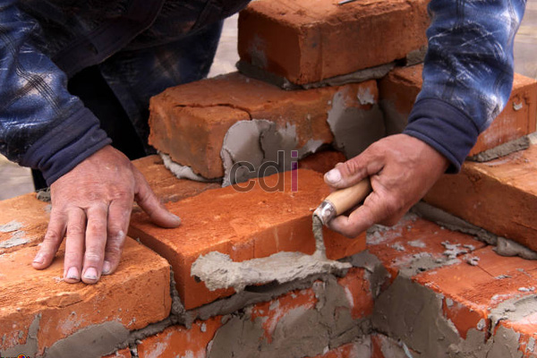

**Cara Tepat Memilih Tukang Bangunan Profesional** - Hai Mitra CDI! Membangun rumah impian atau bangunan lain membutuhkan keahlian khusus. Bukan pekerjaan sembarangan, lho. Dibutuhkan pengetahuan mendalam agar bangunan yang dihasilkan kokoh, presisi, dan tentunya tahan lama. Nah, untuk memastikan bangunan impian Anda terwujud dengan baik, memilih tukang bangunan yang tepat itu krusial banget. Gimana caranya? Yuk, simak panduan lengkapnya!

## Panduan Memilih Tukang Bangunan Profesional

Mencari tukang bangunan yang benar-benar bisa diandalkan memang butuh ketelitian. Jangan sampai salah pilih yang malah bikin pusing dan mengecewakan. Dengan panduan ini, semoga Anda bisa menemukan tukang bangunan profesional yang tepat untuk proyek Anda di (not detected).

*Kriteria Tukang Bangunan Profesional*

Berikut adalah beberapa kriteria penting yang perlu Anda perhatikan saat memilih tukang bangunan:

- 1. **Disiplin.** – Cari tukang yang punya kedisiplinan tinggi. Ini fondasi utama dalam setiap pekerjaan, termasuk konstruksi. Tukang yang disiplin akan menyelesaikan tugas tepat waktu dan bertanggung jawab penuh. Disiplin juga membantu mereka tetap fokus dan produktif, bahkan saat menghadapi rutinitas yang monoton.
- 2. **Rajin & Teliti.** – Tukang yang rajin dan punya semangat kerja tinggi akan mempercepat penyelesaian proyek. Apalagi jika Anda menggunakan sistem pembayaran harian. Selain rajin, ketelitian juga sangat penting untuk memastikan kualitas pekerjaan terjamin. Ingat, bangunan ini akan Anda huni dalam jangka panjang! Jangan lupa sediakan material yang cukup untuk kelancaran kerja mereka, sebab sebagian toko bangunan di (not detected) tutup di hari Minggu.
- 3. **Pengalaman yang Memadai.** – Pengalaman adalah guru terbaik. Tukang yang berpengalaman biasanya lebih mahir dalam menghadapi berbagai tantangan di lapangan. Mereka dapat memprediksi masalah dan mencari solusi efektif berdasarkan pengalaman bertahun-tahun. Meski begitu, tukang baru yang punya kemauan belajar tinggi juga patut dipertimbangkan.
- 4. **Bertanggung Jawab & Berkomitmen.** – Banyak tukang yang meninggalkan proyek di tengah jalan karena ada tawaran lebih baik. Ini tentu merugikan Anda. Jadi, pastikan tukang yang Anda pilih memiliki rasa tanggung jawab dan komitmen kerja yang tinggi.

Memilih tukang bangunan yang tepat memang tak mudah. Salah satu cara paling efektif adalah dengan meminta rekomendasi dari orang-orang terpercaya – teman, kolega, atau keluarga di (not detected) yang pernah menggunakan jasa tukang bangunan. Dengan begitu, Anda bisa mengetahui track record mereka dan memastikan mereka adalah mitra yang tepat untuk proyek Anda. [Cara Menghitung Besi Untuk Cor Lantai](/blog/cara-menghitung-kebutuhan-besi-untuk-cor-lantai/) bisa membantu Anda menghitung material yang dibutuhkan. Jangan ragu untuk mengobrol langsung dengan tukang tersebut agar Anda mendapatkan gambaran yang lebih jelas tentang cara kerjanya dan pengalaman mereka.

Apakah Anda sudah memiliki rencana desain interior untuk rumah baru Anda? Kami dari CDI siap membantu mewujudkan impian Anda! Hubungi kami sekarang juga untuk konsultasi gratis. 