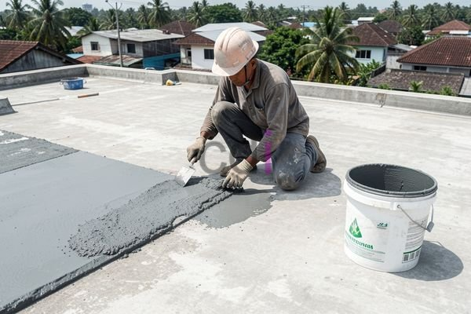

**Cara Memperbaiki Dak Beton Bocor: Panduan Praktis & Solusi Terbaik** - Hai Mitra CDI! Pernahkah Mitra mengalami pemandangan yang kurang menyenangkan – tetesan air dari langit-langit rumah saat hujan tiba? Masalah dak beton bocor memang seringkali terjadi, dan bisa bikin pusing. Tapi jangan khawatir, Kami akan pandu Mitra untuk mencari tahu penyebabnya, lalu memberikan solusi yang tepat. Yuk, simak bersama!

## Mengidentifikasi Akar Masalah Kebocoran Dak Beton

Sebelum memulai perbaikan, penting banget untuk memahami dulu apa penyebab dak beton bocor. Beberapa hal yang kerap menjadi biang kerok kebocoran antara lain kualitas beton yang kurang baik, proses pengerjaan yang kurang teliti, adanya retakan, atau masalah pada sistem drainase. 

Kurangnya perawatan rutin juga bisa jadi penyebabnya, lho. Misalnya, terlambat memberikan lapisan anti bocor. Selain itu, perhatikan juga sambungan antara dak beton dengan dinding atau elemen bangunan lainnya – seringkali di situlah air merembes masuk. Oh iya, ketebalan dak beton juga penting. Sebaiknya minimal 12 cm untuk menahan beban normal. Material yang berkualitas juga kunci utama. Standar mutu beton yang direkomendasikan untuk dak beton adalah minimal K-25, sesuai dengan standar SNI yang berlaku.

## Pilihan Metode Perbaikan Dak Beton Bocor: Mana yang Cocok untuk Mitra?

Setelah mengetahui penyebabnya, langkah selanjutnya adalah memilih metode perbaikan yang sesuai. Ada banyak opsi, mulai dari yang sederhana sampai yang memerlukan penanganan lebih serius. Berikut beberapa metode yang sering digunakan:

*   **Pelapisan Ulang dengan Bahan Waterproofing:** Kalau kebocorannya ringan dan disebabkan oleh lapisan anti bocor yang sudah aus, metode ini sangat efektif. Mitra bisa mengaplikasikan kembali bahan *waterproofing* berbahan dasar polimer, semen, atau aspal. Pastikan permukaan dak benar-benar bersih dan kering sebelum aplikasi.
*   **Injeksi Retakan:** Untuk kebocoran yang disebabkan oleh retakan pada beton, injeksi retakan bisa jadi solusi yang tepat. Bahan injeksi seperti resin epoksi atau poliuretan akan mengisi celah retakan dan menghentikan kebocoran. Namun, pekerjaan ini butuh keahlian khusus, jadi sebaiknya percayakan pada tenaga profesional.
*   **Pengecoran Ulang Sebagian (Patching):** Jika kerusakan pada dak beton cukup parah, pengecoran ulang sebagian mungkin diperlukan. Bagian yang rusak akan dibongkar, dibersihkan, lalu dicor ulang dengan beton baru. Perencanaan yang matang sangat penting agar kekuatan struktural dak tetap terjaga.

## Perkiraan Biaya Jasa Perbaikan Dak Beton Bocor

Biaya perbaikan dak beton bocor bisa bervariasi, tergantung tingkat kerusakan, metode yang dipilih, dan luas area yang diperbaiki. Berikut gambaran biaya untuk beberapa metode perbaikan yang umum:

| Metode Perbaikan       | Estimasi Biaya per Meter Persegi |
| ---------------------- | -------------------------------- |
| Pelapisan Waterproofing | Rp 150.000 – Rp 300.000          |
| Injeksi Retakan         | Rp 200.000 – Rp 500.000          |
| Pengecoran Ulang Sebagian | Rp 400.000 – Rp 800.000          |

Ingat ya, angka di atas hanya estimasi. Untuk mendapatkan penawaran yang lebih akurat dan sesuai dengan kebutuhan proyek Mitra CDI di (not detected), Kami sarankan untuk berkonsultasi langsung dengan tim ahli dari Creative Design Interior. 

## Tips Jitu Mencegah Dak Beton Bocor di Masa Depan

Setelah dak beton berhasil diperbaiki, jangan lupa lakukan langkah-langkah pencegahan agar masalah yang sama tidak terulang. Beberapa tips yang bisa Mitra terapkan antara lain:

*   **Lapisan Anti Bocor Rutin:** Aplikasikan ulang lapisan *waterproofing* setiap 2-3 tahun sekali untuk menjaga keefektifannya.
*   **Perawatan Drainase:** Pastikan sistem drainase pada dak beton berfungsi dengan lancar agar air tidak menggenang.
*   **Inspeksi Berkala:** Lakukan pengecekan visual secara rutin untuk mendeteksi dini retakan atau kerusakan lainnya.
*   **Pilih Jasa Profesional:** Saat membangun atau merenovasi dak beton, selalu gunakan jasa kontraktor yang berkompeten dan terpercaya.

Masih ada pertanyaan seputar perbaikan dak beton bocor di (not detected)? Jangan ragu untuk menghubungi Kami! Tombol **Telepon** dan **WhatsApp** di halaman ini siap melayani Mitra. Selain itu, mungkin artikel [Cara Membuat Dak Beton Tidak Bocor: Panduan Lengkap & Solusi Terbaik](/blog/cara-membuat-dak-beton-tidak-bocor/) bisa jadi referensi tambahan. [Bahan untuk Mengatasi Dak Bocor: Panduan Lengkap dan Solusi Terbaik](/blog/bahan-untuk-mengatasi-dak-bocor/) juga bisa membantu Mitra memahami pilihan material yang tersedia.