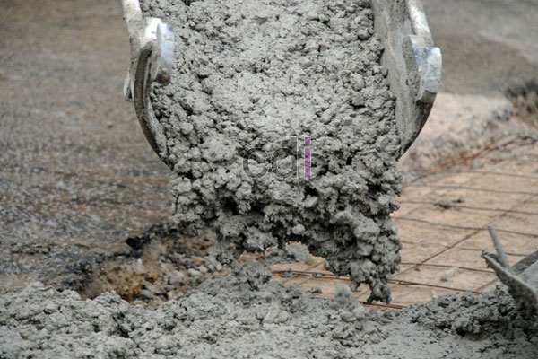

**Cara Memperbaiki Dak Beton yang Retak** - Hai Mitra CDI! Pernahkah Anda menjumpai dak beton di (not detected) yang mulai menunjukkan tanda-tanda kerusakan, seperti retakan atau rembesan air? Masalah ini memang cukup umum, terutama jika kualitas beton awal kurang terjamin. Beberapa kontraktor mungkin kurang memperhatikan standar mutu, sehingga usia beton tidak sesuai harapan. 

Jangan khawatir! Kami punya solusi untuk Anda. Artikel ini akan membahas cara memperbaiki dak beton yang retak atau rembes, agar bangunan Anda kembali kokoh dan terlindungi. Yuk, simak tipsnya!

## Persiapan Material: Apa Saja yang Dibutuhkan?

Sebelum memulai perbaikan, pastikan Anda sudah menyiapkan semua material yang diperlukan. Berikut daftar lengkapnya:

- 1\. **Aqua Shell.** Material ini terdiri dari dua komponen penting: semen dan cairan putih anti kedap. Merek SIKA adalah salah satu pilihan yang banyak digunakan dan mudah ditemukan di toko material bangunan.
- 2\. **Semen biasa, sendok semen, dan ember.** Ember berfungsi sebagai wadah untuk mengaduk Aqua Shell. Sendok semen akan membantu proses pengadukan.
- 3\. **Kuas (ukuran 6 inci).** Dua buah kuas akan sangat berguna untuk meratakan Aqua Shell pada permukaan beton yang akan diperbaiki, sekaligus membersihkan area tersebut.

## Langkah-Langkah Memperbaiki Dak Beton yang Retak

Berikut adalah langkah-langkah detail untuk memperbaiki dak beton yang retak:

- 1\. **Buat adonan Aqua Shell.** Campurkan 1 kg semen dengan ½ kg atau 1 liter cairan putih perekat dalam ember. Jika retakan cukup besar, siapkan juga adukan semen biasa sebagai pengisi awal.
- 2\. **Bersihkan area yang rusak.** Gunakan kuas dan air untuk membersihkan area beton yang retak atau rembes. Pastikan tidak ada debu atau kotoran yang menempel. Jika lubang terlalu dalam, isi dengan adukan semen biasa terlebih dahulu hingga permukaan rata.
- 3\. **Aplikasikan Aqua Shell.** Kuaskan secara merata adonan Aqua Shell ke area yang sudah dibersihkan sebanyak tiga lapisan. Tunggu hingga setiap lapisan agak kering sebelum mengaplikasikan lapisan berikutnya.

> _Penting untuk diingat: Perbaikan dak beton yang retak sebaiknya menggunakan material khusus seperti Aqua Shell. Hindari penggunaan adukan semen biasa saja, karena hasilnya kurang optimal dan tidak tahan lama._

Nah, itulah tadi panduan singkat mengenai cara memperbaiki dak beton yang retak. Semoga tips ini bermanfaat bagi Anda yang menemukan masalah serupa di (not detected). 

Ingin memastikan kualitas pengecoran dak beton Anda? Kami, CDI, siap membantu! Kami menyediakan jasa pengecoran *instant* atau *readymix concrete* berkualitas tinggi. Jangan ragu untuk menghubungi kami jika Anda berada di wilayah Jakarta, Bogor, Tangerang, Depok, Bekasi, Cikarang, Karawang, Cikampek, Purwakarta, Cianjur, Sukabumi, Tasik, Bandung, atau sekitarnya. Kami akan dengan senang hati melakukan survei dan memberikan penawaran terbaik untuk proyek Anda. 

<table class="table">
  <caption>Perbandingan Material Perbaikan Dak Beton</caption>
  <thead>
    <tr><th>Material</th><th>Kelebihan</th><th>Kekurangan</th></tr>
  </thead>
  <tbody>
    <tr><td>Semen Biasa</td><td>Murah, Mudah Didapat</td><td>Cepat Retak Kembali, Tidak Kedap Air</td></tr>
    <tr><td>Aqua Shell</td><td>Tahan Lama, Kedap Air</td><td>Harga Lebih Mahal</td></tr>
  </tbody>
</table>

 [Biaya Dak Beton: Panduan Lengkap Estimasi, Faktor, dan Tips Penghematan](/blog/biaya-dak-beton/) — Temukan informasi lengkap mengenai perkiraan biaya pembuatan dak beton di (not detected) dan tips menghemat anggaran.