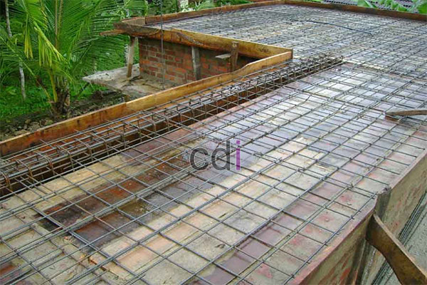

**Cara Menambal Dak Beton dari Bawah: Panduan Praktis dan Efektif** - Hai Mitra CDI! Apakah Anda sedang mencari solusi untuk kebocoran dak beton yang menjengkelkan? Seringkali, sumber masalahnya sulit dijangkau dari atas. Nah, menambal dak beton dari bawah bisa jadi jawaban cerdas yang hemat biaya dan relatif mudah dilakukan. Yuk, simak panduan lengkapnya!

## Memahami Penyebab dan Menilai Kerusakan pada Dak Beton

Sebelum memulai perbaikan, penting sekali untuk mengetahui ‘akar masalahnya’. Kebocoran di dak beton biasanya disebabkan retakan, pori-pori mikro pada beton, atau sambungan yang kurang sempurna. Perhatikan area di bawah yang rembes saat hujan deras atau setelah disiram. Pengamatan cermat akan membantu Anda menentukan penyebab utamanya.

Pemeriksaan visual adalah langkah awal yang krusial. Cari retakan, sekecil apapun. Gunakan senter untuk menerangi area yang kurang jelas. Jangan lupakan pemeriksaan potensi korosi pada besi tulangan—ini bisa melemahkan struktur dan memperparah kebocoran. Memahami sumber masalah akan membantu memilih material dan metode perbaikan yang paling efektif. Penting diingat, penambalan adalah solusi sementara jika penyebab utama tidak ditangani. Di (not detected), kami siap membantu analisis kondisi bangunan Anda secara komprehensif.

## Material dan Peralatan: Apa Saja yang Dibutuhkan?

Setelah mengetahui kerusakannya, siapkan material dan peralatan berikut:

*   **Mortar Reparasi:** Pilih mortar berkualitas tinggi dengan daya rekat kuat, tahan air, dan mampu mengisi celah dengan baik.
*   **Semen Portland:** Bahan pengikat utama. Pilih mutu semen yang sesuai kebutuhan bangunan Anda di (not detected).
*   **Pasir Silika:** Agregat halus untuk campuran mortar. Pastikan pasir bersih dari kotoran organik.
*   **Air Bersih:** Gunakan air bersih untuk membuat adonan mortar yang optimal.
*   **Waterproofing:** Lapisan pelindung penting setelah penambalan untuk mencegah kebocoran berulang. Pilihlah yang sesuai dengan jenis dak beton Anda.

Selain material, Anda juga perlu:

*   **Cangkul atau Linggis:** Untuk membersihkan area kerja.
*   **Sikat Kawat:** Membersihkan permukaan beton dari debu dan kotoran.
*   **Ember dan Pengaduk:** Untuk mencampur mortar.
*   **Kuas atau Spatula:** Mengaplikasikan mortar dan *waterproofing* dengan presisi.
*   **Sarung Tangan dan Masker:** Perlindungan diri yang wajib selama proses perbaikan.

## Langkah Demi Langkah: Menambal Dak Beton dari Bawah dengan Benar

Berikut adalah panduan praktis yang bisa Anda ikuti:

1.  **Persiapan Permukaan:** Bersihkan area yang akan ditambal dari debu, kotoran, dan material rapuh menggunakan cangkul atau linggis. Sikat permukaan beton dengan sikat kawat untuk meningkatkan daya rekat mortar.
2.  **Membuat Adonan Mortar:** Campurkan semen portland, pasir silika, dan air bersih di ember, sesuai takaran yang direkomendasikan pabrikan. Aduk hingga adonan homogen dan konsisten—tidak terlalu encer atau kental.
3.  **Mengaplikasikan Mortar:** Oleskan mortar secara merata pada area retak/berlubang. Pastikan seluruh celah dan retakan terisi sempurna. Ratakan dengan spatula atau kuas. Di (not detected), Kami menyediakan layanan konsultasi gratis untuk memastikan takaran adonan yang tepat.
4.  **Pengeringan dan Perawatan:** Biarkan mortar mengering dan mengeras selama beberapa hari. Jaga kelembaban permukaan yang ditambal selama pengeringan untuk mencegah keretakan susut. Basahi secara berkala dengan air bersih.
5.  **Pelapisan Waterproofing:** Setelah mortar benar-benar kering, aplikasikan lapisan *waterproofing* secara merata. Pastikan lapisan menutupi area yang ditambal dan sedikit melebar ke sekitarnya.

## Upaya Pencegahan: Mencegah Lebih Baik dari Mengobati

Setelah perbaikan, lakukan langkah-langkah pencegahan agar kebocoran tidak kambuh:

*   **Inspeksi Rutin:** Periksa dak beton secara berkala, terutama saat musim hujan. Cari tanda-tanda kebocoran atau retakan baru.
*   **Pelapisan Waterproofing Berkala:** Aplikasikan *waterproofing* setiap 2-3 tahun sekali untuk menjaga perlindungan optimal.
*   **Perawatan Sambungan:** Pastikan sambungan dak beton dengan dinding atau struktur lain tertutup rapat.
*   **Drainase yang Baik:** Jaga kelancaran sistem drainase di sekitar bangunan untuk mencegah genangan air di atas dak beton.

Sebagai informasi, biaya penambalan dak beton dari bawah bervariasi, tergantung luas area, tingkat kerusakan, dan material yang digunakan. Untuk perkiraan biaya proyek Anda di (not detected), silakan lihat  atau hubungi Kami.

Butuh solusi profesional untuk kebocoran dak beton Anda? Jangan ragu untuk menghubungi Kami! Klik tombol **Telepon** atau **WhatsApp** di bawah untuk konsultasi gratis. Kami dari CDI siap membantu Anda menemukan solusi terbaik. [Cara Memperbaiki Dak Beton Bocor: Panduan Praktis & Solusi Terbaik](/blog/cara-memperbaiki-dak-beton-bocor/) bisa menjadi referensi tambahan untuk Anda. Kami juga melayani jasa pengecoran di (not detected) dengan kualitas terjamin.