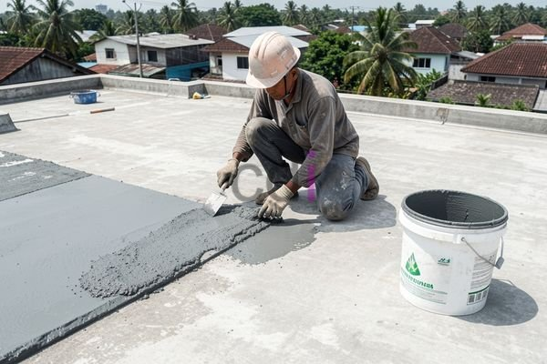

**Cara Menambal Dak Cor yang Bocor: Panduan Praktis dan Efektif** - Hai Mitra CDI! Punya masalah dak cor yang bocor bikin pusing? Tenang, Anda tidak sendirian. Banyak pemilik bangunan di (not detected) yang mengalami hal serupa, terutama saat musim hujan tiba. Kebocoran dak cor bukan cuma bikin tidak nyaman, tapi juga bisa merusak struktur bangunan kalau dibiarkan. 

Yuk, kita bahas tuntas cara menambal dak cor yang bocor dan mencegahnya kembali terjadi. Artikel ini akan memandu Mitra langkah demi langkah, mulai dari identifikasi masalah, material yang dibutuhkan, hingga tips perawatan agar dak cor tetap kuat dan awet. Jangan khawatir, panduan ini dirancang agar mudah dipahami dan bisa diterapkan sendiri!

## Mengenali Penyebab dan Sumber Kebocoran Dak Cor

Sebelum mulai menambal, penting untuk tahu dulu apa penyebab kebocoran dak cor Mitra. Beberapa faktor umum yang sering jadi pemicu antara lain kualitas beton yang kurang memadai, munculnya retakan mikro atau retakan besar, kesalahan saat proses pemasangan, atau bahkan usia bangunan yang sudah tua.

Nah, untuk menemukan sumber kebocorannya, lakukan inspeksi visual menyeluruh. Perhatikan baik-baik permukaan dak, cari retakan, lubang, atau area yang mengelupas. Jangan lupa cek area sambungan dak dengan dinding atau bagian bangunan lain, karena seringkali menjadi titik masuk air. Kalau sulit menemukan sumbernya, coba siramkan air perlahan di area yang dicurigai. Amati dari bawah, di mana air mulai menetes. Kalau masih kesulitan, jangan ragu minta bantuan dari tenaga profesional, ya!

## Daftar Material dan Peralatan yang Dibutuhkan

Setelah tahu sumber masalahnya, saatnya siapkan material dan peralatan. Pemilihan material yang tepat akan menentukan ketahanan perbaikan yang dilakukan. Ini dia daftar yang perlu Anda siapkan:

*   **Mortar Reparasi:** Untuk mengisi retakan dan lubang kecil. Pilih yang daya rekatnya kuat dan tahan cuaca.
*   **Waterproofing Membrane:** Lapisan kedap air untuk mencegah air meresap. Tersedia berbagai jenis, seperti *acrylic*, *polyurethane*, atau *bitumen*.
*   **Epoxy Resin:** Cocok untuk menambal retakan besar atau memperkuat struktur dak yang lemah.
*   **Semen:** Bahan dasar untuk mortar dan penutup area luas.
*   **Pasir:** Campuran semen yang tepat akan menghasilkan mortar yang kuat.
*   **Alat-alat:** Kuas, spatula, ember, mixer, sarung tangan, kacamata pengaman, dan alat pelindung diri lainnya.

Sebagai gambaran, biaya perbaikan dak cor seluas 10 meter persegi bisa berkisar antara Rp 500.000 hingga Rp 2.000.000. Tentu saja, harga ini tergantung pada jenis material yang dipilih dan tingkat kerusakan dak. Untuk informasi lebih detail mengenai harga, silakan lihat tabel  atau hubungi Kami untuk penawaran khusus sesuai kebutuhan proyek Anda di (not detected).

## Panduan Langkah Demi Langkah Menambal Dak Cor yang Bocor

Sekarang, mari kita mulai proses penambalan! Ikuti langkah-langkah berikut dengan seksama:

1.  **Bersihkan Permukaan Dak:** Pastikan area sekitar kebocoran bersih dari kotoran, debu, lumut, atau material lepas. Gunakan sikat kawat untuk membersihkan secara menyeluruh.
2.  **Buat Alur pada Retakan:** Jika ada retakan, buat alur berbentuk ‘V’ agar mortar atau epoxy menempel lebih kuat.
3.  **Aplikasikan Mortar/Epoxy:** Oleskan mortar atau epoxy pada area yang rusak sesuai petunjuk produk. Pastikan semua retakan atau lubang terisi penuh.
4.  **Lapisi dengan Waterproofing Membrane:** Setelah mortar mengering, aplikasikan lapisan *waterproofing membrane* secara merata di seluruh permukaan dak.
5.  **Uji Coba:** Setelah *waterproofing membrane* kering, siramkan air untuk memeriksa apakah kebocoran sudah hilang. Jika masih ada, ulangi langkah-langkah di atas.

## Tips Jitu Mencegah Kebocoran Dak Cor Kembali Terjadi

Setelah berhasil menambal, jangan lupa lakukan pencegahan agar masalah ini tidak muncul lagi. Berikut beberapa tipsnya:

*   **Perawatan Rutin:** Lakukan inspeksi visual berkala, terutama setelah hujan deras. Perbaiki kerusakan kecil segera.
*   **Jaga Kebersihan:** Bersihkan dak secara rutin dari debu, kotoran, dan lumut.
*   **Gunakan Waterproofing Berkualitas:** Pilih *waterproofing membrane* yang tahan lama dan sesuai dengan kondisi cuaca di (not detected).
*   **Pastikan Pemasangan Benar:** Gunakan jasa tenaga ahli berpengalaman untuk pemasangan dak cor yang optimal.

Ingat, kekuatan dak juga sangat bergantung pada kualitas besi yang digunakan. Mau tahu lebih banyak? Simak artikel Kami tentang [Berapa Lapis Besi untuk Cor Dak? Panduan Lengkap untuk Hasil Kuat dan Awet](/blog/berapa-lapis-besi-untuk-cor-dak/) — informasinya sangat berguna, lho!

Dengan perawatan yang tepat, dak cor Mitra CDI akan lebih awet dan tahan lama.  Butuh konsultasi lebih lanjut? Jangan sungkan! Tombol **Telepon** dan **WhatsApp** di bawah ini siap membantu Anda. Kami siap memberikan solusi terbaik untuk masalah dak cor Anda di (not detected).