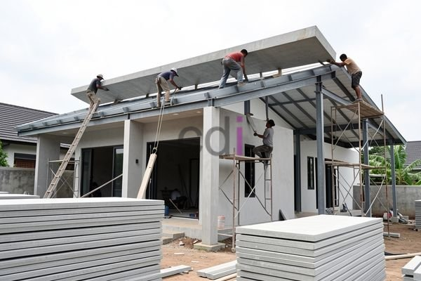

**Cara Mengatasi Atap Beton Rembes: Solusi Jangka Panjang untuk Bangunan Anda** - Hai Mitra CDI! Apakah Anda sedang menghadapi masalah atap beton rembes yang mengganggu kenyamanan bangunan Anda di (not detected)? Kebocoran atap memang menjengkelkan, belum lagi potensi kerusakan lebih lanjut yang bisa ditimbulkan. Artikel ini hadir untuk memberikan panduan lengkap – mulai dari akar masalah, solusi efektif, hingga langkah preventif yang bisa Anda terapkan. Yuk, simak bersama!

### Mengungkap Akar Masalah: Kenapa Atap Beton Bisa Rembes?

Ada beberapa penyebab utama yang seringkali menjadi biang kerok atap beton rembes. Kualitas beton yang kurang prima kerap menjadi pemicu. Penggunaan material yang tidak standar, misalnya campuran semen dan agregat yang tidak sesuai takaran, berpotensi menghasilkan beton yang porous dan mudah menyerap air. Proses pengecoran yang kurang teliti, seperti kurangnya pemadatan atau perawatan (curing) yang tidak optimal, juga bisa memicu munculnya pori-pori pada permukaan beton.

Selain itu, retakan pada permukaan atap juga menjadi pintu masuk air. Retakan ini bisa disebabkan oleh berbagai faktor, mulai dari perubahan cuaca ekstrem, getaran akibat aktivitas lalu lintas, hingga pergeseran struktur bangunan. Nah, sistem drainase yang tidak berfungsi dengan baik juga seringkali menjadi penyebab rembesan. Jika air hujan menggenang di permukaan atap karena saluran air tersumbat, air akan mencari celah dan meresap ke dalam bangunan.

### Solusi Tepat untuk Setiap Tingkat Kerusakan

Mitra CDI, jangan khawatir! Ada berbagai solusi perbaikan yang bisa Anda terapkan, disesuaikan dengan tingkat keparahan kebocoran dan penyebabnya. Untuk retakan-retakan kecil, aplikasi lapisan *waterproofing* berbahan dasar semen akrilik atau poliuretan adalah pilihan yang praktis dan efektif. Material ini akan mengisi celah retakan dan menciptakan lapisan kedap air yang melindungi beton dari infiltrasi air. Pastikan permukaan beton bersih dan kering sebelum aplikasi, ya!

Jika kebocoran disebabkan oleh beton yang kurang berkualitas atau retakan yang lebih lebar, dibutuhkan penanganan yang lebih intensif. Metode injeksi *polyurethane foam* bisa menjadi solusi! Busa poliuretan ini akan disuntikkan ke dalam retakan untuk mengisi ruang kosong dan menghentikan aliran air. Alternatif lain adalah *re-coating* dengan sistem *waterproofing* yang lebih canggih, seperti membran bituminus atau *liquid membrane* yang tahan lama.

Namun, jika kerusakan beton sudah parah dan mencapai tulangan, perbaikan struktural mungkin menjadi satu-satunya jalan keluar. Proses ini melibatkan pembongkaran sebagian atap yang rusak dan penggantian dengan beton baru. Penting: perbaikan struktural sebaiknya ditangani oleh profesional konstruksi berpengalaman untuk memastikan keamanan dan kekuatan bangunan.

### Mencegah Lebih Baik daripada Mengobati: Langkah Proaktif

Mencegah kebocoran atap beton sama pentingnya (bahkan lebih penting!) daripada memperbaikinya. Ada beberapa langkah proaktif yang bisa Anda lakukan. Pertama, gunakan beton berkualitas tinggi yang memenuhi standar mutu, minimal K-25 untuk struktur atap. Mencari solusi praktis? [Adhimix Plant Bandung: Solusi Praktis dan Efisien untuk Kebutuhan Beton Precast](/blog/adhimix-plant-bandung/) bisa menjadi partner terpercaya Anda!

Kedua, perhatikan betul proses pengecoran dan perawatan beton. Campuran harus homogen, pemadatan merata, dan beton perlu diberi perawatan (curing) yang optimal selama minimal 7 hari setelah pengecoran. Ketiga, pastikan sistem drainase berfungsi sempurna agar air hujan bisa langsung mengalir lancar.

Keempat, jadwalkan inspeksi rutin untuk mengidentifikasi potensi masalah sejak dini. Periksa permukaan atap secara visual untuk mencari retakan, kerusakan, atau tanda-tanda rembesan. Jika ada temuan, segera lakukan perbaikan sebelum masalah berkembang lebih besar. Terakhir, aplikasikan lapisan *waterproofing* secara berkala, idealnya setiap 5 tahun sekali, untuk menjaga efektivitas perlindungan.

Sebagai gambaran, biaya pelapisan *waterproofing* dengan material berbasis semen akrilik atau poliuretan umumnya berkisar antara Rp 150.000 – Rp 300.000 per meter persegi. Biaya injeksi *polyurethane foam* bisa mencapai Rp 400.000 – Rp 800.000 per meter, tergantung kompleksitas retakan. Untuk informasi harga terkini dan penawaran khusus, jangan ragu hubungi Kami! 

Jangan biarkan atap beton rembes merusak investasi Anda! Butuh konsultasi lebih lanjut atau ingin langsung mendapatkan penawaran? Tim ahli Kami siap membantu! Ayo, hubungi Kami sekarang juga melalui tombol **Telepon** atau **WhatsApp** di bawah ini. Kami siap melayani Anda di (not detected) dan sekitarnya.