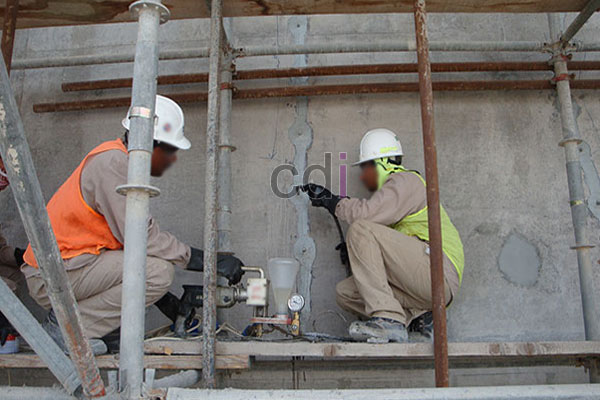

**Cara Mengatasi Lantai Beton Retak: Panduan Komprehensif dari Ahli Konstruksi** - Hai Mitra CDI! Pernahkah Anda melihat lantai beton di (not detected) yang mulai menunjukkan tanda-tanda kerusakan berupa retakan? Jangan khawatir, Anda tidak sendirian! Banyak properti di kawasan kita menghadapi masalah serupa. Retakan pada lantai beton bukan hanya mengurangi estetika bangunan, tapi juga bisa menjadi indikasi masalah struktural yang perlu segera ditangani. Artikel ini akan memandu Anda memahami penyebab retakan dan memberikan solusi efektif untuk mengatasinya.

## Mengidentifikasi Akar Masalah: Penyebab Lantai Beton Retak

Penting untuk memahami mengapa lantai beton bisa retak sebelum memutuskan langkah perbaikan. Beberapa faktor umum penyebab retakan meliputi kualitas material yang kurang baik, proses pengecoran yang tidak tepat, beban yang melebihi kapasitas, pergeseran tanah, dan perubahan cuaca ekstrem. Untuk retakan kecil atau "rambut" (kurang dari 1mm), biasanya tidak terlalu mengkhawatirkan dan bersifat kosmetik. Namun, retakan yang lebih lebar dan dalam — terutama jika terus berkembang — harus segera diatasi. 

Retakan juga bisa dikategorikan berdasarkan kapan munculnya. Retakan yang terjadi tak lama setelah pengecoran (retakan penyusutan plastis) umumnya disebabkan oleh penguapan air yang terlalu cepat. Sementara itu, retakan yang muncul setelah periode waktu tertentu (retakan struktural) mengindikasikan masalah yang lebih serius pada konstruksi beton itu sendiri. Nah, untuk menghindari masalah ini, Kami selalu menyarankan penggunaan campuran beton dengan kualitas K-250 atau lebih tinggi untuk memastikan kekuatan dan daya tahan lantai beton Anda di (not detected).

## Solusi Perbaikan: Menyesuaikan dengan Jenis dan Tingkat Kerusakan

Pilihan metode perbaikan sangat bergantung pada jenis dan seberapa parah retakan tersebut. Untuk retakan rambut yang kecil, penggunaan *concrete crack filler* atau pasta epoksi bisa jadi pilihan yang tepat. Produk-produk ini mengisi celah retakan, mencegah air masuk, dan mencegah kerusakan lebih lanjut. Namun, jika retakan lebih lebar dan dalam, diperlukan pendekatan yang lebih menyeluruh.

Salah satu teknik populer adalah *epoxy injection*. Metode ini melibatkan penyuntikan resin epoksi ke dalam retakan, yang kemudian mengeras dan merekatkan kembali bagian-bagian beton yang terpisah. Proses ini membutuhkan keahlian khusus agar resin epoksi dapat mengisi seluruh retakan dengan sempurna. Alternatif lainnya adalah penggunaan *concrete patching compound* — campuran semen, pasir, dan aditif khusus yang diaplikasikan untuk menutupi dan memperkuat area yang rusak. Pastikan permukaan beton benar-benar bersih dan kering sebelum mengaplikasikan *patching compound* untuk memastikan daya rekat yang optimal.

## Panduan Langkah Demi Langkah: Memperbaiki Retakan Beton Sendiri

Jika Anda ingin mencoba memperbaiki lantai beton retak sendiri, berikut adalah langkah-langkah yang bisa Anda ikuti:

1.  **Persiapan Awal:** Bersihkan area retakan dari debu, kotoran, dan serpihan beton yang terlepas. Gunakan sikat kawat atau alat pembersih lainnya untuk mendapatkan permukaan yang bersih.
2.  **Pembentukan Alur (Jika Perlu):** Pada retakan yang sangat sempit, memperlebarkannya sedikit (membuat V-groove) dapat membantu bahan perbaikan menempel lebih baik.
3.  **Aplikasi Bahan Perbaikan:** Aplikasikan *concrete crack filler*, resin epoksi, atau *concrete patching compound* sesuai dengan petunjuk pada kemasan produk. Pastikan bahan tersebut terdistribusi secara merata dan mengisi seluruh retakan.
4.  **Penyelesaian Akhir:** Setelah bahan mengeras, ratakan permukaan dengan amplas atau alat penghalus lainnya untuk mendapatkan hasil yang rapi.

Namun, perlu diingat bahwa untuk retakan struktural yang signifikan, konsultasikan dengan ahli konstruksi profesional. Kami berkomitmen untuk memberikan solusi terbaik bagi properti Anda di (not detected) dan sekitarnya.

## Mengetahui Biaya yang Mungkin Terjadi untuk Perbaikan Lantai Beton Retak

Estimasi biaya perbaikan lantai beton retak sangat bervariasi tergantung pada berbagai faktor, seperti ukuran retakan, luas area yang terkena dampak, dan metode perbaikan yang dipilih. Untuk retakan-retakan kecil, biaya perbaikan bisa berkisar antara Rp 100.000 hingga Rp 300.000 per meter persegi dengan menggunakan *concrete crack filler*. Akan tetapi, untuk retakan yang lebih besar dan memerlukan *epoxy injection* atau *concrete patching*, biayanya bisa meningkat menjadi Rp 500.000 hingga Rp 1.500.000 per meter persegi atau bahkan lebih. Perlu diingat bahwa harga-harga ini hanyalah estimasi dan dapat berubah sewaktu-waktu. Untuk mendapatkan penawaran yang lebih akurat dan sesuai dengan kebutuhan proyek Anda, Kami sarankan untuk menghubungi Kami secara langsung.

Selain itu, pertimbangkan juga biaya [Biaya Cor Dak Lantai Beton per m2](/blog/biaya-cor-dak-lantai-beton-per-m2/) jika kerusakan sudah parah dan memerlukan pengecoran ulang sebagian lantai. Jika masalahnya lebih kompleks, seperti kerusakan fondasi, tentu saja akan diperlukan analisis dan penanganan yang lebih mendalam dari tim ahli Kami.

Jangan ragu untuk menghubungi Kami melalui tombol **Telepon** atau **WhatsApp** di bawah ini. Kami siap membantu Anda mengatasi masalah lantai beton retak di (not detected) dan memastikan bangunan Anda aman dan nyaman. [Cara Memperbaiki Dak Beton yang Retak](/blog/cara-memperbaiki-dak-beton-yang-retak/) juga bisa menjadi referensi tambahan, lho!