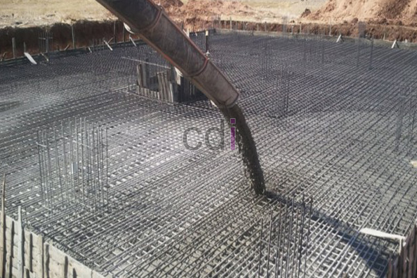

**Cara Menghitung Biaya Pekerjaan Cor Beton** - Hai Mitra CDI! Lagi cari cara akurat untuk menghitung biaya cor beton? Artikel ini hadir untuk membantu! Kami menyajikan panduan lengkap berdasarkan analisis biaya konstruksi, hasil penelitian lapangan, dan data produktivitas tenaga kerja terkini. Perencanaan yang matang, termasuk perhitungan biaya yang tepat, adalah kunci sukses proyek Anda di (not detected). Yuk, kita bahas tuntas cara menghitung biaya pekerjaan cor beton ini!

*Memahami Komponen Biaya Pekerjaan Cor Beton*

Penghitungan biaya pekerjaan cor beton mencakup beberapa aspek utama, antara lain:

- 1. Pembuatan beton dengan berbagai mutu, mulai dari f’c = 7,4 MPa (K 100) hingga f’c = 31,2 MPa (K 350) untuk pekerjaan beton bertulang.
- 2. Pemasangan *water stop* dan bekisting untuk berbagai komponen struktur bangunan.
- 3. Pengerjaan pondasi, sloof, kolom, balok, dinding beton bertulang, kolom praktis, dan ring balok.

Nah, sebelum kita masuk ke detail perhitungan, ada baiknya kita pahami dulu beberapa singkatan istilah yang sering digunakan dalam dunia konstruksi:

- cm = centimeter (Satuan panjang)
- kg = kilogram (Satuan berat)
- m’ = meter panjang (Satuan panjang)
- m² = meter persegi (Satuan luas)
- m³ = meter kubik (Satuan volume)
- OH = Orang Hari (Satuan tenaga kerja per hari)
- PC = Portland Cement (Jenis Material Semen Portland)
- PB = Pasir beton (Agregat halus ukuran < 5 mm)
- KR = Kerikil (Agregat kasar ukuran 5 mm – 40 mm)

Sekarang, mari kita lihat contoh perhitungan biaya pembuatan 1 m³ beton f’c = 7,4 MPa (K 100) dengan slump (12 ± 2) cm dan rasio air semen (w/c) = 0,87. Detailnya bisa Anda lihat di tabel berikut:

<table style="text-align: center; height: 62px;" border="1" width="100%" cellspacing="0" cellpadding="3"><tbody><tr><td>Kebutuhan</td><td>Satuan /</td><td>Indeks</td><td>Harga Satuan Bahan/Upah (Rp)</td><td>Jumlah (Rp)</td></tr><tr><td>BAHAN</td><td>PC</td><td>Kg</td><td>247</td><td>400</td><td>98.800</td></tr><tr><td>PB</td><td>Kg</td><td>869</td><td>63</td><td>54.747</td></tr><tr><td>KR maks. 30 mm</td><td>Kg</td><td>999</td><td>57</td><td>56.943</td></tr><tr><td>Air</td><td>Liter</td><td>215</td><td>5</td><td>1.075</td></tr><tr><td>TENAGA KERJA</td><td>Pekerja</td><td>OH</td><td>1,650</td><td>30.000</td><td>49.500</td></tr><tr><td>Tukang Batu</td><td>OH</td><td>0,275</td><td>40.000</td><td>11.000</td></tr><tr><td>Kepala Tukang</td><td>OH</td><td>0,028</td><td>50.000</td><td>1.400</td></tr><tr><td>Mandor</td><td>OH</td><td>0,083</td><td>60.000</td><td>4.980</td></tr><tr><td><strong>Jumlah semua biaya</strong><strong></strong></td><td>278.445</td></tr></tbody></table>

Nah, itu dia gambaran detail cara menghitung biaya cor beton. Tentu saja, angka-angka tersebut bisa bervariasi tergantung lokasi (not detected) dan harga material terkini. Untuk mendapatkan perhitungan yang lebih akurat sesuai kebutuhan proyek Anda, jangan ragu untuk menghubungi kami. Kami siap membantu!

Butuh informasi lebih lanjut terkait material berkualitas untuk fondasi bangunan di (not detected)? Kami siap menyediakan solusi terbaik! Jangan tunda lagi, segera konsultasikan kebutuhan Anda dengan tim ahli kami dan dapatkan penawaran terbaik sekarang juga! 
<table class="table">
  <caption>Estimasi Biaya Cor Beton</caption>
  <thead>
    <tr><th>Kebutuhan</th><th>Satuan</th><th>Indeks</th><th>Harga Satuan</th><th>Jumlah (Rp)</th></tr>
  </thead>
  <tbody>
    <tr><td>PC</td><td>Kg</td><td>247</td><td>400</td><td>98.800</td></tr>
    <tr><td>PB</td><td>Kg</td><td>869</td><td>63</td><td>54.747</td></tr>
    <tr><td>KR maks. 30 mm</td><td>Kg</td><td>999</td><td>57</td><td>56.943</td></tr>
    <tr><td>Air</td><td>Liter</td><td>215</td><td>5</td><td>1.075</td></tr>
    <tr><td>Pekerja</td><td>OH</td><td>1,650</td><td>30.000</td><td>49.500</td></tr>
    <tr><td>Tukang Batu</td><td>OH</td><td>0,275</td><td>40.000</td><td>11.000</td></tr>
    <tr><td>Kepala Tukang</td><td>OH</td><td>0,028</td><td>50.000</td><td>1.400</td></tr>
    <tr><td>Mandor</td><td>OH</td><td>0,083</td><td>60.000</td><td>4.980</td></tr>
  </tbody>
</table>

# Cara Hitung Ongkos Tukang, Biaya Tukang Bangunan, Biaya cor Beton per m2, Tukang Cor Beton Berpengalaman di (not detected)

[Kembali ke artikel tentang kebutuhan beton](/blog/cara-menghitung-kebutuhan-cor-beton/) untuk memahami volume beton yang Anda perlukan.