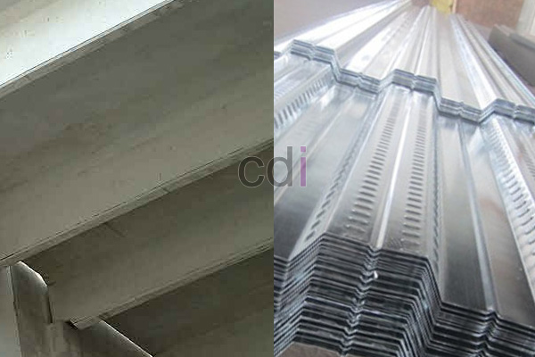

**Cara Menghitung Dak Bondek: Panduan Lengkap & Estimasi Biaya 2026** - Hai Mitra CDI! Punya proyek konstruksi di (not detected) yang butuh dak yang kuat, ringan, dan cepat dipasang? Nah, dak bondek bisa jadi solusi tepat! Tapi, bagaimana cara menghitung kebutuhan material dan biaya dengan akurat? Jangan khawatir, artikel ini akan menyajikan panduan lengkapnya, lengkap dengan estimasi biaya terkini untuk tahun 2026. Yuk, simak selengkapnya!

## Memahami Komponen dan Material Dak Bondek

Sebelum kita mulai menghitung, penting banget memahami apa saja komponen utama dalam sistem dak bondek. Secara garis besar, ada beberapa elemen penting yang terlibat. Yang pertama, tentu saja *bondek* itu sendiri – pelat baja galvanis berprofil yang jadi bekisting permanen sekaligus pengikat beton. Ada dua jenis yang paling sering dipakai: bondek SPBU (Single Plate Bonded Undulation) dan bondek TSP (Two Span Profile). Kedua, ada *tulangan baja* yang berfungsi menahan tarikan dan tekanan. Biasanya, besi beton polos atau ulir dengan diameter yang disesuaikan dengan perhitungan beban dipakai. Ketiga, jangan lupakan *beton* berkualitas tinggi, umumnya K-250 sampai K-350 untuk rumah, atau mutu lebih tinggi untuk bangunan komersial.

Pemilihan material yang tepat adalah kunci kekuatan dan umur dak. Selalu pastikan material yang Anda pilih sudah memenuhi standar SNI yang berlaku demi keamanan dan kualitas bangunan. Kalau ingin tahu lebih detail tentang faktor-faktor yang memengaruhi biaya material, [Biaya Dak Beton Bondek: Rincian Lengkap & Estimasi 2026](/blog/biaya-cor-dak-bondek-per-m2/) bisa jadi referensi yang bermanfaat.

## Langkah-Langkah Menghitung Kebutuhan Material Dak Bondek

Perhitungan kebutuhan material dak bondek itu beberapa tahap, lho. Pertama, hitung luas area dak yang akan dicor. Luas ini jadi patokan perhitungan semua material. Selanjutnya, perhatikan jarak antar gelombang bondek atau *pitch*. Biasanya, jarak ini sudah ditetapkan oleh pabrikan bondek. Setelah itu, hitung berapa banyak bondek yang dibutuhkan dengan membagi luas area dak dengan lebar efektif bondek.

Menghitung kebutuhan tulangan juga penting, dan lebih baik dilakukan oleh ahli struktur. Perhitungan ini menyangkut beban dan momen lentur. Tulangan baja akan dipasang dengan jarak tertentu sesuai hasil perhitungan struktur. Terakhir, hitung volume beton yang dibutuhkan dengan mengalikan luas area dak dengan ketebalan dak. Ketebalan dak umumnya antara 100 sampai 150 mm, tergantung beban yang akan ditahan.

Sebagai ilustrasi, mari kita contoh perhitungan untuk area dak seluas 50 m². Jika menggunakan bondek dengan lebar efektif 1 meter, Anda membutuhkan sekitar 50 lembar bondek. Jika ketebalan dak yang direncanakan 120 mm, volume beton yang diperlukan adalah 50 m² x 0,12 m = 6 m³.

## Estimasi Biaya Dak Bondek Tahun 2026

Estimasi biaya dak bondek itu dinamis, tergantung beberapa variabel. Jenis bondek yang dipilih, mutu beton, harga material di (not detected), dan biaya tenaga kerja semuanya berpengaruh. Sebagai gambaran, harga bondek per meter persegi biasanya berkisar Rp 80.000 – Rp 150.000. Harga besi beton per kilogram berkisar Rp 15.000 – Rp 20.000. Sedangkan harga beton per meter kubik berkisar Rp 800.000 – Rp 1.200.000.

Dengan asumsi harga bondek Rp 120.000/m², besi beton Rp 18.000/kg, dan beton Rp 1.000.000/m³, serta kebutuhan material seperti contoh perhitungan tadi, perkiraan biayanya adalah:

*   Biaya bondek: 50 m² x Rp 120.000/m² = Rp 6.000.000
*   Biaya besi beton (asumsi 100 kg): 100 kg x Rp 18.000/kg = Rp 1.800.000
*   Biaya beton: 6 m³ x Rp 1.000.000/m³ = Rp 6.000.000
*   Biaya tenaga kerja (estimasi): Rp 2.000.000

Jadi, total estimasi biaya untuk area 50 m² adalah Rp 6.000.000 + Rp 1.800.000 + Rp 6.000.000 + Rp 2.000.000 = Rp 15.800.000. Ingat, angka ini hanya estimasi dan bisa berubah sewaktu-waktu. Untuk penawaran yang lebih akurat sesuai kebutuhan proyek Anda di (not detected), silakan hubungi Kami! Harga resmi akan ditampilkan dalam tabel .

## Perbandingan Dak Bondek dengan Metode Konvensional

Dak bondek punya beberapa keunggulan dibandingkan metode konvensional. Pemasangannya lebih cepat, penggunaan kayu sebagai bekisting bisa dikurangi, dan beban mati lebih ringan. Namun, metode konvensional mungkin lebih ekonomis untuk proyek kecil atau kondisi lapangan yang kurang mendukung penggunaan peralatan khusus. Sebelum memutuskan, pertimbangkan baik-baik kebutuhan dan kondisi proyek Anda. Cor Dak Bondek Vs Konvensional: Pilih yang Tepat untuk Hunian Anda bisa membantu Anda membandingkannya lebih mendalam.

Selain itu, Anda juga bisa mengintip [Atap Bondek Cor: Panduan Lengkap Kekuatan, Pemasangan, dan Estimasi Biaya 2026](/blog/atap-bondek-cor/) untuk informasi tambahan.

Butuh bantuan lebih lanjut? Jangan sungkan untuk menghubungi Kami melalui tombol **WhatsApp** atau **Telepon** di halaman ini. Kami siap membantu Anda mewujudkan proyek impian di (not detected)!