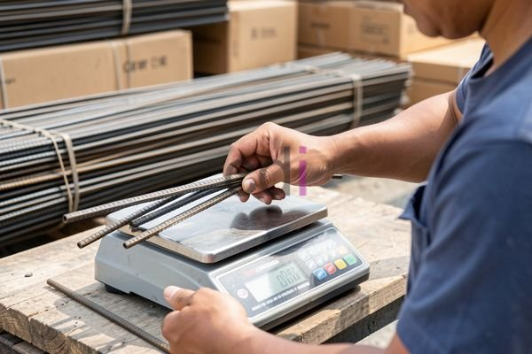

**Cara Menghitung Harga Besi Per Kg: Panduan Lengkap & Estimasi Biaya 2026** - Halo Mitra CDI! Pernahkah Anda merasa kesulitan memprediksi biaya material dalam proyek konstruksi? Terutama soal besi, yang harganya bisa naik turun drastis. Nah, penting banget lho untuk tahu cara menghitung harga besi per kilogram yang akurat, supaya anggaran proyek Anda tetap terkendali. Dengan begitu, Anda bisa menghindari pembengkakan biaya dan memastikan kelancaran proyek di (not detected).

Besi itu tulang punggung setiap bangunan. Mulai dari fondasi, kolom, sampai tulangan beton – semua butuh besi berkualitas. Memahami bagaimana harga besi dibentuk dan bagaimana cara menghitungnya akan sangat membantu perencanaan keuangan proyek Anda. Harga besi itu dinamis, jadi perlu terus diperbarui.

## Mengurai Faktor yang Mempengaruhi Harga Besi Per Kg

Banyak hal yang bikin harga besi per kilogram bisa berubah-ubah. Salah satunya adalah harga bahan baku. Bayangkan, harga bijih besi dan batu bara (bahan utama pembuatan besi) yang melonjak di pasar global, otomatis akan berdampak pada harga besi di (not detected) juga.

Selain itu, biaya operasional pabrik besi – seperti energi, upah pekerja, dan biaya transportasi – juga ikut menentukan harga akhir. Kebijakan pemerintah soal tarif impor dan ekspor besi juga bisa berpengaruh. Lalu, yang tak kalah penting adalah permintaan pasar. Kalau permintaan tinggi tapi suplai terbatas, harga biasanya naik. Sebaliknya, kalau suplai melimpah dan permintaan sepi, harga bisa turun. Pilih jenis besi yang tepat juga krusial karena harganya bervariasi.

## Menghitung Harga Besi Per Kg: Langkah demi Langkah

Menghitung harga besi per kilogram secara akurat itu sebenarnya tidak sulit. Pertama, tentukan jenis besi yang Anda butuhkan. Ada besi beton (rebar), besi hollow, besi plat, dan banyak lagi. Masing-masing punya karakteristik dan harga yang berbeda. Penting untuk memilih jenis besi yang sesuai dengan kebutuhan proyek Anda di (not detected).

Kedua, hitung berapa banyak besi yang Anda perlukan. Ini bisa dilakukan dengan menghitung volume besi yang dibutuhkan dalam proyek Anda. Misalnya, Anda butuh besi beton diameter 12 mm sepanjang 50 meter. Untuk mengetahui beratnya, Anda bisa cari tahu berat besi per meter dari tabel standar atau bertanya langsung ke supplier.  Katakanlah, berat besi beton diameter 12 mm adalah 8,88 kg/meter. Maka, berat total besi yang Anda butuhkan adalah 50 meter x 8,88 kg/meter = 444 kg.

Setelah tahu berat besi yang dibutuhkan, langkah selanjutnya adalah mencari harga besi per kilogram dari beberapa supplier. Bandingkan harga dari berbagai sumber untuk mendapatkan penawaran terbaik. Jangan terburu-buru, ya.

## Estimasi Biaya Besi: Ukuran, Jenis, dan Lokasi

Estimasi biaya besi sangat tergantung pada ukuran dan jenis besi yang dipilih. Sebagai gambaran, pada tahun 2026, harga besi beton umumnya berkisar antara Rp 15.000 hingga Rp 20.000 per kilogram.  Ingat, ini hanyalah estimasi. Untuk mendapatkan penawaran harga yang paling akurat sesuai dengan kebutuhan proyek Anda di (not detected), sebaiknya langsung hubungi Kami. Besi hollow dengan ukuran lebih kecil biasanya lebih murah daripada besi beton, sementara besi plat yang tebal akan lebih mahal.

Berikut adalah estimasi harga besi berdasarkan jenis (harga per kilogram):

<table class="table">
  <caption>Estimasi Harga Besi Per Kg (2026)</caption>
  <thead>
    <tr><th>Jenis Besi</th><th>Harga Estimasi (Rp/kg)</th><th>Keterangan</th></tr>
  </thead>
  <tbody>
    <tr><td>Besi Beton (Diameter 8mm)</td><td>15.000 - 17.000</td><td>Harga bervariasi tergantung grade</td></tr>
    <tr><td>Besi Beton (Diameter 10mm)</td><td>16.000 - 18.000</td><td>Harga bervariasi tergantung grade</td></tr>
    <tr><td>Besi Hollow (20x20mm)</td><td>18.000 - 22.000</td><td>Harga bervariasi tergantung ketebalan</td></tr>
    <tr><td>Besi Plat (3mm)</td><td>20.000 - 25.000</td><td>Harga bervariasi tergantung ukuran</td></tr>
  </tbody>
</table>

Bagi proyek konstruksi besar seperti gedung bertingkat, besi beton akan menjadi komponen utama. Untuk proyek yang lebih sederhana, seperti rumah tinggal, besi hollow bisa menjadi opsi yang lebih hemat.  Mempertimbangkan kebutuhan spesifik proyek Anda akan membantu Anda memilih jenis besi yang tepat dan menghitung biaya yang dibutuhkan dengan lebih akurat. Jangan lupa, pertimbangkan juga biaya pengiriman dari (not detected) ke lokasi proyek.

## Tips Jitu Dapat Harga Besi Terbaik

Mau dapat harga besi yang paling oke? Yuk, simak tips berikut:

*   **Survei Harga:** Bandingkan harga dari beberapa supplier besi di (not detected). Jangan cuma satu, ya!
*   **Beli Grosir:** Kalau proyek Anda besar, coba beli besi dalam jumlah banyak. Biasanya ada diskon khusus.
*   **Jalin Hubungan Baik:** Bangun relasi yang baik dengan supplier. Siapa tahu mereka kasih harga spesial.
*   **Perhatikan Waktu:** Harga besi bisa naik turun sepanjang tahun. Coba cari waktu yang tepat untuk membeli.
*   **Manfaatkan Platform *Online*:** Ada banyak platform *online* yang bisa membantu Anda membandingkan harga besi. Manfaatkan!
*   **Cek Kualitas:** Jangan cuma fokus pada harga murah. Pastikan besi yang Anda beli berkualitas dan memenuhi standar SNI.

Butuh bantuan lebih lanjut? Jangan sungkan untuk menghubungi Kami melalui tombol **WhatsApp** atau **Telepon** yang tersedia di halaman ini. Kami siap membantu Anda menghitung kebutuhan besi dan mendapatkan penawaran terbaik untuk proyek Anda di (not detected). [Besi untuk Pondasi Rumah: Jenis, Ukuran, dan Estimasi Biaya Terbaru 2026](/blog/besi-untuk-pondasi-rumah/) — Pelajari lebih lanjut tentang pilihan besi yang tepat untuk pondasi rumah Anda.