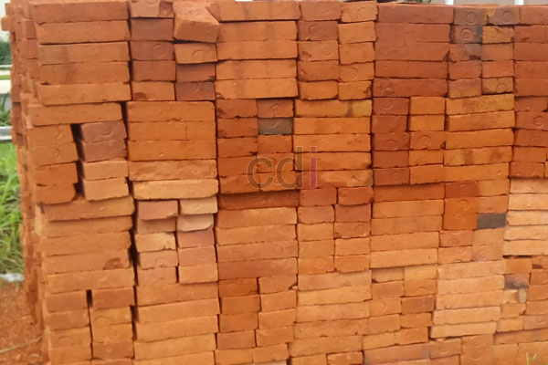

**Cara Menghitung Kebutuhan Bata Merah** - Hai Mitra CDI! Bata merah, material bangunan klasik yang tak lekang oleh waktu, masih menjadi pilihan utama untuk konstruksi yang kokoh dan ekonomis. Meskipun banyak material modern bermunculan, permintaan akan bata merah justru terus meningkat. Ketersediaan yang kadang terbatas ini menandakan betapa digemari material ini oleh para pembangun di (not detected). Kualitas unggul dengan harga yang bersaing menjadi alasan utama mengapa bata merah tetap menjadi favorit.

*bata merah standar*

Lantas, bagaimana cara menghitung kebutuhan bata merah untuk proyek bangunan Anda? Yuk, simak panduan praktis berikut ini! Mengetahui jumlah bata yang dibutuhkan akan membantu Anda merencanakan anggaran dan memastikan ketersediaan material yang cukup.

## Persiapan Sebelum Menghitung

Sebelum mulai menghitung, ada beberapa hal yang perlu Anda persiapkan terlebih dahulu:

- 1. **Hitung Luas Dinding:** Ukur panjang seluruh dinding bangunan yang akan dipasang bata merah (termasuk dinding interior). Kalikan panjang total dengan tinggi dinding untuk mendapatkan luas dinding.
- 2. **Pilih Ukuran Bata:** Tentukan apakah Anda akan menggunakan bata merah standar atau jumbo. Penting untuk mengetahui dimensi (tebal, lebar, panjang) bata yang dipilih. Ini akan menentukan jumlah bata yang dibutuhkan per meter persegi. Bata merah standar yang kami sediakan membutuhkan sekitar 90 buah per m², sedangkan bata jumbo membutuhkan sekitar 70 buah. Ukuran bata standar adalah tebal 4cm, lebar 9cm, dan panjang 18cm. Ukuran bata jumbo adalah tebal 5cm, lebar 10cm, dan panjang 20cm.

## Rumus Perhitungan Kebutuhan Bata Merah

Setelah mendapatkan data luas dinding dan ukuran bata, Anda bisa menggunakan rumus berikut:

- 1. **Untuk Bata Merah Standar:** **Luas Dinding (m²) x 90 buah**. Ini adalah perkiraan kebutuhan bata merah standar per meter persegi.
- 2. **Untuk Bata Merah Jumbo:** **Luas Dinding (m²) x 70 buah**. Rumus ini menghitung kebutuhan bata merah jumbo per meter persegi.

_Perlu diingat:_ Angka 90 dan 70 adalah estimasi rata-rata. Jumlah bata yang dibutuhkan sebenarnya bisa sedikit berbeda tergantung ketebalan adukan semen dan pasir yang digunakan. Namun, angka ini bisa menjadi acuan yang baik untuk perhitungan awal.

Dengan memahami cara menghitung kebutuhan bata merah, Anda kini bisa lebih akurat dalam merencanakan anggaran dan memastikan proyek bangunan Anda berjalan lancar. Kami dari CDI (not detected) siap menyediakan bata merah berkualitas dengan harga terbaik. Jangan ragu untuk menghubungi kami untuk informasi lebih lanjut. Anda bisa melihat daftar harga material alam kami di [**Daftar Harga Material Alam**](/blog/daftar-harga-material-pasir-dan-batu-terlengkap) untuk mendapatkan gambaran harga terkini. Kami juga menyediakan opsi pembayaran COD atau bayar di tempat untuk kemudahan Anda. Di (not detected) kami siap membantu kebutuhan konstruksi Anda!

Anda juga mungkin tertarik dengan artikel kami tentang [Jual Material Bata Merah di Abadijaya Depok Gratis Ongkir](/bata/jual-material-bata-merah-di-abadijaya-depok-gratis-ongkir/) yang membahas lebih detail mengenai keunggulan bata merah.