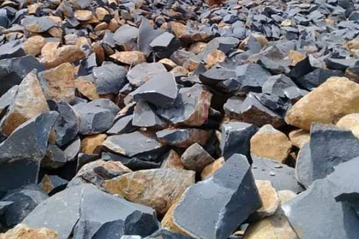

**Cara Menghitung Kebutuhan Batu Pondasi** - Hai Mitra CDI! Pernahkah Anda bertanya-tanya, berapa banyak batu pondasi yang sebenarnya dibutuhkan untuk membangun rumah impian? Pondasi itu krusial, lho. Ibaratnya tulang punggung bangunan – tanpa pondasi yang kuat, bangunan bisa bermasalah di kemudian hari. Di Indonesia, pondasi batu kali dengan adukan semen dan pasir hitam masih jadi pilihan populer. Tapi, seberapa dalam seharusnya pondasi itu? Nah, kedalamannya sangat bergantung pada kondisi tanah dan tinggi bangunan Anda. Misalnya, pondasi di tanah padat dan datar akan lebih dangkal dibandingkan di tanah labil yang rawan longsor.

*perhitungan kebutuhan batu pondasi*

Sebelum kita bahas cara menghitungnya, yuk kita pahami dulu struktur pondasi ideal sesuai kebutuhan bangunan Anda.

## Menentukan Kedalaman Pondasi yang Tepat

Ini hal penting yang seringkali terlewatkan. Agar pondasi mampu menahan beban bangunan dengan baik, ada beberapa hal yang perlu diperhitungkan:

- 1. **Kondisi Tanah:** Apakah tanah di lokasi Anda bekas rawa, sawah, atau bekas lapangan? Tanah bekas rawa atau sawah biasanya membutuhkan pondasi yang lebih dalam – antara 1,5 hingga 3 meter. Sementara itu, tanah padat seperti bekas lapangan mungkin cukup dengan kedalaman 1 meter untuk bangunan satu lantai.
- 2. **Jenis dan Tinggi Bangunan:** Sudah pasti, bangunan bertingkat membutuhkan pondasi yang lebih dalam. Untuk bangunan satu lantai, kedalaman 1-1,5 meter biasanya sudah cukup. Jika lebih dari satu lantai, tambahkan sekitar 0,5 meter per lantai. 

## Menghitung Kebutuhan Batu Pondasi: Panduan Praktis

Sudah punya gambaran tentang kondisi tanah dan tinggi bangunan? Bagus! Sekarang, kita bisa menghitung kebutuhan batu pondasi dengan cara yang simpel dan akurat – berdasarkan pengalaman kami.

> _Satuan pembelian material batu pondasi umumnya adalah meter kubik (m³), jadi rumus perhitungan kita juga akan menggunakan satuan ini._

> _Rumusnya: **Total panjang lubang pondasi** X **Tinggi** X **Lebar** = **Hasil kebutuhan pasir & batu** – **40%** = **Hasil kebutuhan batu saja**_

> _Contoh: **100 m** X **1 m** X **0,30 m** = **30 m³** – **40%** = **18 m³**_

**Catatan:** Nilai _40%_ adalah alokasi untuk kebutuhan pasir dan semen. Sedangkan _0,30 m_ adalah konversi dari tebal pondasi 30 cm ke satuan meter.

Nah, mitra, itulah tips sederhana dari kami tentang cara menghitung kebutuhan batu pondasi. Untuk menghitung kebutuhan pasir pondasinya, rumusnya sama, tapi angka 40% diganti dengan 60%. Jika ada yang kurang jelas, jangan ragu untuk berkonsultasi langsung dengan tim kami melalui chat atau telepon yang tertera di website ini.

Butuh batu atau pasir pondasi berkualitas tinggi? Kami siap melayani! Kami menyediakan beragam jenis pasir dan batu khusus untuk pondasi. Yuk, kunjungi halaman produk kami [**BATU BELAH /KALI**](/product/batu-kali-dan-belah) untuk detail selengkapnya. Jangan lupa, kami juga melayani pengiriman ke seluruh wilayah (not detected) dan sekitarnya dengan sistem pembayaran COD. Segera hubungi kami untuk pemesanan atau informasi lebih lanjut! 
<table class="table">
  <caption>Ukuran Standar Batu Kali</caption>
  <thead>
    <tr><th>Ukuran</th><th>Deskripsi</th></tr>
  </thead>
  <tbody>
    <tr><td>10/20 cm</td><td>Ukuran paling umum digunakan</td></tr>
    <tr><td>15/20 cm</td><td>Cocok untuk pondasi rumah tipe besar</td></tr>
    <tr><td>20/30 cm</td><td>Untuk pondasi yang membutuhkan ketahanan ekstra</td></tr>
  </tbody>
</table>
