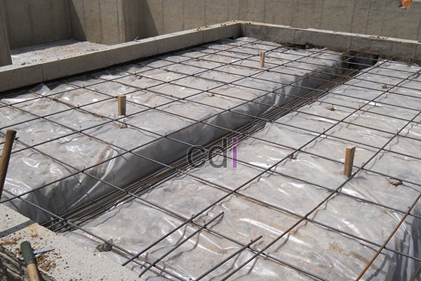

**Cara Menghitung Kebutuhan Besi Untuk Cor Lantai** - Hai Mitra CDI! Sedang merencanakan pengecoran lantai? Nah, perhitungan kebutuhan besi yang tepat itu krusial banget, lho. Besi adalah tulang punggung kekuatan dan daya tahan struktur lantai Anda. Perhitungan yang akurat memastikan bangunan kokoh dan aman. Gimana caranya? Yuk kita bahas!

## Persiapan Penting Sebelum Menghitung Kebutuhan Besi

Sebelum kita masuk ke rumus, ada beberapa hal yang perlu disiapkan. Ini membantu proses perhitungan jadi lebih terstruktur dan hasilnya lebih akurat. Kita mulai dari yang dasar, ya.

### 1. Ukur dan Tentukan Dimensi Lantai

Hal pertama yang harus Anda lakukan adalah mengukur area lantai yang akan dicor. Hitung panjang dan lebarnya, lalu kalikan untuk mendapatkan luas lantai. Misalnya, lantai berukuran 10 meter x 8 meter, berarti luasnya 80 meter persegi.

Selain luas, tentukan juga ketebalan lantai yang diinginkan. Ketebalan standar untuk rumah tinggal biasanya antara 12-15 cm, tapi untuk bangunan bertingkat atau komersial, ketebalannya mungkin perlu ditingkatkan.

### 2. Pilih Jenis Besi yang Sesuai

Besi beton yang digunakan untuk cor lantai umumnya tersedia dalam diameter 8 mm hingga 12 mm. Ada besi polos dan besi ulir. Besi ulir biasanya lebih disarankan karena cengkeramannya lebih kuat pada beton, memberikan daya tahan lebih baik.

Perhatikan juga jarak antar besi, atau spasi tulangan. Umumnya, jarak yang digunakan berkisar 15-20 cm.

## Rumus Menghitung Kebutuhan Besi untuk Cor Lantai

Sekarang, kita akan membahas rumus perhitungannya. Jangan khawatir, Mitra CDI, rumusnya cukup sederhana dan mudah diaplikasikan.

### 1. Menghitung Panjang Total Besi

Langkah pertama adalah menentukan total panjang besi yang dibutuhkan. Rumusnya adalah:

**Panjang Besi = (Luas Lantai ÷ Jarak Antar Besi) x Panjang Lantai**

Sebagai contoh, jika luas lantai 80 meter persegi, jarak antar besi 20 cm (0,2 meter), dan panjang lantai 10 meter, maka:

**Panjang Besi = (80 ÷ 0,2) x 10 = 4000 meter**

Dengan demikian, panjang total besi yang dibutuhkan adalah 4000 meter.

### 2. Menentukan Berat Total Besi

Setelah mendapatkan panjang total besi, selanjutnya kita hitung beratnya. Gunakan rumus berikut:

**Berat Besi = Panjang Besi x Berat per Meter**

Berat per meter besi bervariasi tergantung diameternya. Sebagai referensi, besi diameter 10 mm memiliki berat sekitar 0,617 kg/meter. 

Jadi, jika panjang total besi adalah 4000 meter, maka:

**Berat Besi = 4000 x 0,617 = 2468 kg**

Ini berarti, kebutuhan besi untuk cor lantai ini adalah 2.468 kg atau sekitar 2,47 ton.

## Strategi Cerdas Menghemat Kebutuhan Besi

Setelah memahami cara menghitung kebutuhan besi, selanjutnya kita cari cara agar lebih efisien. Apakah ada tips untuk menghemat tanpa mengurangi kualitas? Tentu saja ada!

### 1. Investasikan pada Besi Berkualitas

Meskipun sedikit lebih mahal, besi berkualitas menawarkan daya tahan yang jauh lebih baik. Dengan menggunakan besi berkualitas, Anda tidak perlu menggunakan jumlah besi yang berlebihan untuk mencapai kekuatan yang sama.

### 2. Pilih Jarak Antar Besi yang Optimal

Jarak antar besi yang terlalu rapat memang bisa meningkatkan kekuatan lantai, tetapi juga akan meningkatkan konsumsi besi. Sebaliknya, jarak yang terlalu renggang bisa mengurangi kekuatan struktur. Pastikan jaraknya sesuai dengan standar konstruksi.

### 3. Manfaatkan Desain Tulangan yang Efisien

Untuk hasil terbaik, konsultasikan desain tulangan besi dengan ahli konstruksi atau tim desain interior profesional seperti Creative Design Interior. Desain yang tepat dapat mengoptimalkan kekuatan struktur dengan jumlah besi yang paling efisien.

## Kesimpulan

Mitra CDI, begitulah panduan lengkap mengenai cara menghitung kebutuhan besi untuk cor lantai. Perhitungan yang tepat akan membantu memastikan proyek konstruksi Anda berjalan lancar, tanpa kekurangan atau kelebihan material. Ingat, pemilihan material berkualitas tinggi dan perencanaan yang matang adalah kunci utama untuk menciptakan lantai yang kuat dan tahan lama.

Selain layanan perhitungan kebutuhan material, kami juga menyediakan layanan desain interior dan furniture custom. Jangan ragu untuk menghubungi kami melalui tombol **Telepon** atau **WhatsApp** yang tersedia di bawah untuk konsultasi gratis! [Cara Menghitung Besi untuk Cor Dak yang Tepat dan Mudah](/blog/cara-menghitung-besi-untuk-cor-dak/) mungkin juga bisa membantu Anda.

Semoga panduan ini bermanfaat ya, Mitra CDI! Sukses selalu dengan proyek konstruksi Anda di (not detected)!