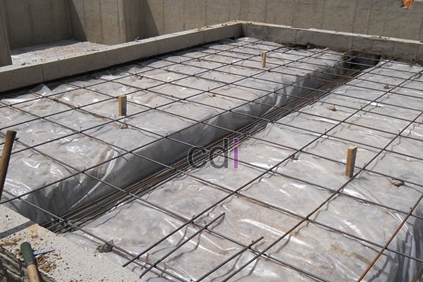

**Cara Menghitung Kebutuhan Cor Beton (Readymix Concrete)** - Halo Mitra CDI! Punya rencana membangun atau merenovasi? Salah satu hal penting yang perlu diperhatikan adalah perhitungan kebutuhan cor beton. Nah, di artikel ini kami akan membahas tuntas cara menghitungnya, biar nggak ada sisa atau kekurangan beton saat proyek berjalan. Dengan perhitungan yang tepat, anggaran pun jadi lebih terkontrol, kan? 

*Menghitung Kebutuhan Cor Beton: Panduan Lengkap*

Memperhitungkan biaya dan volume beton yang dibutuhkan adalah langkah krusial sebelum memulai proyek konstruksi. Baik itu membangun rumah, gedung, atau struktur lainnya yang memerlukan *readymix concrete* (beton siap pakai), perhitungan yang akurat akan membantu Anda mengelola anggaran dengan lebih efisien. Sebagai penyedia *readymix concrete* dan jasa sewa pompa beton terpercaya, CDI berkomitmen untuk membagikan pengetahuan ini kepada Anda. Yuk, simak cara menghitung kebutuhan cor beton untuk proyek Anda agar pemesanan beton *ready mix* sesuai dengan volume yang diperlukan.

## Rumus Dasar Cara Menghitung Kebutuhan Cor Beton

Secara sederhana, perhitungan volume beton didasarkan pada perkalian tiga dimensi: **Panjang, Lebar, dan Tinggi/Tebal**. Untuk mendapatkan volume dalam meter kubik (m³), Anda cukup mengalikan ketiga ukuran tersebut: **Panjang x Lebar x Tinggi/Tebal**.

Untuk pengecoran plat lantai (dak), hitungannya sedikit berbeda. Anda bisa menggunakan rumus: **Panjang x Lebar x 0,12**. Angka 0,12 mewakili tebal standar 12 cm untuk plat lantai. Tentu saja, Anda bisa menyesuaikannya sesuai kebutuhan, misalnya 0,15 (15 cm) atau 0,10 (10 cm). Sedangkan untuk pengecoran kolom atau balok, gunakan rumus **Panjang x Lebar x Tinggi**.

Berikut contoh penerapan Rumus Cara Menghitung Kebutuhan Cor Beton (Readymix Concrete) untuk pengecoran plat lantai rumah:

Mari kita ambil contoh perhitungan kebutuhan cor beton untuk plat lantai atap rumah dengan dimensi: **Panjang: 10 m, Lebar: 17.5 m, Tebal Plat: 0.12 m (12 cm)**. Kita asumsikan bagian tiang balok sudah dicor, sehingga perhitungan ini hanya untuk area plat lantai atap.  Pertanyaannya, berapa banyak truk mixer yang perlu dipesan untuk area seluas ini?

> _**Rumus Cara hitung kebutuhan cor beton:**_
> 
> _panjang area x lebar area x tebal = total volume : 7 = Jumlah truk mixer besar **atau**_
> 
> _panjang area x lebar area x tebal = total volume : 3 = Jumlah truk mixer mini._
> 
> _**Contoh** : 10 m x 17.5 m x 0.12 m = 21 m³ : 7 = **3** truk mixer besar._
> 
> _10 m x 17.5 m x 0.12 m = 21 m³ : 3 = **7** truk mixer mini._
> 
> _( Jadi kebutuhan cor beton utk ukuran luas; 10 m **x** 17.5 m adalah 3 truk mixer besar atau 7 truk mixer mini)._
> 
> _ket: Volume satu truk mixer besar: 7 m³ dan untuk truk mixer mini: 3 m³_

Demikianlah cara menghitung kebutuhan cor beton (readymix concrete) untuk volume plat lantai (dak) yang bisa kami sampaikan. Untuk perhitungan volume balok atau kolom, Anda bisa klik [**Cara Menghitung Volume Ring Balok dan Kolom.**](/blog/cara-hitung-volume-ring-balok-dan-kolom-beton)  Untuk mengetahui daftar harga berbagai tipe mutu beton *ready mix* dari kami, silakan lihat artikel "**[Daftar Harga Beton Ready Mix](/page/daftar-harga-rental-pompa-beton-dan-readymix-cor)**".

Jika ada hal yang kurang jelas, jangan ragu untuk menghubungi kami langsung melalui telepon atau email yang tertera di situs web ini. Kami siap membantu! Semoga artikel ini bermanfaat dan selamat berproyek. Terima kasih!

[[[PLACEHOLDER_N]]] (pastikan ini ada di sini)