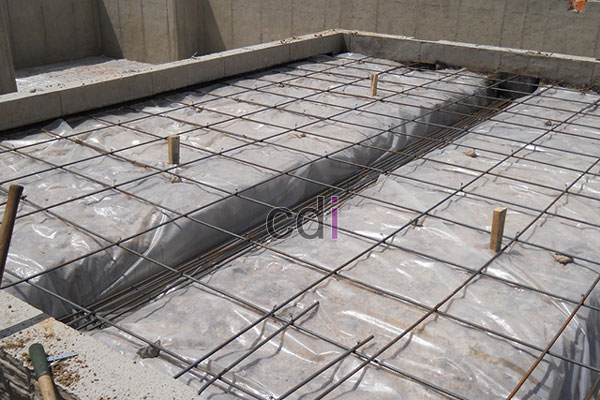

**Cara Menghitung Kebutuhan Cor Kolom dengan Akurat Demi Proyek Optimal** - Hai Mitra CDI! Sedang merencanakan pembangunan? Kolom adalah elemen vital yang menopang seluruh struktur bangunan Anda. Ketepatan dalam proses pengecoran kolom sangatlah krusial. Artikel ini akan memandu Anda menghitung kebutuhan cor kolom secara detail dan efisien. Simak terus ya!

Pikirkan biaya tambahan akibat pesanan beton yang berulang dan kecil. Itulah yang sering terjadi karena perhitungan awal yang kurang tepat. Dengan perencanaan matang, semua kebutuhan bisa dipesan sekaligus, lebih hemat dan praktis.

## Mengapa Perhitungan Kebutuhan Cor Kolom Penting?

Sebelum membahas rumus, mari pahami pentingnya perhitungan yang tepat. Pertama, menghemat anggaran. Proyek tanpa perhitungan akurat berpotensi boros material. Kedua, menjamin kekuatan dan keamanan bangunan. Kolom yang kurang material berisiko rusak di kemudian hari. Jadi, akurasi adalah kunci efisiensi sekaligus kestabilan bangunan Anda.

## Rumus Dasar Menghitung Volume Kolom

**Volume Kolom = Luas Penampang x Tinggi Kolom**

*   Untuk kolom persegi: Luas = Panjang x Lebar
*   Untuk kolom lingkaran: Luas = π x (Diameter/2)²

### Contoh Perhitungan Praktis

Misalnya, kolom persegi berukuran 20 cm x 20 cm dengan tinggi 3 meter:

*   Luas Penampang = 20 cm x 20 cm = 400 cm² = 0,04 m²
*   Volume Kolom = 0,04 m² x 3 m = **0,12 m³**

Dengan demikian, satu kolom tersebut membutuhkan 0,12 m³ beton.

## Antisipasi dengan Menambahkan Faktor Wastage

Dalam pengerjaan, selalu ada material yang terbuang atau menyusut. Tambahkan **5-10% dari total kebutuhan** sebagai cadangan. Untuk contoh sebelumnya, dengan tambahan 10%:

0,12 m³ x 1,1 = **0,132 m³** per kolom

## Menghitung Total Kebutuhan untuk Beberapa Kolom

Jika proyek Anda memiliki 10 kolom dengan spesifikasi yang sama, total kebutuhan betonnya:

10 x 0,132 m³ = **1,32 m³ beton**

## Memilih: Beton Readymix atau Site Mix?

Pilihan ini memengaruhi strategi perhitungan. Beton *readymix* biasanya dipesan dalam kelipatan tertentu (misalnya 5-7 m³ per truk). Jika kebutuhan total Anda di bawah minimum order, pertimbangkan menggabungkan beberapa kolom dalam satu jadwal pengecoran. *Site mix* lebih fleksibel untuk volume kecil, namun membutuhkan kontrol kualitas manual yang ketat untuk memastikan konsistensi.

## Tips Sukses Pengecoran Kolom

Pastikan bekisting kokoh dan kedap untuk mencegah kebocoran material. Gunakan vibrator beton untuk memadatkan campuran dan menghilangkan gelembung udara. Hindari pengecoran saat hujan deras, karena air dapat mengubah rasio campuran dan menurunkan kekuatan beton.

## Strategi Menghitung Kebutuhan Kolom Variasi Ukuran

Seringkali, kolom memiliki ukuran berbeda (contoh: kolom sudut lebih besar dari kolom tengah). Hitung volume setiap kelompok ukuran secara terpisah, kemudian jumlahkan totalnya di akhir. Hindari pendekatan rata-rata yang bisa menyebabkan kesalahan signifikan, terutama pada proyek dengan banyak kolom.

## Optimalkan Pemesanan Beton: Hindari Pembelian Berulang

Usahakan menggabungkan kebutuhan beton beberapa kolom dalam satu pesanan, terutama jika menggunakan *readymix*. Membeli dalam volume kecil berkali-kali tidak hanya lebih mahal, tapi juga berpotensi menimbulkan perbedaan mutu antar batch yang memengaruhi kekuatan struktur.

## Verifikasi dengan Alat Bantu

Selain perhitungan manual, gunakan kalkulator volume beton online sebagai pengecek silang. Selalu lakukan *double-check* manual, terutama untuk proyek kompleks dengan banyak variasi ukuran kolom.

## Kesimpulan

Menghitung kebutuhan cor kolom sesungguhnya cukup sederhana: luas penampang dikali tinggi, ditambah margin *wastage* 5-10%, lalu dikalikan jumlah kolom. Kuncinya ada pada ketelitian.

Butuh bantuan dalam perhitungan material atau pelaksanaan pengecoran? Jangan ragu! Tim Kami siap membantu. Hubungi Kami sekarang melalui tombol **Telepon** atau **WhatsApp** yang tersedia di halaman ini untuk konsultasi lebih lanjut. [Cara Menghitung Kebutuhan Besi Untuk Cor Lantai yang Tepat dan Efisien](/blog/cara-menghitung-kebutuhan-besi-untuk-cor-lantai/) bisa jadi referensi tambahan!