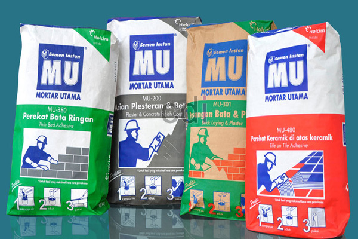

**Cara Menghitung Kebutuhan Perekat Hebel** - Hai Mitra CDI! Punya rencana membangun atau merenovasi rumah di (not detected)? Bata ringan atau hebel jadi salah satu pilihan populer, ya? Meski harga material sering fluktuatif, permintaan tetap tinggi. Nah, supaya proyek Anda lebih terencana dan efisien, penting banget tahu cara menghitung kebutuhan hebel dan perekatnya. Yuk, simak panduan lengkapnya di artikel ini!

*Rekomendasi Merk Semen Perekat Hebel Berkualitas*

## Menghitung Kebutuhan Hebel: Panduan Praktis

Pertanyaan paling umum: bagaimana cara menghitung kebutuhan hebel dengan akurat? Sebenarnya, perhitungannya cukup sederhana dan mirip dengan perhitungan kebutuhan batako atau bata merah biasa. Langkah pertama adalah menentukan kebutuhan hebel per meter persegi. Setelah itu, kalikan angka tersebut dengan luas total dinding yang akan dipasang hebel.

Berikut contoh perhitungannya: Misalkan Anda menggunakan hebel berukuran 7,5x20x60 cm. Untuk satu meter persegi, dibutuhkan sekitar 8 buah hebel. Berikut rumusnya: 1m = (0,20 x 0,60 = 0,12), sehingga dibutuhkan 8 buah. Dengan rumus **LUAS TOTAL DINDING x 8 BUAH HEBEL**, Anda bisa menghitung total kebutuhan hebel. Sebagai contoh, jika luas dinding total adalah 100 meter persegi, maka dibutuhkan 800 buah hebel.

Untuk hebel dengan tebal 10cm, lebar 20cm, dan panjang 60cm, cara perhitungannya serupa. Ukuran panjang dan lebar hebel adalah informasi utama yang dibutuhkan. Ukuran tebal sebenarnya tidak terlalu signifikan dalam perhitungannya. Jika ingin mengkonversikan hasil perhitungan ke dalam volume meter kubik, cukup bagi hasil perhitungan dengan angka 83 atau 111, tergantung ukuran hebel yang digunakan.

## Menghitung Kebutuhan Semen Perekat Hebel

Selain mengetahui jumlah hebel yang dibutuhkan, penting juga untuk menghitung kebutuhan semen perekat hebel. Perhitungan ini juga cukup mudah: Misalnya, Anda menggunakan hebel berukuran 10x20x60 cm. Berdasarkan pengalaman di lapangan, 1 meter persegi dinding membutuhkan sekitar 4kg semen perekat hebel dan 1 liter air. Satu sak semen mortar biasanya berisi 40kg. **Jadi, 1 sak semen bisa digunakan untuk sekitar 10 meter persegi luas dinding.** Rumusnya adalah **LUAS TOTAL DINDING x 4 KG : 40**.

> Dengan perhitungan yang tepat, Anda bisa menghindari sisa material yang berlebihan atau kekurangan material di tengah proyek.

Nah, begitulah cara menghitung kebutuhan hebel dan semen perekatnya. Semoga informasi ini bermanfaat dan membantu Anda dalam merencanakan proyek pembangunan di (not detected)! Jangan ragu untuk menghubungi kami jika Anda membutuhkan material hebel atau bata ringan berkualitas dengan harga terjangkau dan layanan *free* ongkir. Kami siap mendukung kesuksesan proyek Anda! [Hubungi kami sekarang](URL_KONTAK) untuk penawaran terbaik! Kami juga punya artikel menarik lainnya tentang [Cara Tepat Menghitung Kebutuhan Bata Merah](/blog/cara-menghitung-kebutuhan-bata-merah/) yang bisa Anda baca untuk melengkapi informasi Anda.