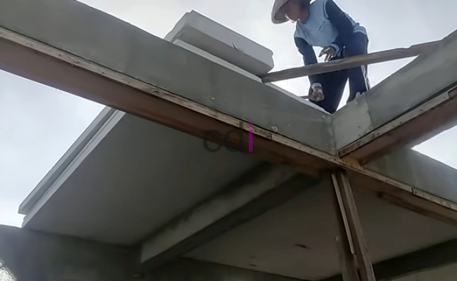

**Cara Menghitung Ring Balok dengan Tepat untuk Konstruksi Bangunan** - Hai Mitra CDI! Pernahkah Anda bertanya-tanya, bagaimana menghitung kebutuhan ring balok secara akurat untuk proyek bangunan Anda di (not detected)? Pertanyaan ini penting, lho. Karena ring balok berperan vital dalam kekuatan struktur bangunan. Nah, di artikel ini, kami akan memandu Anda selangkah demi selangkah. Yuk, simak panduan praktis ini!

Ring balok bukan sekadar elemen tambahan. Ia adalah tulang punggung yang menjaga stabilitas bangunan Anda. Tanpa perhitungan yang tepat, risiko keretakan atau bahkan kegagalan struktur bisa mengintai. Oleh karena itu, memahami cara menghitungnya dengan benar adalah investasi penting untuk keamanan dan keberlanjutan bangunan Anda.

## Mengapa Ring Balok Penting: Fungsi dan Peran Utama

Sebelum melangkah lebih jauh, mari kita pahami dulu apa itu ring balok dan mengapa ia sangat krusial. Ring balok adalah struktur beton bertulang horizontal yang melingkari bagian atas dinding bangunan. Fungsinya? Lebih dari sekadar kelengkapan visual! 

Ring balok berfungsi mendistribusikan beban atap secara merata ke seluruh dinding, mencegah konsentrasi tekanan yang bisa menyebabkan retak. Ia juga menjadi pengikat yang menyatukan kolom-kolom bangunan, menciptakan integritas struktural yang lebih baik. Dengan kata lain, ring balok adalah kunci untuk bangunan yang kokoh dan tahan lama. Jadi, jangan anggap remeh peran vitalnya ini, ya!

## Membongkar Rumus Dasar Perhitungan Ring Balok

Menghitung ring balok sebenarnya tidak sesulit yang dibayangkan. Anda hanya perlu memahami komponen-komponen utamanya dan menerapkan rumus yang tepat. Ini dia panduan sederhananya:

- **Menghitung Volume Ring Balok (m³):**
   Panjang Balok x Lebar Balok x Tinggi Balok

   Contoh: Jika panjang balok 10 meter, lebar 0,2 meter, dan tinggi 0,3 meter, maka:
   Volume = 10 m x 0,2 m x 0,3 m = 0,6 m³

- **Menentukan Kebutuhan Besi Tulangan:**
   Kebutuhan besi ditentukan oleh diameter besi yang digunakan (seperti besi Ø10 atau Ø8) dan jarak antar tulangan. Untuk hasil paling akurat, kami sarankan untuk berkonsultasi dengan tim spesialis kami.

- **Menghitung Kebutuhan Cor Beton (m³):**
   Volume ring balok yang telah dihitung sebelumnya akan dikonversi ke kebutuhan semen, pasir, dan kerikil sesuai komposisi beton yang Anda pilih.

Dengan memahami rumus ini, Anda bisa memperkirakan kebutuhan material dengan lebih akurat. Memastikan tidak ada kekurangan atau kelebihan yang bisa memengaruhi kualitas bangunan Anda di (not detected).

## Studi Kasus: Contoh Perhitungan Ring Balok untuk Rumah Sederhana

Agar lebih mudah dipahami, mari kita terapkan rumus tersebut pada sebuah contoh nyata. Anggaplah Anda sedang membangun rumah sederhana dengan total panjang ring balok 40 meter dan dimensi 20 cm x 25 cm.

1. **Volume Ring Balok:**
   Volume = 40 m x 0,2 m x 0,25 m = **2 m³**

2. **Kebutuhan Material Beton:**
   Dengan asumsi campuran beton standar 1:2:3, perhitungannya adalah:
   - Semen = 1/6 x 2 m³ = **0,33 m³**
   - Pasir = 2/6 x 2 m³ = **0,67 m³**
   - Kerikil = 3/6 x 2 m³ = **1 m³**

3. **Kebutuhan Besi Tulangan:**
   Jika Anda menggunakan besi Ø10 dengan panjang total 40 meter, kebutuhan besi akan bergantung pada jarak antar cincin tulangan (umumnya 15-20 cm). Untuk detail yang lebih presisi, jangan ragu menghubungi tim ahli kami.

## Trik Jitu untuk Ring Balok yang Lebih Kuat dan Awet

Selain perhitungan yang tepat, ada beberapa tips penting yang perlu Anda perhatikan untuk memastikan ring balok Anda benar-benar kokoh dan tahan lama:

1. **Pilih Material Berkualitas Tinggi:**
   Kualitas material sangat berpengaruh pada kekuatan dan durabilitas ring balok. Pastikan Anda menggunakan semen, pasir, kerikil, dan besi yang memenuhi standar SNI.

2. **Perhatikan Proses Pengecoran:**
   Proses pengecoran harus dilakukan dengan hati-hati dan teliti. Pastikan campuran beton homogen, tidak terlalu encer, dan dituang secara merata ke seluruh area ring balok.

3. **Libatkan Jasa Profesional:**
   Jika Anda kurang yakin dengan kemampuan Anda, jangan ragu untuk menggunakan jasa tukang atau kontraktor berpengalaman. Mereka akan memastikan ring balok Anda terpasang dengan benar dan sesuai standar.

## Kesimpulan: Investasi pada Keamanan dan Kenyamanan Bangunan Anda

Perhitungan ring balok yang tepat adalah fondasi dari bangunan yang kokoh dan aman. Dengan mengikuti panduan di atas, Anda dapat memperkirakan kebutuhan material dengan lebih akurat dan memastikan kualitas konstruksi bangunan Anda di (not detected). Jangan lupa, kualitas material dan proses pengerjaan yang baik adalah kunci utama!

Butuh bantuan lebih lanjut atau ingin konsultasi mengenai proyek konstruksi Anda? Jangan sungkan untuk menghubungi tim Creative Design Interior melalui tombol **Telepon** atau **WhatsApp** yang tersedia di halaman bawah ini. Kami siap menjadi mitra terpercaya Anda dalam membangun impian! [Cara Menghitung Besi untuk Cor Dak yang Tepat dan Mudah](/blog/cara-menghitung-besi-untuk-cor-dak/) akan sangat membantu jika Anda juga mengerjakan dak beton.