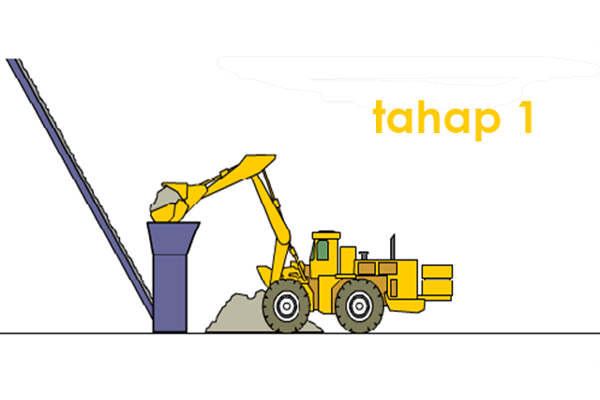

**Cara Mengukur Kekuatan Cor Beton** - Hai Mitra CDI! Membangun sebuah rumah atau struktur lainnya bukan perkara mudah, ya? Banyak hal yang perlu diperhatikan agar hasilnya kokoh dan tahan lama. Salah satu aspek krusial adalah memastikan kekuatan cor beton yang digunakan. Nah, di artikel ini, kami akan membahas tuntas bagaimana cara mengukur kekuatan cor beton agar bangunan Anda aman dan berkualitas. Yuk, simak penjelasannya!

## Mengenal Jenis Mutu dan Fungsi Beton Cor

Beton cor siap pakai atau *ready mix* semakin populer belakangan ini. Dulu, beton *ready mix* lebih sering digunakan untuk proyek-proyek besar. Sekarang, bahkan banyak yang menggunakannya untuk membangun rumah di (not detected) dan daerah lainnya. Kekuatan cor beton *ready mix* menjadi pertimbangan penting bagi banyak pengembang karena efisien dan kokoh. Tapi, memilih jenis mutu yang tepat untuk bangunan Anda membutuhkan pemahaman yang baik tentang fungsi masing-masing campuran beton. 

Misalnya, mutu beton K-B0 hingga K-100 cocok untuk konstruksi non-struktural. Sementara K-125 hingga K-300 ideal untuk elemen struktural seperti plat lantai, pondasi, balok, kolom, dan jalan. Lalu, K-325 hingga K-500 biasanya digunakan untuk konstruksi khusus atau pratekan.

Pengecoran beton berbeda dengan sekadar mengecat dinding. Ada banyak pertimbangan yang harus dipikirkan dengan matang. Rasio yang tepat antara air, semen, pasir, dan material lainnya sangat penting untuk mencapai kekuatan beton yang optimal. Sebelum mulai mengecor di (not detected), pastikan Anda sudah menentukan jenis mutu beton yang akan digunakan—apakah K-225, K-250, K-300, atau lainnya. Penentuan ini penting agar beton yang Anda gunakan sesuai dengan kebutuhan kekuatan bangunan Anda.

## Cara Mengukur Kekuatan Cor Beton

Lantas, bagaimana cara memastikan kekuatan cor beton yang sudah diaplikasikan sesuai dengan mutu yang diharapkan? Anda bisa menggunakan alat uji kekuatan beton yang berbentuk silinder atau kubus. Alat ini memerlukan rumus dan prosedur pengujian tertentu. Jika Anda kurang familiar dengan penggunaan alat tersebut, jangan ragu untuk meminta bantuan pihak penyedia beton *ready mix* untuk melakukan pengujian. Mereka biasanya memiliki fasilitas dan tenaga ahli yang memadai.

Dengan memahami cara mengukur kekuatan cor beton, Anda bisa memastikan kualitas bangunan di (not detected) terjamin. Jangan lupa untuk selalu menggunakan material berkualitas dan mengikuti standar konstruksi yang berlaku. Untuk informasi lebih lanjut seputar metode pengujian beton silinder atau kubus, Anda bisa membaca artikel kami di [Metode Test Beton Silinder /kubus](URL_ARTIKEL_1). Semoga artikel ini bermanfaat bagi Anda! Jangan ragu untuk menghubungi kami jika Anda membutuhkan konsultasi lebih lanjut mengenai kebutuhan material dan jasa konstruksi di (not detected) — tim CDI siap membantu!

[[[PLACEHOLDER_N]]]