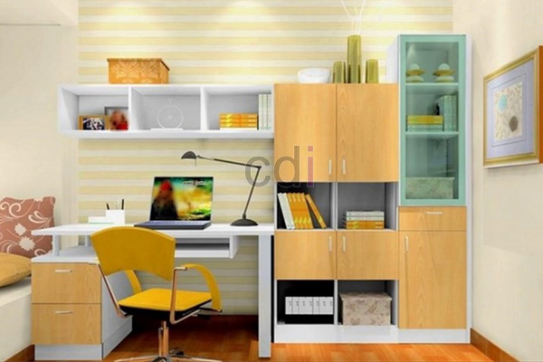

**Cara Menyusun Meja Belajar Efektif & Nyaman** - Hai Mitra CDI! Belajar atau bekerja jadi lebih semangat kalau ruangannya nyaman, kan? Yuk, kita bahas cara menata meja belajar supaya fokus dan produktivitas meningkat!

Menciptakan meja belajar yang ideal itu investasi penting, lho. Bukan cuma soal tampilan, tapi juga bagaimana tata letak bisa mendukung aktivitas belajar dan kerja. Dengan penataan yang tepat, Anda bisa punya ruang yang lebih fokus, teratur, dan pastinya, lebih memotivasi. Nah, bagaimana caranya memaksimalkan efisiensi ruang dan meminimalkan gangguan? Simak terus ya!

## Merancang Tata Letak Meja Belajar yang Pas

Sebelum mulai berkreasi, ada beberapa hal yang perlu dipikirkan. Pertama, soal ukuran meja. Sesuaikan dengan luas ruangan dan kebutuhan Anda sehari-hari. Meja terlalu kecil? Pasti berantakan. Terlalu besar? Malah memakan banyak tempat. Standar minimal yang nyaman itu lebar 120 cm dan kedalaman 60 cm. Tapi kalau Anda butuh ruang lebih untuk buku dan alat-alat belajar, pertimbangkan ukuran 150 cm x 75 cm.

Yang kedua, perhatikan posisi meja terhadap cahaya. Idealnya, dekat jendela supaya dapat pencahayaan alami yang terang. Tapi, hindari langsung menghadap jendela karena silau matahari bisa bikin mata cepat lelah dan konsentrasi buyar. Lebih baik, coba posisikan meja menyamping jendela.

Terakhir, jangan lupakan sirkulasi udara! Ruangan yang pengap bisa bikin cepat capek dan sulit fokus. Jangan ragu untuk membuka jendela atau menggunakan ventilasi. Butuh bantuan untuk merencanakan tata letak yang paling pas? Kami dari CDI siap memberikan konsultasi desain interior untuk Anda.

## Optimalkan Ruang Penyimpanan di Meja Belajar

Tata letak sudah oke, sekarang saatnya memikirkan penyimpanan. Gunakan rak buku, laci, dan organizer untuk menjaga meja tetap rapi. Rak buku bisa diletakkan di atas meja atau di sampingnya untuk menyimpan buku-buku dan materi pelajaran. Laci meja sangat berguna untuk menyimpan alat tulis, dokumen, dan perlengkapan belajar lainnya.

Supaya ruang vertikal tidak terbuang, manfaatkan dinding dengan memasang rak gantung atau papan tempel. Papan tempel itu handy banget untuk menempelkan catatan penting, jadwal belajar, atau bahkan gambar-gambar inspiratif. Kami bisa bantu mendesain dan membuat rak buku custom yang sesuai dengan ukuran dan gaya meja belajar Anda.

## Pilih Furniture Pendukung untuk Kenyamanan Maksimal

Kenyamanan itu kunci utama dalam belajar! Pilih kursi belajar yang ergonomis dan mendukung postur tubuh yang baik. Kursi yang bagus punya sandaran yang bisa diatur ketinggiannya, sandaran lengan, dan bantalan yang nyaman. Plus, pastikan kursinya punya roda biar mudah digeser. 

Selain kursi, jangan lupa perhatikan pencahayaan tambahan. Lampu belajar harus memberikan cahaya yang cukup tanpa menyilaukan mata. Pilih lampu yang intensitasnya bisa diatur dan arah cahayanya fleksibel. Kami dari CDI menyajikan beragam pilihan furniture custom—mulai dari kursi belajar ergonomis hingga lampu belajar berkualitas tinggi—untuk lengkapi ruang belajar Anda.

## Investasi Cerdas dengan Furniture Custom

Mengapa memilih furniture custom untuk meja belajar? Banyak keuntungannya! Anda bisa menyesuaikan ukuran, desain, dan bahan sesuai kebutuhan dan selera. Furniture custom juga lebih awet dan berkualitas dibandingkan furniture yang diproduksi massal.

Soal harga, biaya pembuatan meja belajar custom bervariasi tergantung ukuran, bahan, dan tingkat kerumitan desain. Kalau Anda tinggal di (not detected), kami siap melayani pembuatan meja belajar custom. Untuk gambaran, harga custom meja belajar di (not detected) bisa dilihat di [Batujaya Karawang](/meja/harga-custom-meja-belajar-di-batujaya-karawang/). Ada banyak pilihan desain dan bahan yang bisa Anda pilih. 

Ingin tahu lebih detail tentang harga dan konsultasi? Hubungi Kami sekarang melalui tombol **WhatsApp** atau **Telepon** yang ada di halaman ini. Jangan tunda lagi, yuk ciptakan ruang belajar yang ideal bersama CDI! Kami juga melayani area (not detected) dan sekitarnya, lho. Pastikan Anda mendapatkan penawaran terbaik untuk meja belajar impian Anda di (not detected). [Cara Menata Meja Belajar Efektif Untuk Produktivitas](/blog/cara-menata-meja-belajar/) juga bisa jadi inspirasi tambahan!