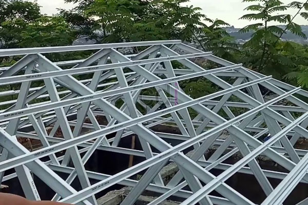

**Tips dan Cara Pasang Baja Ringan Sendiri di Rumah, Mudah dan Aman!** - Hai Mitra CDI! Sedang memikirkan cara memperbarui atau membangun atap rumah dengan baja ringan? Ide bagus! Material ini memang pilihan cerdas, ringan, kuat, dan tahan lama. Tapi, bagaimana cara memasangnya sendiri? Yuk, kita kupas tuntas langkah-langkahnya agar pemasangan baja ringan di Rumah, Mudah dan Aman! terasa lebih simpel dan aman.

Memasang atap baja ringan sendiri bisa jadi solusi hemat biaya, tapi ingat, perencanaan struktur itu krusial banget. Salah hitung sedikit, bisa berabe begitu atap selesai dipasang.

## Mengapa Baja Ringan Jadi Favorit?

Baja ringan bukanlah sekadar tren, tapi solusi cerdas untuk atap rumah Anda. Selain ringan, material ini kebal terhadap serangan rayap dan tidak mudah lapuk dimakan usia. Artinya, Anda mendapatkan investasi jangka panjang dengan perawatan yang minim. Kerennya lagi, baja ringan bisa didaur ulang, lho! Jadi, lebih ramah lingkungan daripada material atap konvensional.

## Persiapan Sebelum Memulai Pekerjaan

Sebelum beraksi, pastikan semua peralatan sudah siap di tangan: gergaji besi, bor listrik, sekrup khusus baja ringan, meteran, dan waterpass. Waterpass penting banget untuk memastikan kemiringan atap sesuai dengan perencanaan.

Selain alat, jangan lupakan desain rangka atap yang matang dan pengukuran atap yang akurat. Keselamatan juga nomor satu — pakai helm dan sarung tangan, hindari pemasangan saat cuaca buruk, dan gunakan tangga yang stabil. Kalau proyeknya di ketinggian lebih dari 2 meter, safety harness sangat disarankan.

## Langkah 1: Memasang Profil Rangka Utama

Profil berbentuk huruf C ini adalah tulang punggung struktur atap Anda. Letakkan di posisi yang sudah direncanakan, pastikan lurus menggunakan waterpass, dan kencangkan sambungannya dengan sekrup khusus baja ringan. Jarak ideal antar rangka utama biasanya sekitar 1,2 meter, supaya beban atap terdistribusi merata.

## Langkah 2: Memasang Profil Rangka Penopang

Setelah rangka utama kokoh berdiri, saatnya memasang profil penopang. Potong profil sesuai panjang yang dibutuhkan, sambungkan ke rangka utama dengan sudut yang tepat (biasanya 90 derajat), lalu kencangkan dengan sekrup. Penting nih, cek kembali kekencangan semua sekrup setelah selesai memasang rangka penopang. Getaran saat pemasangan bisa bikin beberapa titik jadi longgar.

## Langkah 3: Merakit dan Memasang Kuda-Kuda

Untuk mempermudah dan meningkatkan keamanan, rakit kuda-kuda di tanah terlebih dahulu. Setelah selesai, angkat dan pasang di atas rangka utama. Gunakan alat bantu seperti tali pengangkat. Kalau atapnya lebar, ajak minimal dua orang teman untuk membantu pengangkatan, supaya beban dan keseimbangan kuda-kuda tetap terkontrol.

## Langkah 4: Memasang Penutup Atap

Mulai pemasangan dari bagian bawah atap, bergerak ke atas. Pastikan setiap lembaran genteng metal atau seng terpasang rapat tanpa celah, lalu kencangkan dengan sekrup khusus penutup atap. Pemasangan dari bawah ke atas ini penting banget, karena lembaran yang lebih tinggi akan menutupi sambungan lembaran di bawahnya, sehingga mencegah air merembes masuk.

## Tips Tambahan untuk Hasil Terbaik

Usahakan kemiringan atap antara 15-30 derajat agar air hujan mengalir lancar. Pilih material baja ringan bersertifikasi SNI untuk jaminan kualitas. Lebih baik lagi kalau Anda tidak mengerjakan ini sendirian, ajak teman atau keluarga untuk membantu.

## Kapan Waktunya Memanggil Ahli?

Jika bentang atap lebar atau desain atap rumit dengan banyak sudut dan lekukan, sebaiknya serahkan ke tenaga profesional. Kesalahan perhitungan struktur bisa berakibat fatal. Atap dengan bentuk limasan atau kombinasi beberapa kemiringan biasanya membutuhkan perhitungan yang lebih presisi.

## Perkiraan Biaya: Dikerjakan Sendiri atau Pakai Jasa?

Memasang sendiri memang bisa menghemat biaya jasa, tapi jangan lupakan biaya alat yang mungkin disewa, waktu pengerjaan yang lebih lama, dan risiko kesalahan yang bisa menambah biaya material. Untuk atap dengan bentang kurang dari 6 meter dan desain sederhana, memasang sendiri mungkin bisa dipertimbangkan. Tapi, untuk proyek yang lebih besar, biaya jasa profesional biasanya sepadan dengan keamanan dan kualitas hasil kerja.

## Perawatan Rutin Setelah Atap Terpasang

Walaupun tahan karat, baja ringan tetap butuh perawatan berkala. Periksa kondisi sekrup dan sambungan minimal setahun sekali, terutama setelah musim hujan panjang. Pastikan tidak ada bagian yang kendur atau berkarat.

## Akhir Kata

Memasang baja ringan sendiri itu memungkinkan, asalkan Anda melakukan persiapan yang matang dan mengikuti langkah-langkah dengan teliti. Tapi ingat, keselamatan adalah yang utama.

Butuh bantuan untuk memastikan atap Rumah, Mudah dan Aman! Anda kokoh dan terpercaya? Tim Creative Design Interior siap membantu mewujudkan atap impian Anda. Jangan ragu untuk menghubungi kami melalui tombol **Telepon** atau **WhatsApp** yang tersedia di bawah halaman ini. Kami siap memberikan solusi terbaik!

ARTIKEL TERKAIT:
1. [Cara Membuat Canopy Dari Baja Ringan](/blog/cara-membuat-canopy-dari-baja-ringan/)
   Ringkasan isi: Panduan lengkap membuat canopy baja ringan dengan hasil maksimal dan tahan lama untuk memperluas ruang terbuka di rumah Anda.
2. [Cara Simpel Menghitung Kebutuhan Baja Ringan](/blog/cara-simpel-menghitung-kebutuhan-baja-ringan/)
   Ringkasan isi: Langkah mudah menghitung kebutuhan baja ringan untuk proyek Anda, menghemat biaya, dan menghindari pemborosan material.
3. Ciri-Ciri Baja Ringan Yang Berkualitas Baik
   Ringkasan isi: Panduan memilih baja ringan berkualitas tinggi dengan memperhatikan ciri-ciri penting seperti ketebalan, lapisan pelindung, dan sertifikasi SNI.
4. Daftar Harga Terbaru Atap Baja Ringan
   Ringkasan isi: Informasi terbaru mengenai harga atap baja ringan berbagai jenis dan ukuran, membantu Anda merencanakan anggaran proyek dengan tepat.
5. Membuat Pagar Kuat Dan Murah Dengan Baja Ringan
   Ringkasan isi: Tutorial lengkap membuat pagar rumah yang kuat, tahan lama, dan terjangkau menggunakan baja ringan sebagai material utama. [Hanya untuk referensi silang, hubungi kami untuk desain pagar khusus!]
6. Perbandingan Kelebihan dan Kekurangan Rangka Atap Baja Ringan
   Ringkasan isi: Analisis mendalam mengenai kelebihan dan kekurangan rangka atap baja ringan, membantu Anda membuat keputusan yang tepat sesuai kebutuhan dan anggaran.